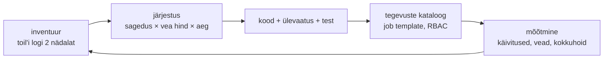

# IT-automatiseerimine ja automatiseerimisstrateegia

Meeskonnal on wiki's nelikümmend runbook'i, cron'is kakskümmend skripti, mille autoreist pooled on lahkunud, ja kolm inimest, kes teavad, millist neist tohib reedel käivitada. Igaüks on midagi automatiseerinud, aga keegi ei oska öelda, kui suur osa tööst on automaatne, kes seda koodi hoiab ja mis juhtub, kui see ebaõnnestub. Automatiseerimine on operatsioonitöö kood, millel on omanik, ülevaatus, test ja käivitamise kord.

## Ülesanne, protsess ja toil

Ülesande automatiseerimises on ühik üks playbook, üks skript, üks moodul. **IT-protsesside automatiseerimises** on automaatne terve töövoog üle mitme süsteemi ja meeskonna. „Uus rakendusserver“ tähendab tiketti, kinnitust, VM-i, DNS-kirjet, seadistust, monitooringu kirjet, CMDB rida ja tiketi sulgemist. Iga samm võib olla eraldi automatiseeritud ja protsess ikkagi käsitsi, kui inimene kannab tulemust ühest süsteemist teise. Siin algab orkestreerimine, mille kohta on lähemalt [4. kohtumise loengus](../k04/loeng.md).

RPA-robot (robotic process automation) klõpsab kasutajaliideses nagu inimene ja murdub, kui nupp liigub. Infra automaatika räägib API, SSH või agendiga ja kirjeldab seisu, mitte klõpse. Skriptide hulgast strateegiat ei teki: kui keegi ei tea, mis on automatiseeritud ja mis mitte, ei saa ka otsustada, mis järgmiseks. Eesmärk on, et inimene otsustaks ja masin täidaks; kinnitus ja audit jäävad.

**Toil** on Google'i SRE raamatu järgi [käsitsi tehtav, korduv, automatiseeritav, taktikaline töö, millel pole püsivat väärtust ja mis kasvab lineaarselt teenuse kasvuga](https://sre.google/sre-book/eliminating-toil/).

## Strateegia: inventuur, järjestus, mõõtmine

Strateegia algab inventuurist, mitte tööriistast. Kaks nädalat kirjutab meeskond üles iga korduva töö: mis, kui tihti, kui kaua, kas tekkis viga. See on toil'i logi. Ilma selleta automatiseeritakse seda, mis on kirjutajale huvitav.

Järjestamiseks on kolm tegurit: **sagedus**, **käsitsi vea hind** ja **ajakulu ühe korra kohta**. Kuine paikamine 40 serveril 15 minutiga serveri kohta on aastas 120 töötundi. Kord aastas tehtav sertifikaadivahetus on lühike, aga harva tehtud töö sammud ununevad ja viga tähendab katkestust, nii et kõrge vea hind tõstab selle samuti ette. Ühekordne migratsioon jääb runbook'iks.

Tasuvus arvutatakse kahelt poolt. Kokkuhoid on käsitsi aeg korda sagedus. Kulu on kirjutamine, test ja **hooldus**: OS-i uus versioon, mooduli muutunud argument, uus host teises võrgus. Kolm päeva kirjutatud paikamise playbook tasub end ära mõne kuuga ainult siis, kui keegi seda pärast Ubuntu järgmist LTS-i ka parandab. Hoolduskulu jääb arvutusest kõige sagedamini välja ja see on põhjus, miks pool aastat hiljem töötab skript ainult osal hostidel.

<figure markdown="span">

  <figcaption>Joonis 1. Automatiseerimisstrateegia tsükkel. Mõõtmise tulemus on järgmise inventuuri sisend.</figcaption>
</figure>

Mõõdikud peavad olema need, mida platvorm ise annab: käivituste arv, ebaõnnestunud käivituste osakaal, keskmine kestus ja käsitsi tehtud parandused, mis koodi ei jõudnud.

## Center of Excellence: mis peab olema ühine

Kui automaatikat kirjutab kolm meeskonda, tekib kolm inventory't, kolm saladuste hoidmise viisi ja kolm nimetamise korda. Center of Excellence (CoE) on väike rühm, kes hoiab kokku seda, mis peab olema ühine:

- repo struktuur ja koodi ülevaatuse reeglid (kes kinnitab PR-i, milline lint on kohustuslik);
- ühine inventory allikas (CMDB, NetBox või Proxmoxi API), mitte iga meeskonna oma fail;
- käivituskeskkonnad: Ansible'i [execution environment](https://docs.ansible.com/projects/builder/en/latest/definition/) on konteineri image, kus on kindlad ansible-core'i, kollektsioonide ja Pythoni teekide versioonid, nii et sama playbook käitub sülearvutis ja AWX-is ühtemoodi;
- tegevuste kataloog: testitud playbook'id ja moodulid, mida teised kasutavad versiooni järgi.

Toimiv mudel on hub-and-spoke: meeskonnad kirjutavad oma automaatika ise, CoE vaatab üle, hoiab standardit ja ühiseid komponente. Kui CoE kirjutab kõik ise, saab sellest järjekord, mille taga muudatused nädalaid ootavad, ja meeskonnad hakkavad sellest mööda minema.

## Automation as Code: platvormi seis Gitis

Playbook Gitis on pool tööst. Teine pool on see, kuidas ja kes seda käivitab: AWX-i või Semaphore'i job template, selle inventory, credential'i viide, ajakava, RBAC ja heakskiidu samm. Kui need on klikitud veebiliideses, on platvormi seis jälle snowflake: keegi ei tea, millal tootmise template'ile Execute-õigus lisati.

Automation as Code viib ka selle osa koodi. AWX-i objekte haldab kollektsioon [`awx.awx`](https://docs.ansible.com/ansible/10/collections/awx/awx/job_template_module.html) samade playbook'idega nagu servereid, Jenkinsi seadistust JCasC ja execution environment'i definitsioon on `execution-environment.yml`, millest `ansible-builder` ehitab image'i. Muudatus õigustes läheb PR-i kaudu nagu muudatus sshd seadistuses ja audit küsib Giti ajalugu.

## Platvormid automaatika käivitamiseks

| Tööriist | Mida teeb | Litsents/hind | Millal valida |
|---|---|---|---|
| [Ansible](https://docs.ansible.com/) (ansible-core) | ülesanded ja soovitud seis üle SSH/WinRM-i | GPLv3, tasuta | vaikimisi valik Linuxi, võrgu ja Windowsi operatsioonitööks |
| [AWX](https://github.com/ansible/awx) | job template'id, RBAC, ajakava, workflow, kinnitused | Apache 2.0, tasuta | mitu meeskonda, audit ja kinnitused on nõue; vajab Kubernetest |
| [Semaphore](https://semaphoreui.com/) | Ansible'i, OpenTofu ja skriptide käivitus veebist | MIT (Community), tasuta; Pro ja Enterprise tasulised | väiksem meeskond, AWX on liiga raske |
| [ansible-rulebook](https://github.com/ansible/ansible-rulebook) | sündmus → tingimus → heakskiidetud tegevus | Apache 2.0, tasuta | monitooringu häirele on üks kindel ette heaks kiidetud vastus |
| [ansible-builder](https://docs.ansible.com/projects/builder/en/latest/) | execution environment'i image | Apache 2.0, tasuta | kollektsioonide ja teekide versioonid peavad olema kõigil samad |
| [Rundeck](https://github.com/rundeck/rundeck) (Community) | runbook'id ja skriptid veebist koos õigustega | Apache 2.0, tasuta | olemasolevad Bashi ja PowerShelli skriptid tuleb anda valvurite kätte |
| Red Hat Ansible Automation Platform | AWX-i, EDA ja sertifitseeritud kollektsioonide kommertsversioon | tellimus | võrdluseks: tugi ja SLA on nõue, ise hoida ei taheta |

*Tabel 1. Automaatika käivitamise ja juhtimise tööriistad.*

## Google'i 50% piir ja E-ITS-i auditijälg

Google'i SRE raamat kirjeldab toil'i piiri kui organisatsiooni reeglit: operatsioonitöö (tiketid, valve, käsitsi tööd) on [piiratud 50%-ga](https://sre.google/sre-book/introduction/) ja meeskond, kes jääb arendustööga alla poole aja, peab töökorraldust muutma. Sageli tähendab see, et osa operatsioonitööst läheb tagasi arendusmeeskonnale või meeskond saab inimesi juurde ilma uute operatsioonikohustusteta. Põhjendus on raamatus otse kirjas: piiramata toil [täidab kiiresti kogu aja](https://sre.google/sre-book/eliminating-toil/). Reegel teeb toil'i mõõdetavaks: tunnid, mis kulusid paikamisele ja käsitsi restartidele, on numbrina olemas ja ROI arvutus põhineb nendel, mitte kellegi tundel.

Eesti avalikus sektoris on sama küsimus seotud [E-ITS](https://eits.ria.ee/)-iga, mis nõuab, et süsteemide muudatused oleksid hallatud ja jälgitavad. Kui paikamine, kasutajate eemaldamine ja hardening käivad läbi platvormi job template'i, on auditis küsitav tõend (kes käivitas, millise commit'iga, millistel hostidel, tulemus) platvormi ajaloos. Kui samad tööd tehakse käsitsi SSH-ga, tuleb tõend koguda shelli ajaloost ja inimeste mälust. Konkreetne auditinõue sõltub asutuse kaitsetarbest ja moodulitest, nii et enne platvormi valikut tasub küsida infoturbejuhilt, milliseid tõendeid audit tegelikult küsib.

## Mõjuala, hoolduskulu ja oskuste kadumine

**Vigase protsessi automatiseerimine.** Kui runbook'is on samm, mille põhjust keegi ei tea, kordab kood seda viga kiiremini ja kõigis hostides korraga. Enne koodi kirjutamist tee protsess käsitsi läbi ja kirjuta üles.

**Hoolduskulu ja bus factor.** Skript, mille autor lahkus ja mida keegi teine ei loe, on risk. Selle vastu aitavad koodiülevaatus, testid ja omanik CODEOWNERS-failis.

**Mõjuala.** Käsitsi viga puudutab üht hosti, automaatika viga kõiki inventory hoste. Lained, canary ja `max_fail_percentage` peavad olema koodis enne, kui seda vaja läheb.

**Oskuste kadumine.** Lisanne Bainbridge kirjeldas juba 1983. aastal [automatiseerimise irooniaid](https://doi.org/10.1016/0005-1098(83)90046-8): mida rohkem süsteem teeb ise, seda harvem harjutab inimene käsitsi tööd ja seda halvemini ta sellega rikke ajal hakkama saab. Infra töös tähendab see, et taasteprotseduuri tuleb proovida ka siis, kui see on automatiseeritud.

**CoE kui pudelikael.** Tsentraliseeritud kontroll annab ühtsuse, aga aeglustab. Kui ülevaatus võtab nädala, tekivad sülearvutitesse skriptid, millest keegi ei tea. Mõõda ülevaatuse kestust samamoodi nagu käivituste vigu.

**Platvormi hind.** AWX vajab Kubernetest, PostgreSQL-i ja uuendusi. Viie hosti peal on see rohkem tööd kui kasu. Platvorm tasub end ära siis, kui automaatikat käivitab mitu meeskonda ja audit on nõue.

## Kus see kursusel tuleb

Strateegia, astmed ja kolm režiimi on [1. kohtumise loengu](../k01/loeng.md) peatükkides 1 ja 7, heakskiidetud tegevuste kataloogi ehitad [1. kohtumise lisaülesandes 20](../k01/lisa.md#20-heakskiidetud-tegevuste-kataloog). 2. kohtumisel käivitad Ansible't teenusena [lisaülesandes 18 (Semaphore)](../k02/lisa.md#18-ansible-teenusena-semaphore) ja seod ketta häire heakskiidetud tegevusega [lisaülesandes 19: sündmuspõhine koristus](../k02/lisa.md#19-sundmuspohine-koristus-ketas-ule-90-ja-inimese-kinnitus). Poliitika koodina ja automation as code on [4. kohtumise loengu](../k04/loeng.md) peatükis 3 ning sama mõtet CI serveri seadistuse kohta proovid [6. kohtumise laboris: Jenkins koodina](../k06/lab-5-jenkins-koodina.md).

## Kontrolli ennast

??? question "Meeskonnal on aega automatiseerida üks kolmest: kuine paikamine 40 hostil, kord aastas tehtav sertifikaadivahetus koormusjaoturil või ühekordne andmebaasi migratsioon. Kuidas otsustad?"
    Järjesta sageduse, vea hinna ja ajakulu järgi. Paikamine on sage ja aeganõudev, sertifikaadivahetus harv, aga vea hind on katkestus ja sammud ununevad. Migratsioon jääb runbook'iks, sest seda ei korrata. Tasuvuse arvutusse pane ka hooldus: paikamise playbook vajab parandust iga OS-i versiooniga.

??? question "Mille poolest erineb IT-protsessi automatiseerimine üksikute ülesannete automatiseerimisest?"
    Ülesande automatiseerimine teeb ühe sammu ilma inimeseta, näiteks VM-i loomise. Protsessi automatiseerimine seob kõik sammud ühte töövoogu koos järjekorra, veakäsitluse ja tulemusega, nii et keegi ei kanna tulemust käsitsi ühest süsteemist teise. Kui iga samm on kood, aga inimene käivitab neid õiges järjekorras, on protsess ikkagi käsitsi.

??? question "Playbook'id on Gitis, aga AWX-i job template'id ja õigused on klikitud veebiliideses. Mis risk sellest tuleb ja kuidas seda vähendad?"
    Platvormi seis on dokumenteerimata: keegi ei tea, millal ja miks tootmise template'ile Execute-õigus lisati, ja AWX-i taastamine pärast riket on käsitöö. Lahendus on hallata AWX-i objekte koodina, näiteks `awx.awx` kollektsiooniga, nii et muudatused lähevad PR-i kaudu ja ajalugu on Gitis.

??? question "CoE vaatab üle kõik automaatika PR-id ja keskmine ootus on kaheksa päeva. Mis juhtub ja mida muudad?"
    Meeskonnad hakkavad käivitama skripte oma masinatest ja platvormist mööda, nii et audit ja ühine standard kaovad. Muuda mudelit nii, et meeskonnad vaatavad oma koodi ise üle CoE reeglite järgi (lint, testid, CODEOWNERS) ja CoE vaatab üle ainult ühised komponendid ning kõrge riskiga muudatused.
