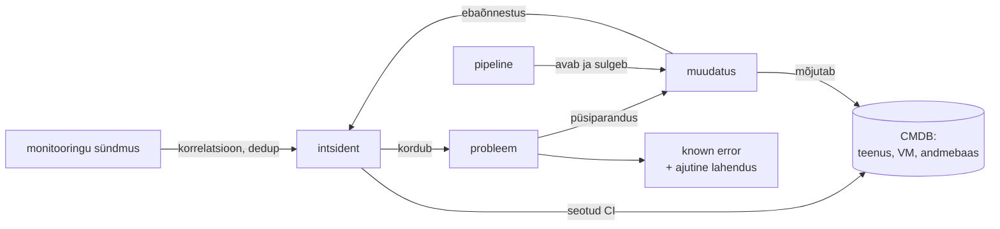

# IT-teenuste haldus (ITSM)

Öösel on intsident: kolm teenust ei vasta ja valvur saab 40 alerti. Hommikul küsitakse, kas põhjus oli eilne muudatus, millised teenused sõltuvad sellest andmebaasist ja kas sama juhtus ka kuu aega tagasi. Vastused peavad olema kolmes kirjes, mis viitavad üksteisele: intsident, muudatus ja konfiguratsiooniüksus. Automaatikaga ühendatud ITSM-is loob need kirjed masin ning inimene hindab ja otsustab.

## ITIL 4, change enablement ja ITIL (Version 5)

**ITIL 4** (2019, praegu PeopleCerti omandis) on ITSM-i levinuim raamistik ja sellel on 34 tava. Muudatuste haldusel on ITIL 4-s uus nimi *change enablement* ja see ei nõua enam kõigi muudatuste jaoks keskset CAB-i. Kinnitaja (*change authority*) võib olla meeskond, kolleegi review või automaatne kontroll pipeline'is ([ülevaade](https://itsm.tools/change-enablement/)). 2026. aasta jaanuaris teatas PeopleCert ITIL (Version 5) väljatulekust. Selle koolitusskeem jõustub järk-järgult ja ITIL 4 kehtib mõnda aega paralleelselt ([kokkuvõte](https://www.advisedskills.com/blog/it-service-management/itil-version-5-in-2026-what-is-confirmed-what-is-available-and-what-comes-next.md)). Seepärast lepi auditi ja sertifikaatide puhul kokku, kumb versioon on aluseks.

ITIL-i järgi organisatsiooni ei sertifitseerita. Organisatsiooni sertifitseeritav standard on ISO/IEC 20000-1.

## Intsident, probleem ja muudatus samal konfiguratsiooniüksusel

**CMDB** (*configuration management database*) hoiab konfiguratsiooniüksusi (CI) ja nende seoseid: teenus → rakendus → VM → host → andmebaas. Inventuuri tabelist ja monitooringu hostide nimekirjast eristavad seda just seosed. Hommikustele küsimustele vastatakse nende seoste järgi.

<figure markdown="span">

  <figcaption>Joonis 1. Intsident, probleem ja muudatus viitavad samadele konfiguratsiooniüksustele. Pipeline loob muudatuse kirje, monitooring loob intsidendi.</figcaption>
</figure>

## Standardmuudatus on testitud pipeline

Automaatika mõttes on standardmuudatus testitud tegevus: playbook, workflow või job template, mille protseduur kinnitati üks kord ja mille iga käivitus on registreeritud. Protseduuri enda muutmine on tavaline muudatus.

## CMDB: discovery või source of truth

CMDB saab andmeid kahest suunast. *Discovery* skannib võrku ja agentidelt ning kirjutab, mis on olemas. *Source of truth* on vastupidine: CMDB-s kirjeldatakse, mis peab olema, ja automaatika ehitab selle järgi. Ansible'i dünaamiline inventory (NetBox, ServiceNow, GLPI) loeb hostid ja grupid CMDB-st, OpenTofu või pipeline kirjutab loodud ressursid tagasi. Kui mõlemad suunad on kasutusel, vajab CMDB reeglit, kumb allikas võidab, ja aruannet lahknevuste kohta. Muidu kirjutab discovery üle selle, mida automaatika kasutab.

## Alertist intsidendini

Alertmanager või ITSM-i sündmuste moodul rühmitab ja dedublikeerib alerdid ning intsident avatakse ainult kasutajat mõjutava seisu korral. Hea integratsioon seob intsidendi CI-ga ja näitab samal lehel viimaseid muudatusi selles CI-s. Sageli on see kiireim tee põhjuseni.

## AI ITSM-is: klassifitseerimine, otsing ja riskihinnang

Levinumad rakendused on intsidentide klassifitseerimine ja suunamine õigele meeskonnale, pika ticket'i ajaloo kokkuvõte vahetuse üleandmiseks, sarnaste varasemate intsidentide ja known error kirjete otsing ning muudatuse riskihinnang varasemate ebaõnnestumiste põhjal. Tööriistad pakuvad ka automaatset lahendust: kasutaja kirjeldab probleemi, süsteem valib runbook'i ja käivitab selle. Siin kehtivad samad piirid mis sündmuspõhises automaatikas: AI valib heakskiidetud tegevuste seast ja riskantne tegevus ootab inimese kinnitust. ITIL (Version 5) skeemis on selle jaoks eraldi laiendusmoodul [ITIL AI Governance](https://www.advisedskills.com/blog/it-service-management/itil-version-5-in-2026-what-is-confirmed-what-is-available-and-what-comes-next.md).

## Avatud lähtekoodiga ITSM ja CMDB

| Tööriist | Mida teeb | Litsents/hind | Millal valida |
|---|---|---|---|
| [GLPI](https://glpi-project.org/) | Helpdesk, intsidendid, muudatused, inventuur ja CMDB, REST API | GPLv3 | Avatud lähtekoodiga ITSM koos varahaldusega |
| [iTop](https://www.combodo.com/itop) | ITIL-i põhine ITSM ja tugev CMDB andmemudel, REST API | AGPLv3 | CMDB seosed on peamine vajadus |
| [Zammad](https://zammad.org/) | Helpdesk ja ticket'id, e-posti ja vestluse kanalid | AGPLv3 | Kasutajatugi, mitte täis-ITSM |
| [Znuny](https://www.znuny.org/) | OTRS-i Community Editioni järeltulija, ticket'id ja ITSM-moodulid | GPLv3 | Olemasolev OTRS-i paigaldus |
| [Request Tracker](https://bestpractical.com/request-tracker) | Ticket'id ja töövood, pikaajaline avatud lähtekoodiga projekt | GPLv2 | Lihtne ja stabiilne järjekord |
| [NetBox](https://github.com/netbox-community/netbox) | IPAM/DCIM ja source of truth, Ansible'i inventory | Apache 2.0 | Taristu andmed automaatika jaoks, kõrvuti ITSM-iga |

Kommertsvõrdluseks on ServiceNow ja Jira Service Management. Nende tugevus on integratsioonide hulk ja valmis töövood, hind on litsents kasutaja kohta ja sõltuvus platvormist.

## DORA määrus ja CAB-i hind

EL-i finantssektori digitaalse tegevuskerksuse määrus [DORA](https://eur-lex.europa.eu/eli/reg/2022/2554/oj) kehtib 17. jaanuarist 2025 ka Eesti pankadele ja makseasutustele. Selle tehniline standard, [delegeeritud määrus 2024/1774 artikkel 17](https://www.springlex.eu/en/packages/dora/rts-rmf-regulation/article-17/), nõuab IKT muudatuste halduse kohta järgmist:

- muudatusi kinnitav funktsioon on sõltumatu funktsioonist, mis neid taotleb ja teeb;
- kiirmuudatused dokumenteeritakse, hinnatakse ja kinnitatakse pärast tegemist;
- igal muudatusel on tagasimineku ja katkestamise protseduur ning vastutajad.

Samal ajal näitas [2019. aasta State of DevOps uuring](https://dora.dev/publications/pdf/state-of-devops-2019.pdf), et formaalse välise kinnitusega organisatsioonid (CAB või juhi kinnitus) olid 2,6 korda tõenäolisemalt madala tarnevõimega. Uuring soovitas kasutada kolleegi review'd ja automaatseid kontrolle. Need kaks ei ole vastuolus, kui sõltumatus on tehniliselt tagatud. PR-i kinnitab teine inimene kui autor, haru kaitset ei saa autor ise maha võtta, pipeline'i kontrollid on kohustuslikud ja deploy jätab kirje koos rollback'i võimalusega. Kas audiitor peab sellist PR-i kinnitust määruse mõttes sõltumatuks funktsiooniks, sõltub organisatsiooni rollijaotusest. Seda tuleb enne auditit tema ja riskijuhiga kokku leppida.

## Kus ITSM-i ja automaatika ühendus katki läheb

- **Vananenud CMDB.** Kui CMDB-d uuendatakse käsitsi, on see poole aasta pärast vale ja automaatika, mis seda inventory'na kasutab, paigaldab vale hulga hoste. CMDB püsib õige siis, kui automaatika seda loeb või sinna kirjutab.
- **Formaalne protsess.** Kui iga muudatus läheb CAB-i, kinnitatakse ticket'eid vaatamata. Standardmuudatuste laiendamine testitud pipeline'idele vähendab koormust ja jätab inimese tähelepanu riskantsetele muudatustele.
- **ITSM kui üksik rikkepunkt.** Kui deploy ootab ITSM-i API vastust, peatab ITSM-i katkestus ka paranduse. Reegel, kuidas toimida fail-open või fail-closed olukorras, peab olema kirjas enne esimest katkestust.
- **Andmekaitse.** Ticket'ites on isikuandmeid, logilõike ja vahel paroole. AI-tööriist, mis neid välisesse teenusesse saadab, vajab samasugust hinnangut nagu iga teine andmetöötleja. Automaatika ei tohi kirjutada saladusi ticket'isse.
- **Automaatika pimesi usaldamine.** Kui AI suunab ticket'i valesse meeskonda või pakub sarnase intsidendi vale lahenduse, kipub inimene seda usaldama, sest see on tavaliselt õige. Klassifikatsiooni täpsust tuleb mõõta ja valesti suunatud kirjed peavad tagasisidena süsteemi jõudma.
- **Alertide tulv intsidentideks.** Ilma dedup'ita avab iga alert intsidendi ja valvur sulgeb neid hulgi. Siis jääb tegelik intsident märkamata.

## Kontrolli ennast

??? question "Mis vahe on intsidendil ja probleemil ning miks on see vahe automaatika jaoks oluline?"
    Intsidendi eesmärk on teenus kiiresti taastada, näiteks restardi või rollback'iga. Probleemi eesmärk on leida põhjus, et intsident ei korduks. Automaatika, mis taastab teenuse sündmuse peale, sulgeb intsidendi, aga kui keegi ei ava probleemi, jääb põhjus alles ja automaatne taastamine peidab seda.

??? question "Pipeline'iga deploy on standardmuudatus. Miks on `.github/workflows/` kausta muutmine tavaline muudatus?"
    Standardmuudatus on kinnitatud protseduuri käivitus. Workflow'faili muutmine muudab protseduuri ennast, näiteks eemaldab kontrolli või muudab sihtkeskkonda. Seepärast vajab see eraldi hinnangut ja kinnitust, mida teeb CODEOWNERS koos nõutud ülevaatajaga.

??? question "Discovery ja Ansible'i automaatika kirjutavad mõlemad samasse CMDB-sse. Mis läheb valesti ja kuidas seda vältida?"
    Discovery kirjutab olemasoleva seisu ja võib üle kirjutada välja, mida automaatika kasutab soovitud seisuna, näiteks rolli või keskkonna. Siis muudab järgmine jooks hosti vale rolli järgi. Iga välja kohta peab olema määratud omanik (discovery või automaatika) ning lahknevused peavad jõudma aruandesse, mitte vaikse ülekirjutamiseni.

??? question "DORA määrus nõuab, et muudatuse kinnitaja oleks sõltumatu muudatuse tegijast. Kuidas seda pipeline'is tehniliselt tagada?"
    PR-i peab kinnitama keegi teine kui autor ja haru kaitse ei luba autoril seda reeglit ise maha võtta, ka administraatoril mitte. Tootmise deploy ootab environment'i või `input`-i kinnitust, kus kinnitaja ja käivitaja võrdlus on pipeline'is kirjas. Kõik see jätab kirje väljaspool CI serverit.
