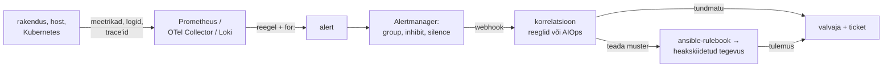

# Jälgitavusest AIOps'ini

Sinu `check.sh` kirjutab iga viie minuti järel journal'isse `OK` või `CRITICAL`, aga kell kolm öösel ei loe journal'it keegi. Tootmises on probleem vastupidine: tuumikkommutaatori rike annab kahe minutiga 200 alerti 60 hostilt ja valvaja otsib nende seast seda ühte, mis ütleb põhjuse. Signaal on kasulik alles siis, kui see jõuab otsuseni: inimeseni või heakskiidetud tegevuseni. AIOps lühendab seda teed, heakskiidetud tegevuste kataloogi see ei asenda.

## Seotud signaalid ja AIOps'i neli funktsiooni

**Jälgitavus** (observability) on süsteemi omadus: telemeetriast saab vastuse ka küsimusele, mida keegi ette ei mõelnud, näiteks miks on aeglased ainult ühe kliendi päringud, mis läbivad kolmandat app-serverit. Selleks peavad meetrikad, logid ja trace'id olema omavahel seotud ühiste label'ite ja logireal oleva `trace_id` kaudu. Kui andmetes pole label'it, mille järgi küsida, ei aita ükski dashboard.

**AIOps** on statistika ja masinõppe kasutamine operatsiooniandmetel. Termin pärineb analüütikafirmalt Gartner. Praktikas tähendab see nelja funktsiooni: müra vähendamine (dedublikeerimine), korrelatsioon (mitu alerti ühe intsidendina), anomaaliate leidmine ilma käsitsi lävendita ja juurpõhjuse pakkumine. Uuemad tööriistad lisavad keelemudeli, mis loeb logisid ja kirjutab hüpoteesi. AIOps otsustab, mis toimub ja mis on tähtis. Tegevuse teeb sündmuspõhine automaatika ([ansible-rulebook](https://ansible.readthedocs.io/projects/rulebook/en/latest/), AWX-i job template) või inimene.

SIEM teeb sama turvasündmustega. Mehhanism on sarnane, aga andmed ja vastutajad on teised (vt [turvaautomaatika](turvaautomaatika.md)).

## Viis etappi signaalist tegevuseni

Iga etapp võib signaali kaotada.

**Kogumine.** Prometheus küsib meetrikaid ise (`scrape_interval`, tavaliselt 15–60 s). Logid ja trace'id saadetakse push-mudeliga. [OpenTelemetry Collector](https://opentelemetry.io/docs/collector/architecture/) on agent või vaheserver, kus iga signaalitüübi (traces, metrics, logs) jaoks on oma pipeline: receiver võtab andmed vastu, processor'id muudavad neid järjest (atribuudid, filter, sampling, `batch`) ja exporter saadab need edasi. Üks Collector saab samu andmeid saata nii Prometheusele kui ka Lokile ja vahetada backend'i ilma rakendust muutmata.

**Tuvastamine.** Alert'i reegel on PromQL-avaldis koos `for:`-iga. `for: 5m` tähendab, et tingimus peab kehtima viis minutit järjest, enne kui alert läheb olekust `pending` olekusse `firing`. See summutab ühekordsed piigid, aga lisab tuvastamisele viis minutit. Sinu `check.sh` puhul määrab sama viivituse timer'i intervall: rike, mis algab kohe pärast kontrolli, jõuab journal'isse kuni viis minutit hiljem.

**Müra vähendamine.** [Alertmanager](https://prometheus.io/docs/alerting/latest/configuration/) rühmitab alerdid `group_by` label'ite järgi. Uue grupi esimest teavitust ootab ta vaikimisi 30 sekundit (`group_wait`), et samasse gruppi jõuaks rohkem alerte, grupi muutustest teatab ta kõige varem 5 minuti järel (`group_interval`) ja muutumatut alerti kordab 4 tunni järel (`repeat_interval`). `inhibit_rules` vaigistab tagajärjed, kui põhjus juba põleb: kui `SwitchDown` on aktiivne, ei saadeta sama saidi `HostDown` alerte. Silence on ajutine vaigistus hooldusaknaks.

**Korrelatsioon.** Reeglipõhine korrelatsioon kasutab topoloogiat ja label'eid: sama `site`, sama `node`, sama ajaaken. AIOps lisab statistilise korrelatsiooni ehk alerdid, mis on ajaloos koos tulnud, pannakse ühte intsidenti ka siis, kui neil ühist label'it pole. Kvaliteet sõltub sellest, kui puhtad on andmed ja kui pikk on ajalugu.

**Tegevus.** Alertmanager saadab webhook'i, milles on `status` (`firing` või `resolved`), label'id ja annotatsioonid. Vastuvõtja võib olla valve teavitus, ticket'i süsteem või reeglimootor, mis käivitab heakskiidetud playbook'i.

<figure markdown="span">

  <figcaption>Joonis 1. Signaal liigub kogumisest tegevuseni. Iga nool on koht, kus see võib vaikselt kaduda.</figcaption>
</figure>

## Tasuta tööriistad ja millal mida

| Tööriist | Mida teeb | Litsents/hind | Millal valida |
|---|---|---|---|
| [Prometheus](https://prometheus.io/) + Alertmanager | meetrikad pull-mudeliga, PromQL-reeglid, rühmitamine ja vaigistus | Apache 2.0 | vaikevalik Linuxi ja Kubernetese meetrikatele |
| [OpenTelemetry Collector](https://opentelemetry.io/docs/collector/) | kõigi kolme signaali vastuvõtt, töötlus ja edastus | Apache 2.0 | rakendused on instrumenteeritud või tahad backend'ist sõltumatust |
| [Grafana](https://grafana.com/oss/) + [Loki](https://grafana.com/oss/loki/) | visualiseerimine, logid label'ite indeksiga | AGPLv3 | logid ja meetrikad ühes vaates, odav logihoidla |
| [Zabbix](https://www.zabbix.com/) | agentide ja SNMP-ga monitooring, trigerid, eskalatsioon | AGPLv3 alates 7.0 ([Zabbix](https://blog.zabbix.com/striking-the-right-balance-zabbix-7-0-to-be-released-under-agplv3-license/)) | klassikaline serveri- ja võrgupark, palju SNMP-seadmeid |
| [ansible-rulebook](https://github.com/ansible/ansible-rulebook) | sündmus → tingimus → playbook või job template | Apache 2.0 | tegevus on juba Ansible'is |
| [StackStorm](https://stackstorm.com/) | sündmuspõhine automaatika, sensorid, workflow'd | Apache 2.0 | palju erinevaid integratsioone ja mitmesammulised töövood |
| [HolmesGPT](https://github.com/robusta-dev/holmesgpt) | keelemudel uurib alerti: loeb meetrikaid, logisid ja Kubernetese objekte | Apache 2.0, CNCF sandbox | AI-toega uurimine ainult lugemisõigusega |

Kommertsplatvormid (Datadog, Dynatrace, Splunk ITSI, BigPanda) pakuvad korrelatsiooni ja anomaaliate leidmist valmis kujul. Hinnastus käib tavaliselt hostide või andmemahu järgi ja andmed on pakkuja juures.

## GitLab 2017: veateade, mis ei jõudnud kohale

31. jaanuaril 2017 kustutas GitLabi insener vale andmebaasiserveri andmekausta. Taastamisel selgus, et öised varukoopiad polnud ammu töötanud. Backup-skript kasutas PostgreSQL 9.2 `pg_dump`-i, andmebaas oli 9.6 ja skript lõppes veaga. Veateated saadeti e-postiga, aga vastuvõttev server lükkas need tagasi, sest kirjad polnud DMARC-iga allkirjastatud. Umbes kuue tunni andmed läksid kaotsi ([GitLabi postmortem](https://about.gitlab.com/blog/postmortem-of-database-outage-of-january-31/)).

Signaal oli olemas, aga teavitustee polnud kontrollitud. Sama riski näed laboris: `check.sh` saatmise viga ei katkesta kontrolli, nii et timer võib nädal aega näidata rohelist ainult sinu terminalis. Vastumeede on kontrollida ka teavitusteed ennast. kube-prometheus'e komplektis on selleks alati põlev `Watchdog` alert. Kui see väline teenus ei saa seda teatud aja jooksul kätte, on teavitustee katki (*dead man's switch*).

## Kus signaal kaob või eksitab

- **Liiga palju teavitusi.** Kui valvaja saab öösel 40 teavitust, millest 38 ei nõua tegevust, jätab ta ka kaks olulist vahele. Teavitus peab nõudma inimese tegevust. Muu läheb ticket'isse või dashboard'ile.
- **Kardinaalsus ja hind.** Iga unikaalne label'ite kombinatsioon on Prometheuses eraldi aegrida. `user_id` või päringu URL label'ina paisutab mälu ja kettakasutuse. Logide ja trace'ide maht on sageli suurim jälgitavuse kulu ning sampling vähendab kulu, aga vähendab ka nähtavust.
- **Vale korrelatsioon.** Statistiline mudel paneb kokku asjad, mis tulid koos ajaloos, mitte asjad, millel on põhjuslik seos. Uus arhitektuur või hooajaline koormus annab valesid gruppe ja valvaja võib usaldada mudelit rohkem kui oma vaatlust.
- **Automaatne parandus peidab põhjuse.** Restart, mis käivitub igal ööl, muudab mälulekke nähtamatuks. Iga automaatne tegevus peab andma ticket'i ja loenduri, et kordumine oleks näha.
- **Hilinenud ja aegunud signaal.** `resolved` võib jõuda kohale pärast seda, kui tegevus juba käivitus. Tegevus kontrollib enne muutmist olekut uuesti ja sel on sageduspiir.
- **Logid on sisend.** AI-tööriist, mis loeb logisid, loeb ka ründaja kirjutatud teksti. Logist tulnud juhist ei täideta ja tööriistal on ainult lugemisõigus.

## Kontrolli ennast

??? question "Võrgulüliti rikke ajal saab valvaja 60 `HostDown` teavitust ja ühe `SwitchDown` teavituse. Mida muudad Alertmanageris?"
    Lisa `inhibit_rules`, mis vaigistab `HostDown` alerdid, kui samal saidil (ühine label, näiteks `site`) põleb `SwitchDown`. Lisaks kontrolli `group_by`-d: kui grupeerida saidi järgi, tuleb üks teavitus mitme alertiga. Põhjus on siis nähtav ja tagajärjed ei kata seda kinni.

??? question "Alert'i reeglil on `for: 10m`. Mida see võidab ja mida see maksab?"
    Lühike piik või üks ebaõnnestunud scrape ei käivita teavitust. Hind on see, et tegelikust rikkest teatatakse kõige varem 10 minutit pärast tingimuse tekkimist, lisaks scrape'i intervall ja `group_wait`. SLO-põhine burn rate'i alert lahendab sama probleemi kahe aknaga paremini.

??? question "Öised varukoopiad ebaõnnestuvad ja veateade läheb e-postiga, mis kunagi kohale ei jõua. Kuidas selle avastad enne, kui varukoopiat vaja läheb?"
    Mõõda õnnestumist, mitte ebaõnnestumist: viimase eduka varukoopia aeg on meetrika ja alert käivitub siis, kui see on vanem kui 26 tundi. Teavitustee jaoks on alati põlev Watchdog alert koos välise teenusega, mis annab häire, kui Watchdog vaikib. Kõige kindlam tõend on korrapärane taastamise proov.

??? question "AIOps-tööriist pakub, et kolm alerti on üks intsident, kuigi neil pole ühist label'it. Kas usaldad seda?"
    Mitte enne kontrolli. Statistiline korrelatsioon ütleb, et alerdid tulid ajaloos koos, mitte et neil on ühine põhjus. Vaata, kas topoloogias on seos (sama node, sama sõltuvus), ja kasuta ettepanekut hüpoteesina. Tegevus tuleb teha testitud tegevuste hulgast, mitte mudeli järelduse põhjal.
