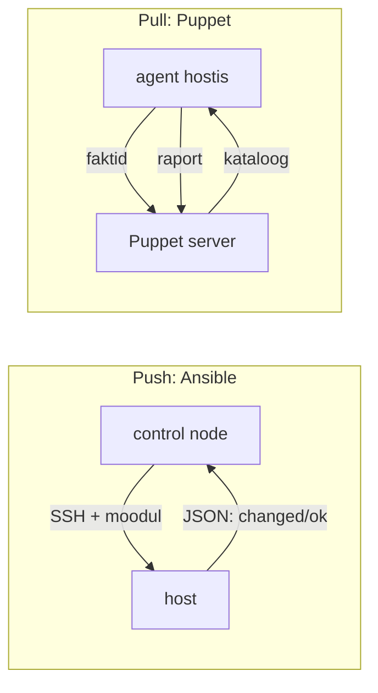

# Konfiguratsioonihaldus

Turvaaudit küsib, kas kõigis 60 serveris on `PermitRootLogin no`, NTP kasutab asutuse servereid ja logid lähevad keskserverisse. Vastus „peaks olema“ ei sobi, `for`-tsükkel üle SSH annab vastuse tänaseks, aga mitte homseks. Konfiguratsioonihaldus annab vastuse koodist ja hoiab selle tõesena: hosti seadistuse ainus allikas on versioonitud kood ja tööriist viib tegeliku seisu selle koodiga kokku korduvalt ja ohutult.

## Piirid: CMDB, IaC ja deploy

- **ITIL-i konfiguratsioonihaldus** tähendab sama sõnaga konfiguratsiooniüksuste ja nende seoste arvestust CMDB-s. CMDB ütleb, mis on olemas ja kellele kuulub. Konfihalduse tööriist ütleb, milline see peab olema, ja teeb selle selliseks. Need kohtuvad siis, kui CMDB on inventory allikas.
- **IaC**: OpenTofu loob ja kustutab API objekte (VM, ketas, DNS-kirje) ja hoiab state'i. Konfihaldus seadistab masina sisu ja state'i tavaliselt ei hoia. Koodist eemaldatud fail jääb hosti alles, kui sa selle eemaldamist eraldi ei kirjuta.
- **Deploy**: Ansible'iga saab deploy'd teha, aga rakenduse versiooni vahetus vajab järjekorda, health check'i ja rollback'i, mida konfihaldus ise ei paku.

## Faili omamine: terve fail, plokk või drop-in

Konfiguratsioonifaili formaate on palju (INI, YAML, TOML, JSON, teenuse oma süntaks) ja peaaegu igaühel on oma valideerija. Konfihalduse jaoks on kaks küsimust: kes faili omab ja kas seda saab kontrollida enne, kui teenus selle loeb.

Kolm viisi, kuidas konfihaldus faili muudab, annavad eri tugevusega garantii:

- **Terve fail mallist** (`template`, Puppeti `file` + `content`). Kood on faili ainus allikas, käsitsi muudatus kirjutatakse järgmisel jooksul üle. Tugevaim garantii, aga mall peab katma kõik, mida failis vaja on.
- **Hallatud plokk või rida** (`blockinfile`, `lineinfile`). Muud read jäävad puutumata. Sobib failile, mida haldab ka keegi teine (pakett, teine meeskond). Risk: `lineinfile` regulaaravaldis, mis tabab kaht rida, või rida, mida pakett järgmisel uuendusel muudab.
- **Drop-in kaust** (`/etc/ssh/sshd_config.d/`, `/etc/systemd/system/<unit>.d/`, `/etc/sudoers.d/`). Konfihaldus omab ainult oma faili ja paketi vaikimisi fail jääb puutumata. Nii väldib paketiuuendus konflikti ja vastutus on failinime järgi selge. Pane tähele lugemise järjekorda: sshd võtab iga võtme esimese esinemise, systemd drop-in'i puhul võidab hilisem.

Iga muudatuse ees on kontroll. `template` ja `copy` toetavad parameetrit `validate`, mis käivitab valideerija ajutise faili peal enne, kui see õigele kohale liigub:

```yaml
- name: sshd seadistus
  ansible.builtin.template:
    src: 50-hardening.conf.j2
    dest: /etc/ssh/sshd_config.d/50-hardening.conf
    mode: "0600"
    validate: /usr/sbin/sshd -t -f %s
  notify: Reload sshd
```

Ilma `validate`-ita jõuab vigane fail kohale, handler laadib sshd uuesti ja järgmine SSH-ühendus, ka Ansible'i oma, ebaõnnestub. Drop-in faili puhul kontrollib `sshd -t -f %s` ainult seda faili, mitte koos peafailiga, nii et ühe võtme kahekordne määramine jääb märkamata. Teine kontroll on pärast reload'i: kas uus ühendus õnnestub.

## YAML 1.1 lõksud

YAML on Ansible'i, Salt'i, Kubernetese, GitHub Actionsi ja cloud-init'i keel. Ansible loeb YAML-i andmestruktuuriks ja tõlgendab seda ise. Ta kasutab PyYAML-i, mis järgib YAML 1.1 reegleid. Sealt tulevad vead, mida süntaksikontroll ei näe:

- **Tõeväärtused.** YAML 1.1 loeb `yes`, `no`, `on`, `off`, `y`, `n` tõeväärtuseks. Riigikood `NO` muutub `false`-iks ([„Norra probleem“](https://allan.reyes.sh/posts/yaml-norway-law/)), sshd väärtus `no` mallis muutub `False`-iks. Kirjuta tõeväärtused `true`/`false` ja stringid jutumärkides.
- **Failiõigused.** `mode: 644` on kümnendarv 644, mitte kaheksandsüsteemi 0644, ja fail saab õigused, mida keegi ei oodanud. Ansible'i dokumentatsioon soovitab õigused kirjutada stringina: `mode: "0644"`.
- **Koolon ja looksulg.** Väärtus, milles on `: `, või väärtus, mis algab `{{`-ga, peab olema [jutumärkides](https://docs.ansible.com/projects/ansible-core/2.14/reference_appendices/YAMLSyntax.html), muidu loeb YAML selle sõnastikuks.
- **Taane.** Tabulaator taandes on viga, aga valel tasemel tühikutega taandatud võti on kehtiv YAML, mis läheb lihtsalt vale objekti alla. `ansible-lint` ja `yamllint` püüavad selle kinni enne käivitust.

## Push ja pull: kes algatab muudatuse

Ansible on push-mudel: control node ühendub, saadab mooduli, saab JSON-i ja lõpetab. Ülejäänud kolm suurt tööriista on pull-mudelid oma mehhanismiga:

- **Puppet**: agent saadab serverile faktid (Facter), server kompileerib nendest ja koodist hostipõhise kataloogi (ressursside graafi), agent viib hosti selle järgi seisu ja raporteerib. Järjekord tuleb sõltuvustest (`require`, `before`, `notify`), mitte faili järjekorrast.
- **Chef**: `chef-client` laeb cookbook'id alla ja käivitab need kahes faasis: compile-faas ehitab Ruby koodist ressursside kogu, converge-faas teeb need muudatused. Klassikaline viga on Ruby kood, mis töötab compile-faasis, kui ressurss, millest see sõltub, pole veel tehtud.
- **Salt**: minion hoiab masteriga püsivat ZeroMQ ühendust, nii et käsk jõuab tuhandesse hosti sekunditega. Seisu kirjeldavad SLS-failid ja `state.apply` (highstate) viib hosti `top.sls`-is määratud seisu.

Valiku sisuline küsimus on see, kas drift peab kaduma ilma inimeseta (pull) või ainult siis, kui keegi käivitab (push), ja kas sihtmasinatesse tohib panna agendi.

<figure markdown="span">



  <figcaption>Joonis 1. Push-mudelis algatab muudatuse control node, pull-mudelis agent ajakava järgi.</figcaption>
</figure>

## Ansible, OpenVox, Salt, Cinc: millal mida

| Tööriist | Mida teeb | Litsents/hind | Millal valida |
|---|---|---|---|
| [Ansible](https://docs.ansible.com/) | push üle SSH, agenti pole | GPLv3, tasuta | segakeskkond (Linux, võrk, Windows), sihtmasinasse agenti ei panda |
| [OpenVox](https://github.com/OpenVoxProject/) | Puppeti kogukonna haru, pull agendiga | Apache 2.0, tasuta | tuhanded hostid, drift peab kaduma ise, olemasolev Puppeti kood |
| [Salt](https://saltproject.io/) | püsiühendusega master/minion, event bus ja reactor | Apache 2.0, tasuta | kiire käsk paljudele hostidele, sündmustele reageerimine |
| [Cinc](https://cinc.sh/) | Chefi vaba build, pull agendiga | Apache 2.0, tasuta | olemasolev Chefi kood ilma kommertslitsentsita |
| [CFEngine](https://cfengine.com/) Community | pull, väga väike agent | GPLv3, tasuta | väga piiratud ressursiga hostid, pikk ajalugu |
| [ansible-lint](https://docs.ansible.com/projects/lint/) ja yamllint | stiili- ja veakontroll enne käivitust | GPLv3 / GPLv3, tasuta | alati, pre-commit'is ja pipeline'is |
| Puppet Enterprise, Progress Chef | kommertsversioonid toe ja konsooliga | tellimus | võrdluseks: tugi ja sertifitseeritud moodulid on nõue |

*Tabel 1. Konfiguratsioonihalduse tööriistad.*

## CERN 15 000 node'iga ja Facebooki Chef

CERN haldab Puppetiga umbes [15 000 node'i](https://voxpupuli.org/voxconf/2026/slides/Migrating_to_OpenVox_at_CERN.pdf) (enne Kubernetese laialdast kasutuselevõttu üle 40 000). Ettekande järgi on taristus umbes 150 Puppeti serverit, 25 Foremani node'i (UI, API, raportid ja External Node Classifier, mis määrab hosti rolli hostgroup'i järgi) ning umbes 400 administraatorit, kes selle koodiga töötavad. Päevas kompileeritakse umbes 240 000 kataloogi. OpenVoxile kolitakse meta-RPM-iga, mis asendab paketi `puppet-agent` paketiga `openvox-agent` tavalise `dnf upgrade`-iga, nii et hoste ei pea uuesti bootstrap'ima. Ettekande ajal (2026. aasta suvi) oli PuppetDB kolitud ja agentide üleviimine kogu pargis alles ees. Ettekande järeldus on, et suurem tehniline võlg oli üle 15 aasta jooksul Puppeti peale ehitatud abstraktsioonides kui tööriistas endas.

Facebook kirjeldas 2014. aastal, kuidas ta haldab Chefiga [sadu tuhandeid servereid](https://engineering.fb.com/2014/10/01/core-infra/facebook-configuration-management-community-and-open-source): üksikute seadete asemel on cookbook'ides üldised mallid, mis käivad läbi andmestruktuuri, ja iga meeskond muudab ainult andmeid. Testimiseks avaldati tööriist Taste Tester, mis proovib muudatust enne merge'i valitud hostidel. Mõlemas näites tuleb skaala probleem sellest, et sadu inimesi muudab sama koodi; tööriista kiirus on teisejärguline.

## Kaks allikat, kaks tööriista ja ülevõtmine

**Kaks allikat.** Kui sama faili muudab nii konfihaldus kui ka inimene, kirjutab järgmine jooks käsitsi muudatuse üle. Push-mudelis juhtub see juhuslikul ajal, siis kui keegi playbook'i käivitab. Selle vastu on reegel „parandus läheb koodi“ ja öine `--check --diff`, mis näitab drift'i enne, kui see üle kirjutatakse.

**Kaks tööriista samal hostil.** Puppet ja Ansible, mis haldavad sama faili, kirjutavad teineteise töö üle iga 30 minuti järel. Jaota vastutus selgelt (Puppet OS-i baas, Ansible rakendus) ja kirjuta see üles.

**Mall, mis ei kata kõike.** Terve faili mall kustutab read, mida pakett või teine meeskond lisas. Enne malli kasutuselevõttu võrdle olemasolevaid faile (`fetch` kõigist hostidest ja `diff`).

**Ülevõtmine olemasolevas keskkonnas.** Esimene jooks viie aasta vanuses keskkonnas annab sadu muudatusi. Alusta `--check --diff`-iga, ühest hostigrupist ja ühest rollist korraga.

**Agendi hind.** Pull-mudel vajab serverit, sertifikaatide haldust, agendi uuendusi ja kõrgkäideldavust. Kui server on maas, drift'i ei parandata, aga hostid töötavad edasi. Push-mudel vajab ainult SSH-d, aga skaleerub control node'i järgi.

**Lock-in ja litsents.** Puppeti ja Chefi omanike litsentsi- ja levitusmuudatused tõid kaasa kogukonna harud ja build'id (OpenVox, Cinc). Kood kandub haru vahel üle, aga kommertsmoodulid ja konsoolid mitte.

## Kontrolli ennast

??? question "Playbook paneb sshd seadistuse drop-in faili ja kasutab `validate: sshd -t -f %s`. Kas see kaitseb välja lukustamise eest täielikult?"
    Ei. Valideerija kontrollib ainult drop-in faili süntaksit, mitte koosmõju peafailiga ega seda, kas uue seadistusega saab sisse logida. Kui peafailis on sama võti varem, kehtib see ja sinu väärtus ei mõju. Pärast reload'i peab olema eraldi kontroll uue SSH-ühendusega ja teine sessioon peab olema avatud, kuni kontroll on läbi.

??? question "Inventory's on `country: NO` ja mall kirjutab faili `country=False`. Miks?"
    PyYAML järgib YAML 1.1 reegleid, kus `NO` on tõeväärtus `false`. Jinja2 kirjutab Pythoni `False`-i. Parandus on panna väärtus jutumärkidesse (`country: "NO"`) ja lisada yamllint'i reegel, mis keelab tõeväärtuste muud kirjaviisid peale `true`/`false`.

??? question "Millal valiksid Ansible'i asemel pull-mudeliga tööriista?"
    Kui nõue on, et käsitsi muudatus kaob kindla aja jooksul ilma inimeseta, ja hoste on nii palju, et ühe control node'i push muutub aeglaseks. Hinnaks on agent igas hostis, keskserver, sertifikaadid ja selle serveri kõrgkäideldavus. Segakeskkonnas, kus võrguseadmetesse ja osadesse serveritesse agenti panna ei saa, jääb Ansible vähemalt nende jaoks alles.

??? question "Mis vahe on konfihaldusel ja ITIL-i mõistes konfiguratsioonihaldusel ning kus need kohtuvad?"
    ITIL-i konfiguratsioonihaldus peab arvestust konfiguratsiooniüksuste ja nende seoste üle CMDB-s. Konfihalduse tööriist kirjeldab hosti soovitud seisu ja viib hosti sellesse seisu. Need kohtuvad siis, kui CMDB on konfihalduse inventory allikas: kirje staatus ja roll määravad, millised hostid ja millise rolliga jooksu satuvad.
