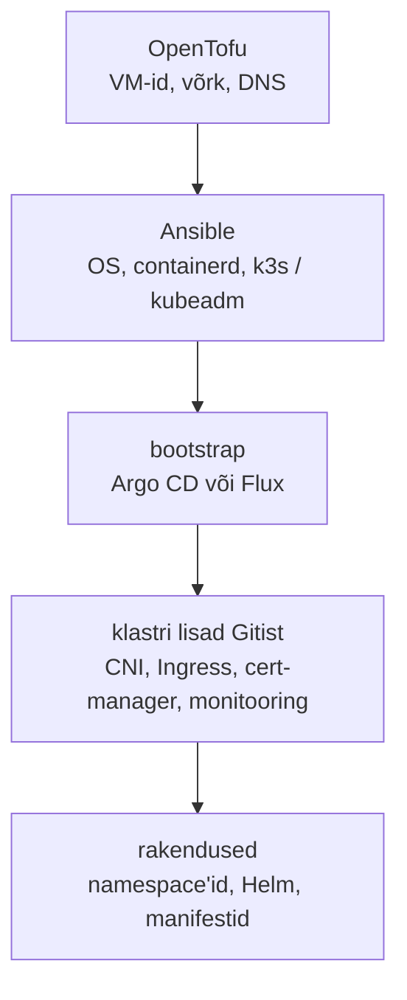

# Kubernetese klastrihaldus

Rakendusmeeskond deploy'b klastrisse Argo CD kaudu ja kõik on Gitis. Klaster ise tehti aasta tagasi käsitsi kolmel VM-il `kubeadm init`-iga ning ühel hommikul vastab API server `x509: certificate has expired`. Selgub, et sertifikaadid kehtisid aasta, klastrit pole kordagi uuendatud ja juhendit, kuidas see tehti, ei ole. **Klaster on samasugune hallatav süsteem nagu iga teine: tal on elutsükkel, versioonid, sertifikaadid, varundus ja omanik, ning see kõik peab olema koodis samamoodi nagu sellel töötavad rakendused.**

## Platvormi ja rakenduse piir, haldusklaster

Klastri lisad (CNI, CSI, Ingress, cert-manager, monitooring, poliitikamootor) ja rakendused paigaldatakse samade tööriistadega (Helm, Argo CD), nii et piir käib omaniku järgi: platvormimeeskond vastutab selle eest, et klaster on terve ja ajakohane, rakendusmeeskond oma namespace'i sisu eest. Enamik tööd ja enamik rikkeid on day 2: uuendused, sertifikaadid, etcd varundus ja taastamine. Kui klastreid on palju, lisandub fleet management: sama baasseadistus kümnele või tuhandele klastrile.

Cluster API mudelis on veel üks mõiste: haldusklaster (management cluster) on Kubernetese klaster, mille objektid `Cluster`, `MachineDeployment` ja `Machine` kirjeldavad teisi, töökoormuse klastreid (workload cluster). Haldusklastri kontrollerid loovad ja asendavad nende node'e samamoodi, nagu ReplicaSet asendab pod'e.

## Ansible node'il, GitOps API-s, sertifikaadid ja edge

Klastri tasemed jagunevad tööriistade vahel selgelt. Kubelet'ist allpool on masin: VM, kernel, sysctl, containerd, tulemüür, kettad. Sellest kõrgemal on Kubernetese API objektid. Allpool on Ansible'i ja OpenTofu ala, ülalpool GitOps'i ala.

<figure markdown="span">

  <figcaption>Joonis 1. Klastri tasemed. Ansible lõpetab seal, kus algab Kubernetese API, ja sealt edasi haldab klastrit GitOps agent.</figcaption>
</figure>

Ansible ja Kubernetes on mõlemad deklaratiivsed, aga erinevad ajas. Ansible viib hosti soovitud seisu siis, kui playbook'i käivitad, ja lõpetab. Kubernetese kontroller võrdleb seisu pidevalt. Seepärast sobib Ansible node'i tasemele: paketid, kerneli parameetrid, containerd'i seadistus, k3s-i paigaldus ([k3s-ansible](https://github.com/k3s-io/k3s-ansible)) või kubeadm-klaster ([Kubespray](https://kubespray.io/)). Klastri sees tasub objektid anda kontrollerile. `kubernetes.core.k8s` moodul oskab manifesti klastrisse saata, aga pärast playbook'i lõppu ei paranda keegi drift'i. Kui sama objekti haldavad nii Ansible kui ka Argo CD, kirjutavad nad üksteise muudatusi üle.

Hea koostöö näide on node'i patch'imine. Ansible võtab node'id ükshaaval (`serial: 1`), teeb `kubectl drain`, uuendab paketid, taaskäivitab masina, ootab, kuni node on `Ready`, ja teeb `uncordon`. Drain austab PodDisruptionBudget'it, nii et Kubernetes ise ütleb, millal järgmise node'iga jätkata tohib ([7. kohtumise loeng, ptk 5](../k07/loeng.md#5-klastri-elutsukkel-ja-cloudops)). Ansible'i Operator SDK läheb teist teed: playbook käivitub klastri sees kontrollerina ja seda kutsutakse iga kord, kui CRD objekt muutub.

Sertifikaatide puhul on vaikeväärtused erinevad. kubeadm-i klientsertifikaadid kehtivad aasta ja `kubeadm upgrade` uuendab need; `kubeadm certs check-expiration` näitab tähtaegu ([kubeadm-i dokumentatsioon](https://kubernetes.io/docs/tasks/administer-cluster/kubeadm/kubeadm-certs/)). Klaster, mida uuendatakse vähemalt kord aastas, ei jõua sertifikaatide aegumiseni. k3s-i sertifikaadid kehtivad samuti 365 päeva, aga uuenevad k3s-i käivitumisel, kui aegumiseni on vähem kui 120 päeva. CA kehtib 10 aastat ja seda automaatselt ei uuendata ([k3s certificate](https://docs.k3s.io/cli/certificate)). Kui k3s-i node'i pole aasta jooksul taaskäivitatud, võivad selle sertifikaadid seega ikkagi aeguda.

Edge tähendab palju väikseid klastreid kohtades, kus pole IT-inimest: kauplus, tehas, alajaam, laev. Piirangud on teised kui andmekeskuses. WAN võib kaduda tundideks ja klaster peab selle aja iseseisvalt töötama. Riistvara on väike: k3s-i server vajab vähemalt kaks tuuma ja 2 GB RAM-i, agent ühe tuuma ja 512 MB ([k3s nõuded](https://docs.k3s.io/installation/requirements)). etcd kirjutab palju ja SD-kaart või eMMC seda ei kannata, nii et vaja on SSD-d. Üks k3s-i server kasutab vaikimisi etcd asemel SQLite'it. Muudatused peavad jõudma kohale pull-mudeliga: klastris olev agent tõmbab seisu Gitist siis, kui ühendus on olemas, sest keskne CI ei näe sadu klastreid NAT-i ja tulemüüride taga. Image'id tuuakse kohaliku registry peegli kaudu, et sama image'it ei tõmmataks üle aeglase liini iga node'i jaoks eraldi.

## kubeadm, k3s, Talos, Cluster API ja teised

| Tööriist | Mida teeb | Litsents / hind | Millal valida |
|---|---|---|---|
| [kubeadm](https://kubernetes.io/docs/reference/setup-tools/kubeadm/) | standardne control plane'i bootstrap ja uuendus | Apache 2.0 | täielik kontroll, upstream'iga sama käitumine |
| [k3s](https://docs.k3s.io/) | üks binaar, SQLite või embedded etcd, Traefik | Apache 2.0 | väikesed klastrid, edge, laborid |
| [RKE2](https://docs.rke2.io/) | k3s-i sarnane, turvalisemate vaikeseadetega | Apache 2.0 | k3s-i mugavus koos rangemate nõuetega |
| [Talos Linux](https://www.talos.dev/) | ainult Kubernetese jaoks OS, SSH puudub, hallatakse API-ga | MPL 2.0 | muutumatud node'id, ei taha OS-i eraldi hallata |
| [Kubespray](https://kubespray.io/) | kubeadm-klaster Ansible'iga | Apache 2.0 | Ansible on majas juba olemas |
| [Cluster API](https://cluster-api.sigs.k8s.io/) | klastrid Kubernetese objektidena, node'ide asendus | Apache 2.0 | palju klastreid samal platvormil |
| [Rancher](https://ranchermanager.docs.rancher.com/) + Fleet | mitme klastri haldus, GitOps paljudele klastritele | Apache 2.0, tugi tasuline | palju klastreid, sh edge |
| [Velero](https://velero.io/docs/) | API objektide ja volume'ite varundus | Apache 2.0 | klastri taastamine või kolimine |
| system-upgrade-controller | k3s-i ja RKE2 node'ide uuendus `Plan` objektist | Apache 2.0 | uuendus ilma Ansible'ita |
| OpenShift, EKS, AKS, GKE | kommerts- ja hallatud klastrid | tasuline | võrdluseks: pakkuja võtab osa elutsüklist |

*Tabel 1. Klastrihalduse tööriistad.*

## Chick-fil-A: klaster igas restoranis

Chick-fil-A käitab igas restoranis väikest Kubernetese klastrit: kolm väikest arvutit, igaühes 8 GB RAM-i ([eWeek](https://www.eweek.com/de/cloud/how-chick-fil-a-uses-kubernetes-and-gitops-at-the-edge/)). Plaan oli viia see üle 2000 restoranini. Klastreid ei hallata kohapeal. Pilves on iga restorani jaoks oma Giti repo ja restorani klastris töötav agent kloonib selle ning teeb muudatused ise. Ettevõtte enda süsteemide nimed on Fleet ja Vessel. Nende Fleet on teine toode kui Rancheri Fleet, aga mõte on sama: pull-mudel, kus keskus kirjeldab soovitud seisu ja iga klaster viib end sellega kooskõlla.

Mudel lahendab kolm edge'i probleemi korraga. Klaster ei pea olema väljast ligipääsetav, kõigi restoranide seis on Gitis loetav ja katkenud ühendus tähendab ainult seda, et uus seis jõuab kohale hiljem.

Sama kehtib ka ühe suure klastri puhul: Redditi 2023. aasta katkestus pärast klastri uuendust tulenes koodist mööda tehtud seadistusest ([7. kohtumise loeng](../k07/loeng.md#5-klastri-elutsukkel-ja-cloudops)).

## Snowflake-klaster, etcd kvoorum ja kaks kontrollerit

Kui klastrit ei saa samast koodist uuesti teha, ei saa ka uuendust enne proovida. Lahendus on klaster, mida saab tunniga uuesti ehitada, ja testklaster, mis on tehtud samast koodist.

Uuendus võib takerduda eemaldatud API-versioonide taha. Lisa või Helmi chart, mis kasutab eemaldatud API-t, ebaõnnestub pärast uuendust. Seda kontrollitakse enne uuendust, mitte pärast.

etcd kvoorum vajab paaritut arvu liikmeid: kolm talub ühe rikke, viis kaks. Kahe control plane'i node'iga klaster on vähem töökindel kui ühega, sest kumbki rike peatab kirjutamise. etcd snapshot on väärtusetu, kui taastamist pole kordagi proovitud.

Kaks kontrollerit sama objekti peal tekitavad lõputu muudatuste ringi. Tavaline näide: Ansible või Argo CD määrab Deployment'i `replicas` väärtuse ja HPA muudab seda. Lahendus on jätta väli Gitist välja või lasta Argo CD-l seda ignoreerida.

Haldusklastril ja mitme klastri haldustööriistal on kõigi klastrite õigused: nende kaudu saab muuta kõiki klastreid. Kui haldusklaster on maas, töötavad olemasolevad klastrid edasi, aga neid ei saa muuta ega asendada.

Edge'il on oht, et uuendus muudab kauge seadme kasutuskõlbmatuks ja kohapeal pole kedagi, kes selle taastaks. Uuendus viiakse kõigepealt mõnele asukohale, A/B partitsiooniga OS-i või muutumatute node'idega on tagasiminek lihtsam. Füüsiline ligipääs tähendab ka, et kettad krüpteeritakse ja saladused ei ole kettal lihttekstina.

## Kus see kursusel tuleb

Kontrolltsüklit ([ptk 1](../k07/loeng.md#1-soovitud-seis-ja-control-loop)), klastri elutsüklit, version skew'd ja hallatud klastreid ([ptk 5](../k07/loeng.md#5-klastri-elutsukkel-ja-cloudops)) käsitleb [7. kohtumise loeng](../k07/loeng.md). Laboris [Oma klaster](../k07/lab-1-oma-klaster.md) lood VM-i k3s01 OpenTofuga ja laboris [GitOps Argo CD-ga](../k07/lab-7-argocd.md) annad klastri sisu Gitile; edasi viivad lisaülesanded [6. Oma klaster edasi](../k07/lisa.md#6-oma-klaster-edasi), [11. Oma klastri admini vaade](../k07/lisa.md#11-oma-klastri-admini-vaade) (cordon ja PodDisruptionBudget) ja [16. Oma app01 klastri node'iks](../k07/lisa.md#16-oma-app01-klastri-nodeiks). Node'ide patch'imise muster (`serial`, paigad ja reboot lainetena) on Ansible'i poolel laboris [Deploy ja rolling](../k02/lab-6-deploy.md), pilves töötab k3s EC2-l samade manifestidega [7. kohtumise kodutöös](../kodutood/k07-aws.md).

## Kontrolli ennast

??? question "Miks paigaldab k3s-i Ansible, aga Ingress'i ja cert-manager'i Argo CD?"
    k3s on node'i tarkvara kubelet'ist allpool ja Ansible seadistab masinat. Ingress ja cert-manager on Kubernetese API objektid, mida GitOps agent hoiab pidevalt Gitiga kooskõlas. Kui need tuleksid Ansible'ist, jääks drift järgmise playbook'i jooksuni parandamata ja Argo CD-ga koos haldamisel kirjutaksid tööriistad üksteist üle.

??? question "kubeadm-iga tehtud klaster lõpetab aasta pärast töö sertifikaadivea tõttu. Miks ja kuidas seda oleks vältinud?"
    kubeadm-i klientsertifikaadid kehtivad aasta. `kubeadm upgrade` uuendab need, nii et klaster, mida uuendatakse vähemalt kord aastas, ei jõua aegumiseni. Lisaks näitab `kubeadm certs check-expiration` tähtaegu, mille saab panna monitooringusse.

??? question "Miks kasutatakse edge'i klastrite puhul pull-mudelit, mitte CI-st push'i?"
    Edge'i klastrid on NAT-i ja tulemüüride taga ning ühendus võib kaduda. Keskne CI ei pääse neile ligi ega tea, millised on parasjagu kättesaadavad. Klastris olev agent tõmbab seisu Gitist ise, kui ühendus on olemas, ja klastrisse ei pea avama sissetulevat ligipääsu.

??? question "Klastris on kaks control plane'i node'i embedded etcd-ga. Miks on see halvem kui üks?"
    etcd vajab kirjutamiseks enamust liikmetest. Kahe liikme korral on enamus kaks, nii et kumbki rike peatab kirjutamise ja rikkeid talub klaster null. Ühe liikmega klaster peatub ainult selle ühe rikke korral, kolmega talub klaster ühe rikke.
