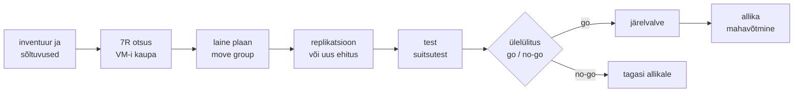

# IT-migratsioon ja pilve migratsioon

Andmekeskuse rendileping lõpeb 14 kuu pärast ja 180 VM-i peavad olema selleks ajaks mujal: osa uues Proxmoxi klastris, osa pilves, osa enam mitte kusagil. Tehniliselt on ühe VM-i kolimine lihtne. 180 VM-i puhul on raske teada, mis millest sõltub, mida võib maha võtta ja kuidas kõike sama moodi kontrollida. **Migratsioon on iga töökoormuse kohta tehtud otsus (kas viia üle muutmata, muuta, asendada või maha võtta) ja seda otsust saab skaleerida ainult siis, kui inventuur, kolimine ja kontroll on automatiseeritud.**

## Seitse R-i

Moderniseerimine (monoliidi tükeldamine, konteineritesse viimine) võib olla migratsiooni osa, aga suurtes projektides tehakse see sageli eraldi, pärast kolimist.

Strateegiate loend pärineb Gartnerilt, kes kirjeldas 2011. aastal viit varianti: rehost, refactor, revise, rebuild ja replace ([ComputerWeekly kokkuvõte](https://www.computerweekly.com/tip/Cloud-applications-Five-migration-tips-from-Gartner)). AWS laiendas loendit ja kasutab praegu seitset R-i ([AWS Prescriptive Guidance](https://docs.aws.amazon.com/prescriptive-guidance/latest/large-migration-guide/migration-strategies.html)). Varasem kuueline loend ("6R") on sama ilma relocate'ita.

| Strateegia | Mida tehakse | Näide Labori seisu põhjal |
|---|---|---|
| Retire | võetakse maha | ops01, mida keegi mitu kuud ei kasutanud |
| Retain | jääb esialgu alles | db01, kui andmete asukoha nõue keelab pilve |
| Rehost (lift-and-shift) | sama VM teise platvormi peale muutmata | app01 VM ESXi-st Proxmoxi või EC2-le |
| Relocate | sama platvormi pilveversiooni, rakendust ja OS-i muutmata | vSphere'i VM-id VMware Cloud on AWS-i |
| Replatform | väike muudatus, et kasutada sihtplatvormi teenust | MariaDB VM-ist hallatud andmebaasi (RDS) |
| Repurchase | asendatakse teise tootega, sageli SaaS-iga | oma RabbitMQ hallatud teenuse vastu |
| Refactor | arhitektuur muudetakse | app01 tükeldatakse teenusteks Kubernetesesse |

*Tabel 1. Seitse migratsioonistrateegiat.*

## Lained, move group'id ja ülelülituse aken

Migratsioon käib lainetena ja igal lainel on samad etapid. Inventuur kogub iga VM-i kohta OS-i, ressursid, omaniku, litsentsid ja võrguühendused. Sõltuvuste kaart tuleb liiklusest, mitte dokumentatsioonist: `ss -tnp` ajastatult, NetFlow, tulemüüri logid. Rakendused, mis omavahel sageli räägivad, lähevad samasse lainesse (move group), sest pool rakendust pilves ja pool andmekeskuses tähendab iga päringu juures WAN-i latentsust. Maha võtmise kandidaat on rakendus, millele pole pika aja jooksul (näiteks mitme kuu jooksul) ühtki sissetulevat ühendust tulnud.

Kolimiseks on kolm tehnilist teed. Plokitasemel replikatsioon kopeerib töötava masina ketast pidevalt sihtkohta ja ülelülitusel jääb üle viimane sünk (AWS Application Migration Service). Ketta image'i konverteerimine teeb peatatud VM-ist uue formaadi (`virt-v2v`, `qemu-img convert`, Proxmoxi ESXi impordiviisard alates versioonist 8.2). Kolmas tee on uuesti ehitamine koodist: OpenTofu loob sihtkohta VM-id, Ansible seadistab need ja andmed tulevad varukoopiast või replikatsioonist. Kolmas on aeglasem alustada, aga ainus, mis ei vii kaasa aastate jooksul kogunenud käsitsi muudatusi.

<figure markdown="span">

  <figcaption>Joonis 1. Ühe laine elutsükkel.</figcaption>
</figure>

Ülelülituse aken sõltub andmete mahust ja muutumise kiirusest. Plokitasemel replikatsiooni korral on see minutid, `pg_dump` ja taastamine suure andmebaasi puhul võib olla tunde. Enne ülelülitust lühendatakse DNS-kirjete TTL-i, et vahetus jõuaks klientideni kiiresti. Allikas jääb pärast ülelülitust kokkulepitud ajaks alles ja kirjutuskaitstuks, et tagasi minna oleks kuhu.

1. kohtumisel öeldi, et ühekordne töö vajab runbook'i, mitte koodi ([1. kohtumise loeng](../k01/loeng.md)). Migratsioonis kehtib see ühe VM-i kohta. 180 VM-i puhul on iga samm sama ja seda korratakse 180 korda: inventuuri päring, eelkontroll (vaba ruum, agent, ligipääs), replikatsiooni käivitus, ülelülituse runbook, järelkontroll. Neid automatiseeritakse nagu iga korduvat tööd. Sihtkoha võrk, tulemüürid ja õigused (landing zone) tehakse koodiga, sest neid kasutavad kõik lained. Järelkontroll on sama suitsutest, mis töötas enne kolimist; kui seda polnud, kirjutatakse see enne esimest lainet.

## virt-v2v, Proxmoxi import ja AWS-i teenused

| Tööriist | Mida teeb | Litsents / hind | Millal valida |
|---|---|---|---|
| [virt-v2v](https://libguestfs.org/virt-v2v.1.html) | VMware'i ja Hyper-V VM-id KVM-i peale, draiverid ja seadistus | GPL, tasuta | rehost KVM-põhisele platvormile |
| [Proxmoxi import](https://proxmox.com/en/about/press-releases/proxmox-virtual-environment-8-2) | ESXi ja vCenteri VM-id otse veebiliidesest | AGPLv3, osa Proxmox VE-st | VMware → Proxmox |
| `qemu-img convert` | ketta formaadi teisendus (vmdk, qcow2, raw) | GPL | üksik ketas või oma skript |
| [AWS Application Migration Service](https://aws.amazon.com/application-migration-service/) | plokitasemel replikatsioon EC2-le | AWS-i teenus, vt hinnaleht | palju VM-e AWS-i, lühike ülelülitus |
| [VM Import/Export](https://aws.amazon.com/ec2/vm-import/) | VM-i image AMI-ks | AWS-i teenus | üksikud VM-id |
| AWS DMS | andmebaasi replikatsioon ja mootori vahetus | AWS-i teenus, tasuline | replatform andmebaasi tasemel |
| OpenTofu + Ansible | sihtkoha ehitus koodist, seadistus | MPL 2.0, GPLv3 | rebuild ja landing zone |
| rsync, andmebaasi replikatsioon | andmete sünk enne ülelülitust | tasuta | failid ja andmebaasid eraldi masinast |

*Tabel 2. Migratsiooni tööriistad.*

## TSB 2018: üks nädalavahetus kõigile klientidele

TSB pank viis 20.–22. aprillil 2018 oma süsteemid ja kliendiandmed Lloyds Banking Groupi platvormilt emaettevõtte Sabadelli platvormile Proteo UK, mida käitas Sabadelli tütarettevõte SABIS. Kolimine tehti ühe nädalavahetusega kõigi klientide jaoks korraga. Pärast seda ei pääsenud suur osa klientidest oma kontodele ja tavaline teenindus taastus alles 2018. aasta detsembris. Ühendkuningriigi järelevalveasutused FCA ja PRA trahvisid panka 2023. aasta jaanuaris kokku 48,65 miljoni naelaga ([Mishcon de Reya kokkuvõte](https://www.mishcon.com/news/following-a-joint-investigation-the-pra-and-fca-have-fined-tsb-bank-48m-following-its-2018-it-meltdown)). Järelevalve leidis, et ajakava koostati tähtajast tagasi, testimise ulatus oli ebapiisav ning väljasttellimise riske (SABIS ja tema 85 alltöövõtjat) ei juhitud ega hinnatud piisavalt.

Tehnilise poole pealt on õppetunnid tuttavad: üks suur ülelülitus lainete asemel, testkeskkond, mis ei vastanud tootmise koormusele, ja go/no-go kriteeriumid, mis anti tähtajale järele. Ükski neist ei ole tööriista probleem. Automatiseerimine aitab siin seda, et sama kontroll käib igal lainel ühtemoodi ja tulemus on mõõdetud.

## Peidetud sõltuvused, pilve hind ja kaks keskkonda

Peidetud sõltuvused tulevad välja alles pärast kolimist: IP-aadress konfiguratsioonifailis, cron-töö, mis kopeerib faile teise serverisse, litsents, mis on seotud MAC-aadressi või riistvara ID-ga. `virt-v2v` ja impordiviisard muudavad võrgukaardi tüüpi ja MAC-aadressi, nii et liidese nimi võib muutuda (`ens192` asemel `ens18`) ja staatiline võrguseadistus ei hakka tööle.

Lift-and-shift on kiire, aga pilves sageli kallim kui oodatud. On-prem VM, millele anti kunagi igaks juhuks 16 GB RAM-i, maksab pilves iga tund 16 GB eest. Suurus valitakse mõõdetud kasutuse järgi, mitte allika seadistuse järgi. Andmete väljaviimine pilvest (egress) on tasuline, nii et rakendus, mis jääb on-prem andmebaasi lugema, maksab iga päringu eest.

Litsentsid (Windows Server, SQL Server, Oracle) võivad pilves või teisel hüperviisoril kehtida teistel tingimustel. Seda kontrollitakse enne lainet, mitte pärast.

Migratsiooni ajal makstakse kahe keskkonna eest. Kui allika mahavõtmine pole plaanis tähtajaga kirjas, jääb see tegemata ja vana keskkond jääb aastateks alles.

Turvamudel muutub. Andmekeskuse tulemüür ja VLAN-id ei kandu pilve automaatselt üle, security group'id ja IAM-i õigused tuleb kirjeldada uuesti. Rehost kopeerib ka OS-i turvaaugud ja käsitsi muudatused.

## Kus see kursusel tuleb

[Pilve kodutööd](../kodutood/kodutood.md) on üks migratsioon seitsmes osas, sama kood Proxmoxist AWS-i: [2. kohtumise kodutöö](../kodutood/k02-aws.md) on rehost Ansible'iga, [3. kohtumise kodutöö](../kodutood/k03-aws.md) viib image'i ECR-i, [4. kohtumise kodutöö](../kodutood/k04-aws.md) ehitab VPC ja EC2-d OpenTofuga ja [7. kohtumise kodutöö](../kodutood/k07-aws.md) käivitab samad manifestid k3s-is. Laboris [Import, drift ja keskkonnad](../k04/lab-6-import-drift.md) tood käsitsi tehtud VM-i koodi alla, mis on iga rebuild-migratsiooni esimene samm, ja laboris [Golden image Packeriga](../k04/lab-7-kuldne-mall.md) kolib Labori seis uuele mallile, esmalt ühele hostile. Elutsüklit ja mahavõtmist (ptk 5) ning OpenTofu ja Terraformi vahel kolimist (ptk 7) käsitleb [4. kohtumise loeng](../k04/loeng.md).

## Kontrolli ennast

??? question "Mis vahe on rehost'il ja replatform'il? Too mõlemast näide."
    Rehost viib VM-i teisele platvormile muutmata, näiteks app01 VM ESXi-st EC2-le. Replatform teeb väikese muudatuse, et kasutada sihtkoha teenust, näiteks MariaDB VM-ist hallatud andmebaasi. Rakenduse kood ja arhitektuur jäävad mõlemal juhul samaks.

??? question "1. kohtumisel öeldi, et ühekordne migratsioon vajab runbook'i, mitte koodi. Millal see enam ei kehti?"
    Siis, kui sama samm tuleb teha paljudele masinatele. 180 VM-i juures on inventuur, eelkontroll, replikatsiooni käivitus ja järelkontroll iga kord samad, nii et need automatiseeritakse. Runbook jääb otsustele, mis on igal lainel erinevad, näiteks go/no-go.

??? question "Pärast `virt-v2v`-ga tehtud kolimist käivitub VM, aga võrk ei tööta. Mida kontrollid kõigepealt?"
    Liidese nime ja MAC-aadressi: võrgukaardi tüüp muutus ja staatiline seadistus (netplan, `ifcfg`) viitab vanale nimele või MAC-ile. `ip link` näitab uut nime. Samal põhjusel võivad ebaõnnestuda ka MAC-iga seotud litsentsid.

??? question "Miks võib lift-and-shift'iga pilve viidud rakendus olla kallim kui andmekeskuses?"
    VM-i suurus kopeeritakse allikast, kuigi tegelik kasutus on väiksem, ja pilves makstakse iga tunni eest kogu suuruse järgi. Kui osa rakendusest jääb on-prem, maksab iga päring pilvest välja (egress). Lisaks makstakse migratsiooni ajal kahe keskkonna eest.
