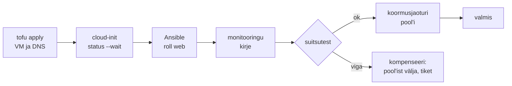

# Orkestreerimine ja automatiseerimine

Uue veebihosti jaoks on kõik sammud automatiseeritud: VM tuleb OpenTofust, seadistus Ansible'ist, monitooringu kirje API-st ja koormusjaoturi pool'i lisab skript. Ikkagi kulub tellimusele pool päeva, sest admin käivitab need õiges järjekorras, ootab vahepeal cloud-init'i ja kontrollib käsitsi, kas eelmine samm õnnestus. Kui kolmas samm ebaõnnestub, ei tea keegi, mis seisu esimesed kaks jätsid. **Automatiseerimine teeb ühe ülesande ilma inimeseta, orkestreerimine seob mitu ülesannet eri süsteemides üheks töövooks, millel on järjekord, sõltuvused, veakäsitlus ja üks tulemus.**

## Töövoo ja käituse orkestreerimine, CloudOps

Sõnal on IT-s kaks tähendust. Töövoo orkestreerimine käivitab sammude ahela ja lõpetab: AWX-i workflow, Rundeck'i job, pipeline. Käituse orkestreerimine töötab pidevalt: Kubernetes otsustab, kuhu pod läheb, ja asendab selle, kui node kaob. Esimene on ühekordne käivitus, mis lõpeb edu või veaga. Teine on kontrolltsükkel, mis ei lõpe kunagi ([7. kohtumise loeng, ptk 1](../k07/loeng.md#1-soovitud-seis-ja-control-loop)).

Pilves kasutatakse nelja lähedast terminit. Cloud automation on üks pilveülesanne koodina: öine snapshot, dev-masinate peatamine õhtul, vanade image'ite kustutamine. Cloud orchestration seob mitu pilveressurssi ja teenust ühe üksusena: VPC, alamvõrgud, security group'id, VM-id, andmebaas ja DNS õiges järjekorras, koos sellega, mis toimub osalise ebaõnnestumise korral. Cloud management on laiem juhtimine: inventuur, õigused, kulud, poliitika ja iseteeninduskataloog üle mitme pilve ja on-prem keskkonna (cloud management platform, näiteks ManageIQ). CloudOps on pilves töötavate süsteemide igapäevane käitus: monitooring, mahu planeerimine, kulu, patch'imine, varundus ja intsidendid. Viimane termin pole standarditud ja pakkujad kasutavad seda erinevalt; mõnel on see lihtsalt ITOps pilves, teisel FinOps'i ja SRE segu.

Cron, mis käivitab viis skripti järjest, annab järjekorra ilma veakäsitluse ja olekuta: kui kolmas skript ebaõnnestub, käivituvad neljas ja viies ikkagi või ei käivitu keegi ning keegi ei tea, kumb juhtus.

## Olek, andmed, kompenseerimine ja lukud

Töövoo orkestreerijal on neli osa. Graaf kirjeldab samme ja nende sõltuvusi, enamasti DAG-ina. Iga sammu olek (ootel, töös, õnnestus, ebaõnnestus) on salvestatud, nii et katkenud töövoogu saab jätkata õigest kohast. Sammude vahel liiguvad andmed: Tofu väljund saab Ansible'i inventory'ks, loodud VM-i IP läheb monitooringu kirjesse. AWX-is annab üks job teisele andmeid `set_stats`-iga, pipeline'is on selleks artefaktid ja job'i väljundid. Neljas osa on harud: mis käivitub edu, ebaõnnestumise või alati korral, kus on inimese kinnitus ja kui kaua igat sammu oodatakse.

<figure markdown="span">

  <figcaption>Joonis 1. Uue veebihosti töövoog. Igal sammul on oma automaatika, orkestreerija lisab järjekorra, ootamise ja veaharu.</figcaption>
</figure>

Hajutatud töövool pole tehingut. Kui VM ja DNS-kirje on loodud ja Ansible ebaõnnestub, jäävad need alles. Orkestreerija valikud on: jätta pooleli ja teavitada, proovida sammu uuesti või käivitada kompenseeriv tegevus, mis eelmised sammud tagasi võtab. Uuesti proovimine on ohutu ainult idempotentse sammu puhul. Playbook ja `tofu apply` on idempotentsed, aga skript, mis lisab koormusjaoturisse rea, ei pruugi olla, ja teine katse lisab teise rea.

Teine mehhanism on lukk. Kaks samaaegset töövoogu sama keskkonna peal kirjutavad sama state'i ja sama inventory't. OpenTofu S3 backend lukustab state'i, aga Ansible'i jooks ei ole millegagi lukus. Seepärast lubatakse orkestreerijas ühe keskkonna kohta üks töövoog korraga (AWX-is job template'i valik samaaegsete käivituste kohta, GitHub Actionsis `concurrency` grupp).

Töövoo käivitab inimene, ajakava, Giti sündmus või monitooringu signaal. Viimane on sündmuspõhine automaatika: [ansible-rulebook](https://docs.ansible.com/projects/rulebook/en/latest/) kuulab allikat, hindab reeglit ja käivitab playbook'i või AWX-i job template'i. Automaatse käivituse korral peavad piirid olema koodis: korduste arv, `throttle`, inimese kinnitus riskantse sammu ees.

## AWX, Rundeck, rulebook ja pilve orkestreerijad

| Tööriist | Mida teeb | Litsents / hind | Millal valida |
|---|---|---|---|
| [AWX](https://github.com/ansible/awx) | Ansible'i job'id, workflow job template'id, kinnitused, RBAC, logi | Apache 2.0 | töövoog koosneb peamiselt playbook'idest |
| [Rundeck](https://docs.rundeck.com/) (Community) | runbook'id job'idena, node'ide kaupa, ACL | Apache 2.0 | olemasolevad skriptid tuleb anda valvele turvaliselt kasutada |
| [ansible-rulebook](https://docs.ansible.com/projects/rulebook/en/latest/) | sündmus → reegel → playbook | Apache 2.0, vajab Java 17+ | häire peale käivituv parandus |
| [StackStorm](https://docs.stackstorm.com/) | sündmuspõhised töövood, palju integratsioone | Apache 2.0 | mitu süsteemi ja sündmuste allikat, mitte ainult Ansible |
| GitHub Actions, Jenkins, GitLab CI | pipeline kui töövoog | tasuta / kommerts | muudatus algab Gitist |
| [Argo Workflows](https://argo-workflows.readthedocs.io/) | DAG Kubernetese pod'idena | Apache 2.0 | töövoog töötab klastris |
| [ManageIQ](https://www.manageiq.org/docs/) | cloud management: inventuur, kataloog, kvoodid üle mitme platvormi | Apache 2.0 | iseteenindus mitmes pilves ja on-prem |
| Ansible Automation Platform, VMware Aria Automation | kommertsplatvormid samale tööle | kommerts | võrdluseks: AWX-i ja ManageIQ tugiversioonid ja lisad |

*Tabel 1. Orkestreerimise tööriistad. Apache Airflow on samuti DAG-orkestreerija, aga see on mõeldud andme-pipeline'idele, mitte taristule.*

## Facebook 2021: audititööriist, mis käsku ei peatanud

4. oktoobril 2021 oli Facebook mitu tundi täielikult maas. Meta [inseneride kokkuvõtte](https://engineering.fb.com/2021/10/05/networking-traffic/outage-details/) järgi andis insener tavalise hooldustöö ajal käsu, mis pidi hindama globaalse magistraalvõrgu mahtu. Käsk võttis maha kõik magistraalühendused. Audititööriist, mis pidi sellised käsud peatama, ei peatanud seda vea tõttu. Teise ahela käivitas automaatika, mis töötas täpselt ettenähtud viisil: DNS-serverid võtavad oma BGP-teadaanded tagasi, kui nad andmekeskustega ühendust ei saa. Nii kadusid ka DNS-serverid, kuigi need töötasid. Taastamist aeglustas see, et sisemised tööriistad sõltusid samast võrgust ja DNS-ist ning andmekeskustesse tuli minna füüsiliselt. Kui võrk oli tagasi, ei lülitatud kõike korraga sisse, vaid teenused toodi üles järk-järgult, et koormus ei tekitaks uut riket.

Orkestreerimisele tuleb siit kolm järeldust. Kaitsemehhanism on samuti tarkvara ja on sama hea kui selle enda testid. Kohalikult õige automaatne reaktsioon võib globaalselt tekitada katkestuse, kui kõik serverid reageerivad sama signaali peale korraga. Taastamise töövoog peab töötama ka siis, kui tavaline haldusvõrk ja DNS on maas.

## Kõige suurema õigusega süsteem ja liiga pikk workflow

Orkestreerija on kõige suurema õigusega süsteem majas. AWX-is on masinate SSH-võtmed, hüperviisori tokenid ja pilve volitused korraga. Selle kompromiteerimine annab ligipääsu kogu taristule ja selle rike peatab kõik töövood. Seepärast on orkestreerija ise koodis (AWX-i objektid `awx.awx` kollektsiooniga), varundatud ning sellel on eraldi õigused ja audit.

Töövoog jääb pooleli regulaarselt. Iga töövoo juures peab olema kirjas, mis seisu jätab iga sammu ebaõnnestumine ja kas töövoogu saab algusest uuesti käivitada.

Liigne orkestreerimine on samuti risk. Kolmekümne sammuga workflow, millest igaüks kutsub järgmist tingimuste järgi, on raskem lugeda kui runbook ja sageli käivitab seda ainult selle autor. Kui samme on vähe ja neid tehakse harva, piisab sageli ühest skriptist või playbook'ist, mis kutsub teisi.

Pilve enda orkestreerijad (CloudFormation, AWS Step Functions, Azure Logic Apps) seovad töövoo ühe pakkujaga. Ühes pilves töötamiseks on see mugav, aga mitme platvormi töövoog tuleb kirjutada teise tööriistaga.

## Kus see kursusel tuleb

Automatiseerimise ja orkestreerimise vahet ning Tofut ja Ansible't koos käsitleb [4. kohtumise loengu ptk 6](../k04/loeng.md#6-orkestreerimine-ansible-ja-opentofu-koos), Kubernetest käituse orkestreerijana [7. kohtumise loeng](../k07/loeng.md) ([ptk 1](../k07/loeng.md#1-soovitud-seis-ja-control-loop)) koos CloudOpsi ja hallatud klastritega ([ptk 5](../k07/loeng.md#5-klastri-elutsukkel-ja-cloudops)). Laborites ehitad Bashi orkestreerija ([Viis teenust ühe käsuga](../k01/lab-4-viis-teenust.md)), seod `up.sh`-iga Tofu ja Ansible'i ([Üks käsk](../k04/lab-4-uks-kask.md)) ja teed [GitOps Argo CD-ga](../k07/lab-7-argocd.md); sündmuspõhist käivitust proovib 2. kohtumise lisaülesanne [19. Sündmuspõhine koristus](../k02/lisa.md#19-sundmuspohine-koristus-ketas-ule-90-ja-inimese-kinnitus).

## Kontrolli ennast

??? question "Mille poolest erineb cron, mis käivitab järjest `create.sh`, `configure.sh` ja `register.sh`, orkestreeritud töövoost?"
    Cronil pole sammude olekut ega sõltuvusi: `configure.sh` käivitub ka siis, kui `create.sh` ebaõnnestus, või ei käivitu keegi ja keegi ei tea, kumb juhtus. Orkestreerija salvestab iga sammu tulemuse, annab andmed järgmisele, käivitab veaharu ja laseb katkenud töövoogu jätkata õigest kohast.

??? question "Töövoog lõi VM-i ja DNS-kirje, Ansible ebaõnnestus. Mis on kolm võimalust ja millal on uuesti proovimine ohtlik?"
    Jätta pooleli ja teavitada, proovida sammu uuesti või käivitada kompenseeriv tegevus, mis võtab VM-i ja DNS-kirje tagasi. Uuesti proovimine on ohtlik siis, kui samm pole idempotentne, näiteks skript lisab koormusjaoturisse teise rea. Playbook'i ja `tofu apply` uuesti proovimine on ohutu.

??? question "Mis vahe on cloud automation'il ja cloud orchestration'il? Too näide kummastki."
    Cloud automation on üks ülesanne koodina, näiteks dev-masinate peatamine igal õhtul. Cloud orchestration seob mitu ressurssi ühte töövoogu õiges järjekorras: VPC, security group'id, VM-id, andmebaas ja DNS koos osalise ebaõnnestumise käsitlusega. Esimene on üks samm, teine on sammude ahel koos sõltuvustega.

??? question "Miks on AWX või muu orkestreerija turvavaates tundlikum kui ükski üksik server?"
    Selles on korraga kõigi masinate SSH-võtmed, hüperviisori tokenid ja pilve volitused ning see saab käivitada muudatusi kõikjal. Ründaja, kes selle üle võtab, saab ligipääsu kogu taristule. Seepärast on selle seadistus koodis, õigused jagatud job template'ide kaupa ja iga käivitus auditilogis.
