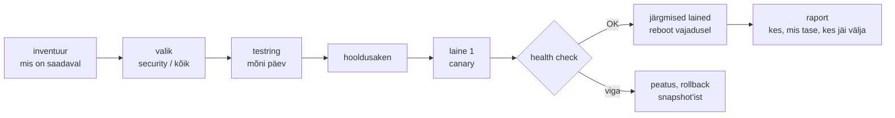

# Patch-haldus

Kolmapäeval tuleb OpenSSH turvateade, neljapäeval küsib infoturbejuht, mitu hosti on veel haavatavad, ja reedel peab tootmine olema paigatud ilma, et teenus kasutajale katkeks. Kui vastus algab sõnadega „vaatan järele“, puudub protsess. Patch-haldus on elutsükkel inventuurist raportini, mille iga samm on korratav ja mõõdetav; `dnf upgrade` on sellest üks rida.

## Piirid ja errata

- **Haavatavuste haldus** leiab ja hindab nõrkusi (skännerid, CVE-d, riskihinnang), patch-haldus on üks viis neid kõrvaldada. Mõne haavatavuse vastu on lahendus seadistuse muudatus, mitte pakett.
- **Versiooniuuendus** (Ubuntu 22.04 → 24.04 või Rocky 8 → 9) on eraldi projekt, mille kohta loe lehte [SOE ja elutsükkel](soe-ja-elutsukkel.md).
- **Rakenduse deploy** käib läbi pipeline'i. OS-i paketid ja rakendus jagavad küll hooldusakent, aga mitte tööriista.

**Errata** või **advisory** on distributsiooni teade, mis seob paketiversioonid CVE-de ja tõsidusega: Red Hati perekonnas RHSA/RLSA, Ubuntul USN. **Laine** on hostide osa, mida paigatakse korraga, enne kui järgmine algab.

## Inventuurist raportini

<figure markdown="span">



  <figcaption>Joonis 1. Paikamise tsükkel. Iga lainet lubab järgmine health check, mitte kellaaeg.</figcaption>
</figure>

**Inventuur.** Kõigepealt küsimus, mis on saadaval ja kui tõsine see on. Rockyl annab `dnf updateinfo list --security` iga hosti kohta advisory'te nimekirja, Ubuntul `apt list --upgradable` ja security pocket'i paketid. Ansible'iga kogutakse see kõigist hostidest korraga ja tulemus on tabel host × advisory × tõsidus.

**Valik.** Kas paigaldad kõik uuendused või ainult turvauuendused? Ainult turvauuendused (`dnf upgrade --security`) vähendavad muudatuse mahtu, aga jätavad vigade parandused hiljemaks ja kuhjavad neid. Paljud meeskonnad paigaldavad iga kuu kõik ja kriitilise turvateate korral ainult selle paketi kohe.

**Sama sisu igas keskkonnas.** Kui testring saab esmaspäeval paketid peegelserverist ja tootmine neljapäeval sama serveri pealt, on tootmises teised versioonid kui testitud, sest vahepeal tuli uusi. Selle vastu on hoidla snapshot. [Katello](https://theforeman.org/plugins/katello/3.18/user_guide/errata/index.html) (Foremani plugin) teeb seda **content view**'ga: hoidlate versioneeritud seis, mis liigub läbi **lifecycle environment**'ide (Library → Test → Prod). Host näeb ainult seda versiooni, mis on tema keskkonda viidud. Kriitilise errata jaoks on **incremental update**: content view'st tehakse vahepealne versioon, kuhu lisatakse ainult see errata, ilma kogu sisu edasi viimata. Katello eristab ka *applicable* errata (puudutab hosti) ja *installable* errata (puudutab hosti ning on tema content view's olemas).

**Hooldusaken ja lained.** Aken lepitakse kokku teenuse omanikuga, mitte valvuriga öösel. Lainete suurus tuleb teenuse lubatud katkestusest: kolmest rakendushostist tohib korraga maas olla üks, andmebaasi primary paigatakse pärast replikat. Ansible'is on selleks `serial`, `max_fail_percentage` ja health check iga laine järel. Enne lainet tehakse snapshot või kontrollitakse varukoopiat, sest paketiuuendust ei saa Ansible'iga tagasi võtta.

**Reboot.** Kerneli, glibc, systemd või OpenSSL-i uuendus jõuab protsessidesse alles pärast restart'i. Rockyl ütleb `dnf needs-restarting -r` [väljumiskoodiga 1](https://www.mankier.com/1/needs-restarting), et reboot on vaja, ja koodiga 0, et pole. Ubuntul tekib fail `/var/run/reboot-required`. Reboot ainult vajaduse korral hoiab katkestused väikesed. Teenuse restart ilma reboot'ita on vahepealne tee: `needs-restarting -s` või Ubuntul `needrestart` näitab teenuseid, mis kasutavad vana teeki. Kerneli livepatch (Canonical Livepatch, kpatch) lükkab reboot'i edasi, aga ei asenda seda.

**Raport.** Raport vastab kolmele küsimusele: milline host on millisel tasemel (`package_facts`, `uname -r`, viimase reboot'i aeg), kes jäi aknast välja ja miks, ning millised advisory'd on endiselt avatud. Hostid, mis ebaõnnestusid või olid `UNREACHABLE`, peavad raportis olema eraldi real, mitte kaduma koguarvu sisse.

## Iseseisev paikamine: unattended-upgrades ja dnf-automatic

Kõik hostid ei vaja keskset orkestreerimist. Ubuntul paikab [`unattended-upgrades`](https://sleeplessbeastie.eu/2024/10/08/how-to-configure-unattended-upgrades/): sagedus on failis `/etc/apt/apt.conf.d/20auto-upgrades`, poliitika failis `50unattended-upgrades`, käivitab `apt-daily-upgrade.timer` ja `Automatic-Reboot` on vaikimisi `false`. Rocky 9-l on sama töö `dnf-automatic` ja selle timerid. dnf5 versioonis on [`dnf5-automatic`](https://dnf5.readthedocs.io/en/latest/dnf5_plugins/automatic.8.html)-il valik `reboot` väärtustega `never`, `when-changed` ja `when-needed`, vaikimisi `never`, ning `upgrade_type = security` piirab uuendused turvateadetega.

```ini
# /etc/dnf/automatic.conf (dnf5)
[commands]
upgrade_type = security
apply_updates = yes
reboot = when-needed
```

Nii saavad hostid paigad kiiresti, aga reboot ja teenuse restart tulevad hosti oma ajakava järgi, ilma laine ja health check'ita. See sobib tööjaamadele ja üksikutele hostidele, mitte klastrile, kus kolm node'i võivad samal minutil taaskäivituda.

## Ansible, Katello ja iseseisvad agendid

| Tööriist | Mida teeb | Litsents/hind | Millal valida |
|---|---|---|---|
| Ansible (`dnf`, `apt`, `reboot`, `serial`) | paikamine lainetena koos health check'iga | GPLv3, tasuta | olemasolev Ansible, lained ja kontroll on vajalikud |
| [Foreman](https://docs.theforeman.org/3.18/Planning_for_Project/index-foreman-el.html) + Katello | hoidlate snapshot'id, errata, lifecycle environment'id, remote execution | Foreman GPLv3+, Katello GPLv2, tasuta | kümned kuni tuhanded RHEL-i perekonna hostid, sama sisu igas keskkonnas |
| `unattended-upgrades` | Ubuntu/Debiani iseseisev turvapaikamine | GPLv2+, tasuta | üksikud hostid ja tööjaamad, reboot'i aeg ei ole kriitiline |
| `dnf-automatic` / `dnf5-automatic` | Rocky/RHEL/Fedora iseseisev paikamine | GPLv2+, tasuta | sama, RPM-põhistel hostidel |
| [OpenSCAP](https://www.open-scap.org/) | OVAL-põhine haavatavuste ja seadistuse kontroll | LGPL, tasuta | tõend auditile, et paik on paigaldatud |
| Red Hat Satellite, Ubuntu Landscape | kommertslahendused hoidlate ja paikamise juhtimiseks | tellimus | võrdluseks: Satellite on Foremani ja Katello toote versioon |

*Tabel 1. Patch-halduse tööriistad.*

## WannaCry 2017 ja tähtajad avalikus sektoris

WannaCry lunavara levis 12. mail 2017 Windowsi SMB haavatavuse kaudu, mille paik oli välja antud märtsis. Ühendkuningriigi riigikontrolli [raporti](https://www.nao.org.uk/reports/investigation-wannacry-cyber-attack-and-the-nhs/) järgi nakatus Inglismaal vähemalt 81 NHS-i trust'i 236-st ning 603 esmatasandi ja muud NHS-i organisatsiooni. NHS England loendas 6912 tühistatud vastuvõttu. Kõigil nakatunud organisatsioonidel oli paikamata või toetuseta Windows. Raport märgib ka, et tervishoiuministeeriumil polnud ametlikku mehhanismi hinnata, kas kohalikud organisatsioonid olid soovitusi järginud. Paik oli olemas, puudu oli raport.

Avaliku sektori jaoks on tähtajad üha sagedamini kirjas. USA küberturbe agentuur nõuab föderaalasutustelt, et teadaolevalt ärakasutatud haavatavuste kataloogi kantud CVE-d (alates 2021. aastast väljastatud) [paigataks kahe nädalaga](https://cisa.gov/binding-operational-directive-22-01). Eestis seab nõuded [E-ITS](https://eits.ria.ee/), mis põhineb Saksa BSI IT-Grundschutzil, kus paikade ja muudatuste haldusel on oma moodul. Kui asutus peab E-ITS-ile vastama, küsib audit tõenäoliselt, kuidas paigad valitakse, testitakse ja paigaldatakse ning kus on tõend, et need on paigaldatud.

## Kiirus, reboot'i ajastus ja ununenud lukud

**Kiirus või stabiilsus.** Iga päev hilinenud paik on avatud aken, iga testimata paik on katkestuse risk. Lahendus on kaks protsessi: tavaline kuine tsükkel testringiga ja kiire protsess kriitilise teate jaoks väiksema testiga.

**Reboot'i ajastus.** Iseseisev paikamine koos `reboot = when-needed`-iga taaskäivitab klastri node'id omal ajal. Kui kolm node'i saavad sama paiga samal öösel, on klaster maas. Klastris käib reboot keskse orkestreerimise all, mitte hosti timeriga.

**Topeltpaikamine.** Kui hostis töötab `unattended-upgrades` ja Ansible paikab samal ajal, ootab üks apt'i lukku või ebaõnnestub. Otsusta, kumb paikab, ja lülita teine välja.

**Välja jäänud hostid.** Inventory's puuduv host ei saa kunagi paika ja raportis teda ei ole. Võrdle paigatud hostide nimekirja CMDB või hüperviisori nimekirjaga.

**Paketi tagasivõtmine.** `dnf history undo` töötab, kui vana versioon on hoidlas alles, apt'is sellist mehhanismi ei ole. Snapshot enne lainet on ainus kindel tee tagasi, aga see kaotab andmed, mis vahepeal kirjutati.

**Versiooni lukustamine.** `exclude` või `apt-mark hold` andmebaasi paketile hoiab ära ootamatu põhiversiooni vahetuse, aga ununenud lukk jätab paketi aastateks paikamata. Lukk vajab põhjendust ja kuupäeva koodis.

## Kus see kursusel tuleb

Lained, `serial` ja health check on [2. kohtumise loengu](../k02/loeng.md) ptk 4-s, patch-haldus ja compliance ptk 5-s. `patch.yml`-i, `needs-restarting -r`-i, `/var/run/reboot-required`-i ning MariaDB ja RabbitMQ lukustamist teed [2. kohtumise laboris 6: paigad ja reboot lainetena](../k02/lab-6-deploy.md#paigad-ja-reboot-lainetena). Sama ajastatud kontrolli mustrit raporti jaoks kasutab [2. kohtumise lisaülesanne 9: drift'i öine kontroll](../k02/lisa.md#9-drifti-oine-kontroll), paikamist konteinerite maailmas [3. kohtumise lisaülesanne 12: oma baas-image ja selle elutsükkel](../k03/lisa.md#12-oma-baas-image-ja-selle-elutsukkel).

## Kontrolli ennast

??? question "Testringi paikasid esmaspäeval, tootmise neljapäeval ja tootmises tuli viga, mida testis polnud. Mis on tõenäoline põhjus ja kuidas seda väldid?"
    Mõlemad keskkonnad võtsid pakette sama peegli pealt eri päevadel ja vahepeal tuli uusi versioone, nii et tootmine sai testimata paketid. Lahendus on hoidla snapshot, mis viiakse testist tootmisse: Katello content view ja lifecycle environment või muu snapshot'iga peegel.

??? question "Kõik 12 rakendushosti on seadistatud `dnf5-automatic`-iga `reboot = when-needed`. Mis võib juhtuda?"
    Kerneli uuenduse järel taaskäivituvad kõik hostid sama timeri järgi umbes samal ajal ja teenus on maas. Iseseisev reboot ei tea koormusjaoturist ega teistest hostidest. Klastris peab reboot käima keskse orkestreerimisega lainetena koos health check'iga, iseseisvalt võib hosti peal paigad ainult alla laadida või paigaldada.

??? question "Miks on raportis eraldi rida hostidele, mis olid `UNREACHABLE`?"
    Kättesaamatu host ei saanud paika, aga koguarvus („38 paigatud, 0 ebaõnnestunud“) teda ei paista. Just need hostid jäävad mitu tsüklit järjest vahele. Raport peab võrdlema paigatud hoste kogu inventory või CMDB-ga.

??? question "Millal paigaldad ainult turvauuendused ja millal kõik uuendused?"
    Kriitilise turvateate korral paigalda kohe ainult see paik, sest muudatus on väike ja testimine kiire. Tavalises kuises tsüklis paigalda kõik, sest muidu kuhjuvad vigade parandused ja järgmine täisuuendus on suur ja riskantne. Mõlemad protsessid käivad läbi samade lainete ja raporti.
