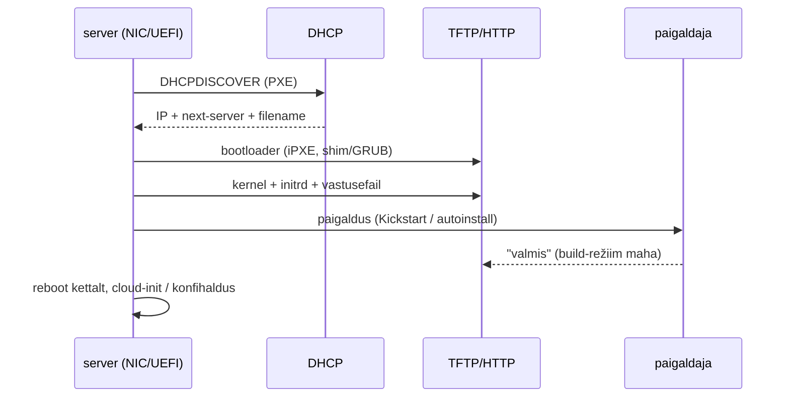

# Provisioning

Uus server jõuab andmekeskusesse kastis, uus VM tekib tiketi peale, uus kommutaator tuleb harukontorisse, kus IT-inimest pole. Igal juhul peab masin jõudma seisu, kus ta on võrgus, tal on õige nimi ja võti ning konfihaldus saab üle võtta. Kui see osa on käsitöö, algab drift juba esimesest minutist, sest iga käsitsi samm siin on erinevus, mida keegi hiljem ei leia.

## Bare metal, VM, pilv ja võrguseade

Provisioning lõpeb seisus, kus konfihaldus (Ansible, Puppet) võib rolli seadistada: riistvara või VM on eraldatud, OS paigaldatud või kloonitud, võrk, IP, hostinimi, DNS-kirje ja ligipääs olemas ning esimene käivitus tehtud. Igal tasemel on oma mehhanism:

- **Bare metal**: füüsiline server bootib võrgust (PXE või UEFI HTTP boot), paigaldaja töötab vastusefailiga (Kickstart, Ubuntu autoinstall, preseed) ja BMC (IPMI, Redfish) lülitab toite ning boot-järjekorda.
- **VM**: hüperviisor kloonib malli ja annab VM-ile identiteedi, tavaliselt cloud-init'i andmetena. OS-i paigaldust ei toimu.
- **Pilv**: platvorm käivitab image'i ja annab metaandmed ja user-data metaandmeteenusest. Ressursi loob API kutse, mida teeb OpenTofu.

**Zero-touch provisioning** (ZTP) tähendab, et seade seadistab end esimesel käivitusel ise ilma, et keegi kohapeal klaviatuuri puudutaks. Mõiste on levinud eelkõige võrguseadmete juures, aga sama mõte kehtib PXE-ga serverile ja cloud-init'iga VM-ile.

Provisioning teeb esimese seisu üks kord, rolli seadistus ja selle hoidmine on konfihalduse töö. Cloud-init'i user-data, kuhu on kirjutatud terve rakenduse paigaldus, on üks kord käivituv skript, mida keegi hiljem ei kontrolli. Golden image ehitatakse enne (Packer), provisioning kasutab seda.

## Bare metal: PXE ahel ja build-režiim

<figure markdown="span">

  <figcaption>Joonis 1. Bare metal provisioning'u ahel. Viimane teade ütleb provisioning'u serverile, et järgmine võrgust boot ei tohi paigaldust korrata.</figcaption>
</figure>

DHCP vastus sisaldab lisaks IP-le boot-serverit ja failinime. Vana BIOS-i PXE laeb TFTP-st väikese bootloader'i, UEFI oskab ka HTTP-d. Sageli laaditakse esmalt iPXE, mis räägib HTTP-d ja oskab skripte. Siin on tuntud silmus: iPXE küsib DHCP-lt uuesti ja saab jälle iPXE. Lahendus on, et DHCP server vaatab [user-class'i](https://ipxe.org/_export/raw/cfg/user-class) `iPXE` ja annab sellisele kliendile tegeliku boot-skripti, teistele iPXE binaari.

Paigaldaja saab vastusefaili, mis kirjeldab partitsioone, pakette, kasutajat ja esimese boodi skripti. Ubuntu autoinstall'i soovitatav tee on [cloud-init'i NoCloud](https://canonical-subiquity.readthedocs-hosted.com/en/latest/tutorial/providing-autoinstall.html): `autoinstall:` võti cloud-config'is. Foreman hoiab iga hosti jaoks **build-režiimi**: kuni see on sees, saab host PXE-st paigaldaja, paigalduse lõpus teatab vastusefaili skript Foremanile, et ta on valmis, ja järgmine võrgust boot läheb kohalikule kettale. Ilma selleta paigaldaks iga reboot masina uuesti.

Tühja masina kohta ei tea provisioning'u server alguses midagi. Foremani discovery plugin [bootib tundmatu masina väikese image'iga](https://docs.theforeman.org/3.18/Provisioning_Hosts/index-katello.html), mis saadab serverile MAC-aadressi ja riistvara faktid; admin või reegel määrab hostgroup'i ja paigaldus algab.

## VM: mall, cloud-init ja `instance-id`

VM-i provisioning on kiirem, sest OS on mallis juba olemas. Hüperviisor kloonib malli ja annab andmeallika. Proxmox teeb [cloud-init'i andmetest ISO](https://pve.proxmox.com/wiki/Cloud-Init_Support), mis ühendatakse CD-ROM-ina, Linuxil vaikimisi NoCloud-formaadis. NoCloud loeb [kettalt sildiga `CIDATA`](https://docs.cloud-init.io/en/25.3/reference/datasources/nocloud.html) faile `user-data`, `meta-data`, `vendor-data` ja `network-config` või võtab need HTTP-st (`ds=nocloud;s=https://…`).

`meta-data` sisaldab `instance-id`'d. Cloud-init võrdleb seda eelmise käivituse omaga: kui see on sama, on see sama masina reboot ja ühekordseid mooduleid ei korrata; kui see on uus, käivitatakse need uuesti, sh SSH host key'de genereerimine ja kasutajate loomine. Seepärast peab kloonil olema oma `instance-id` ja mallis ei tohi olla eelmise käivituse olekut (`cloud-init clean`).

## Pilv: metaandmeteenus ja IMDSv2

Pilves annab sama info metaandmeteenus link-local aadressil `169.254.169.254`. AWS-i IMDSv2 nõuab enne lugemist `PUT`-päringuga [sessioonitokenit](https://docs.aws.amazon.com/AWSEC2/latest/UserGuide/configuring-instance-metadata-service.md) ja vastuse vaikimisi hop limit on 1. Nii ei jõua päring konteinerist ega läbi valesti seadistatud proxy. User-data on sama teenuse kaudu loetav igale protsessile instantsi sees.

## Võrguseade: ZTP DHCP option 67-ga

Cisco Catalyst 9300 alustab ZTP-d, kui [startup-config'i pole](https://www.cisco.com/c/de_de/support/docs/switches/catalyst-9300-switch/220634-configure-and-troubleshoot-ztp-on-cataly.html). Seade küsib DHCP-lt aadressi, saab option 67-ga Pythoni skripti URL-i, laeb skripti alla ja käivitab selle guest shell'is. Skript kirjutab baasseadistuse (haldusliides, AAA, SSH) ja guest shell kustutatakse. Sealt edasi võtab üle Ansible või NETCONF.

## PXE-st cloud-init'ini: tööriistad

| Tööriist | Mida teeb | Litsents/hind | Millal valida |
|---|---|---|---|
| [cloud-init](https://cloudinit.readthedocs.io/en/latest/) | VM-i ja pilveinstantsi esimene käivitus: kasutaja, võti, võrk, bootstrap | Apache 2.0 / GPLv3, tasuta | iga VM ja pilveinstants |
| [OpenTofu](https://opentofu.org/docs/) | VM-ide, võrkude, DNS-i loomine API kaudu, user-data üleandmine | MPL 2.0, tasuta | taristu kirjeldus koodina, state |
| [Foreman](https://docs.theforeman.org/3.18/Planning_for_Project/index-foreman-el.html) | PXE, mallid, discovery, BMC, DHCP/DNS/TFTP Smart Proxy kaudu | GPLv3, tasuta | bare metal ja VM-id ühes kohas, RHEL-i perekond |
| [MAAS](https://maas.io/) | bare metal kui pilv: discovery, commissioning, OS-i paigaldus | AGPLv3, tasuta | suur bare metal park, Ubuntu-keskne |
| [Cobbler](https://cobbler.github.io/) | PXE ja vastusefailide haldus | GPLv2+, tasuta | väiksem bare metal keskkond ilma Foremanita |
| [Tinkerbell](https://tinkerbell.org/) | bare metal töövood konteineritena | Apache 2.0, tasuta | Kubernetese-keskne bare metal |
| Cisco ZTP / PnP | võrguseadme esimene seadistus DHCP + skriptiga | seadmes kaasas | võrguseadmed kohtades, kus IT-inimest pole |
| VMware vSphere customization spec, Red Hat Satellite | kommertsvõrdlus | litsents/tellimus | olemasolev VMware või RHEL-i tellimus |

*Tabel 1. Provisioning'u tööriistad.*

## Catalyst 9300 harukontoris

Cisco dokumenteerib ZTP-d Catalyst 9300 kommutaatoril: tehase seadetega seade bootib, logis on rida „No startup-config, starting autoinstall/pnp/ztp…“, DHCP vastus sisaldab option 67-ga HTTP URL-i, seade laeb skripti alla, käivitab selle guest shell'is ja kirjutab „Script execution success!“ ([juhend](https://www.cisco.com/c/de_de/support/docs/switches/catalyst-9300-switch/220634-configure-and-troubleshoot-ztp-on-cataly.html)). Organisatsioonis, kus on kümneid harukontoreid, tähendab see, et kohapeal ühendab keegi kaabli ja vooluvõrgu ning ülejäänu tuleb keskselt. Eeldus on, et DHCP ja HTTP server on harukontori võrgust kättesaadavad ja skript on samas Giti repos kui ülejäänud võrgukood.

## Juhuslik uuesti paigaldus ja muud rikked

**Juhuslik uuesti paigaldus.** Kui boot-järjekorras on võrk esimene ja PXE server annab paigaldaja igale küsijale, paigaldab reboot tootmisserveri uuesti ja kustutab ketta. Build-režiim, MAC-põhine piirang ja eraldi provisioning'u VLAN on kaitse.

**Saladused user-data's.** User-data on loetav metaandmeteenusest igale protsessile instantsis ja Proxmoxis igaühele, kes näeb VM-i seadistust. Pane sinna ainult avalik võti ja bootstrap-token, mis aegub; paroolid tulevad hiljem konfihaldusest või Vaultist.

**„Valmis“ enne valmisolekut.** SSH vastab enne, kui cloud-init on lõpetanud, ja automaatika, mis alustab kohe, ebaõnnestub dpkg luku peal. Ootamine on koodis (`cloud-init status --wait`), mitte `sleep 60`.

**Mall ilma koristuseta.** Kloonidel on sama machine-id, sama SSH host key ja sama `instance-id`, kui malli ei koristatud. Tagajärjed on DHCP konflikt, SSH hoiatused ja cloud-init, mis ei käivita esimese boodi samme. Vaata lehte [SOE ja elutsükkel](soe-ja-elutsukkel.md).

**Liiga palju user-data's.** Iga user-data's olev paigaldussamm sõltub paketihoidla seisust provisioning'u hetkel ja ebaõnnestumisel on masin pooleli ilma, et keegi märkaks. Hoia user-data lühike ja pane roll konfihaldusse, mis näitab `changed` ja `failed`.

**Palju eraldi tööriistu.** Bare metal provisioning vajab DHCP-d, TFTP-d/HTTP-d, DNS-i, BMC ligipääsu ja paigaldaja malle. Foreman või MAAS koondab need, aga on ise keerukas süsteem, mida tuleb uuendada ja varundada.

## Kus see kursusel tuleb

SOE, provisioning ja drift on [1. kohtumise loengu](../k01/loeng.md) ptk 2-s ning Proxmoxi Cloud-Init vahekaarti ja `cloud-init status --wait`-i kasutad [1. kohtumise laboris 1: keskkond](../k01/lab-1-keskkond.md). Provisioning taristu tasemel ja SDDC on [4. kohtumise loengu](../k04/loeng.md) ptk 1-s. VM-i, võrgu ja võtme lood koodist [4. kohtumise laboris 1: üks VM koodist](../k04/lab-1-uks-vm.md), inventory tuleb Tofu väljundist [laboris 4: üks käsk](../k04/lab-4-uks-kask.md), ja user-data malli teed [4. kohtumise lisaülesandes 8: user-data templatefile'iga](../k04/lisa.md#8-user-data-templatefileiga).

## Kontrolli ennast

??? question "Kloonitud VM bootib, aga SSH host key on sama mis mallil ja kasutaja `kasutaja` võti on vana. Mis läks valesti?"
    Kloonil on sama `instance-id` mis mallil või on mallis eelmise käivituse cloud-init'i olek alles. Cloud-init peab käivitust sama masina reboot'iks ja jätab ühekordsed moodulid vahele. Lahendus on oma `instance-id` igale kloonile ja `cloud-init clean` enne malli salvestamist.

??? question "Miks peab PXE paigaldus lõpus teatama provisioning'u serverile, et host on valmis?"
    Muidu saab host järgmisel võrgust boodil jälle paigaldaja ja kustutab ketta. Teade lülitab hosti build-režiimi välja ja server annab edaspidi kohalikult kettalt boodi juhise. Sama kaitse on eraldi provisioning'u VLAN ja MAC-põhine piirang.

??? question "Kolleeg tahab panna user-data'sse andmebaasi parooli, et rakendus saaks esimesel boodil ühenduse. Mida vastad?"
    User-data on loetav metaandmeteenusest igale protsessile instantsis ja hüperviisori seadistusest igaühele, kellel on VM-ile ligipääs, ning see ei aegu. User-data'sse sobib avalik võti ja lühiajaline bootstrap-token. Parool tuleb konfihaldusest, Vaultist või muust secrets manager'ist ja seda saab vahetada ilma VM-i uuesti loomata.

??? question "Kuidas jõuab tehase seadetega Cisco kommutaator harukontoris oma seadistuseni ilma, et keegi kohapeal käske sisestaks?"
    Kui startup-config puudub, alustab seade ZTP-d: küsib DHCP-lt aadressi, saab option 67-ga Pythoni skripti URL-i, laeb skripti alla ja käivitab selle guest shell'is. Skript kirjutab baasseadistuse ja edasise seadistuse teeb keskne automaatika. Eeldus on, et DHCP ja HTTP server on harukontorist kättesaadavad.
