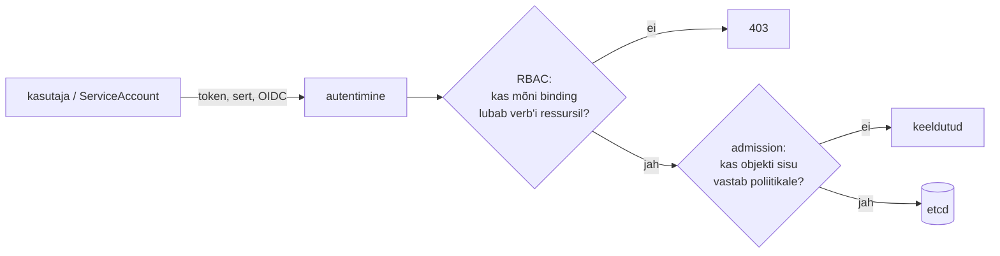

# RBAC ja ligipääsu kontroll

Audiitor küsib, kes saab tootmises paikamise playbook'i käivitada. Esimene vastus on "valvurid". Tegelik vastus on pikem: kõik, kellel on control node'is SSH ligipääs, kõik, kes saavad repo `main`-i push'ida, ja Jenkinsi administraatorid, sest Script Console annab neile kõik credential'id. Automatiseerimisplatvormis sõltuvad tegelikud õigused rollitabeli kõrval sellest, kes muudab koodi, mida roll käivitada lubab, ja millistele saladustele see kood ligi pääseb.

## RBAC, ABAC ja ülesannete lahusus

NIST-i RBAC-mudel, millest sai standard ANSI INCITS 359-2004, lisab rollide hierarhia ja ülesannete lahususe (*separation of duties*): kaks rolli, mida üks inimene korraga kanda ei tohi, näiteks muudatuse taotleja ja kinnitaja.

**ABAC** (*attribute-based access control*) teeb otsuse subjekti, objekti, tegevuse ja keskkonna atribuutide põhjal poliitika järgi ([NIST SP 800-162](https://csrc.nist.gov/pubs/sp/800/162/upd2/final)). Reegel "deploy tootmisse on lubatud, kui kasutaja on rakenduse omaniku grupis, image on allkirjastatud ja kell on hooldusaknas" on ABAC. Rolliga sellist reeglit kirjeldada ei saa, sest RBAC-i roll ei tea midagi image'i allkirjast ega kellaajast. ABAC-i hind on see, et keelduva otsuse põhjust on raskem leida. Vastus "ei" võib tulla viiest atribuudist, millest üks tuli IdP-st valel kujul.

Vähim õigus ([NIST SP 800-53](https://csrc.nist.gov/pubs/sp/800/53/r5/upd1/final) kontroll AC-6) on põhimõte, RBAC ja ABAC on mehhanismid selle tegemiseks.

Hosti sees kehtivad DAC ja SELinux. Kui automatiseerimisplatvorm annab playbook'ile `become: true`, ei piira platvormi RBAC enam seda, mida playbook hostis teeb.

## PEP ja PDP: kus otsus tehakse

NIST-i ABAC juhendi terminites on igal süsteemil kaks osa. *Policy Enforcement Point* (PEP) võtab päringu kinni. Kubernetesis on selleks API server, AWX-is REST API. *Policy Decision Point* (PDP) otsustab poliitika järgi. Kubernetesis on PDP-sid mitu järjest: RBAC autoriseerija ja admission'i kontrollerid.

<figure markdown="span">

  <figcaption>Joonis 1. Kubernetese API päring. RBAC otsustab tegevuse üle, admission'i poliitika objekti sisu üle. Teine kontroll on oma olemuselt ABAC.</figcaption>
</figure>

## Kubernetese RBAC: ainult lisavad õigused

`Role` (namespace'is) ja `ClusterRole` (klastris) on reeglite loendid: `apiGroups`, `resources`, `verbs`. `RoleBinding` ja `ClusterRoleBinding` seovad rolli subjektiga (`User`, `Group`, `ServiceAccount`). `ClusterRole` koos `RoleBinding`-uga kehtib ainult selles namespace'is, nii saab üht rolli kasutada paljudes namespace'ides. Õigused on ainult lisavad: keelureeglit pole ja kaks bindingut annavad õiguste ühendi. Vaikimisi on kasutajatele mõeldud rollid `cluster-admin`, `admin`, `edit` ja `view`. Rolli loomise korral kehtib eskalatsiooni kaitse: rolli saab luua või muuta ainult siis, kui sul endal on kõik selle õigused või verb `escalate`. Bindingu tegemiseks on vaja samu õigusi või verb'i `bind`.

## Kaudne eskalatsioon: pod'i loomine annab Secret'id

Kaudsed eskalatsioonid on [heade tavade lehel](https://kubernetes.io/docs/concepts/security/rbac-good-practices) loetletud ja just need jäävad auditis kahe silma vahele. Kes saab namespace'is pod'e luua, saab neisse mount'ida namespace'i iga Secret'i ja käivitada pod'i selle namespace'i iga ServiceAccount'i nimel. Pod'i loomise õigus on seega namespace'i Secret'ite lugemise õigus. `impersonate` laseb tegutseda teise kasutaja nimel. Grupp `system:masters` läheb RBAC-ist mööda ja selle liikmelisust ei saa RBAC-iga tagasi võtta, nii et sellise kliendisert'iga kubeconfig on kehtiv kuni serdi aegumiseni. `kubectl auth can-i --list --as=system:serviceaccount:ops:agent` näitab, mida identiteet tegelikult tohib.

## AWX, Semaphore ja Jenkins: kus rolli piir lekib

**AWX.** [AWX-i rollid](https://ansible.readthedocs.io/projects/awx/en/latest/userguide/security.html) antakse objektile: job template'il on Admin, Execute ja Read, inventory'l lisaks Ad Hoc ja Update, credential'il Use ja Owner. Õigused liituvad ning organisatsiooni ja meeskonna roll pärandub objektidele. Use võimaldab credential'it template'is kasutada ilma saladust nägemata. See piir kehtib ainult kasutajaliideses, sest playbook saab saladuse käivitusel kätte. Kes muudab template'i projekti repos olevat playbook'i, võib lisada ülesande, mis saadab parooli välja. Execute-õigus tootmise inventory peal on seega sama lai kui õigus muuta selle projekti `main`-i.

**Semaphore** kasutab projekti rolle [Owner, Manager, Task Runner ja Guest](https://semaphoreui.com/docs/user-guide/team). Task Runner saab käivitada projekti iga template'i ja näeb ülejäänut ainult lugemiseks. Template'i kaupa piiratud rollid on ainult Enterprise versioonis (alates 2.17). Kui valvur tohib käivitada ainult paikamist, mitte andmebaasi taastamist, on vaja kahte projekti.

**Jenkins** eraldab *security realm*'i (kust kasutaja tuleb) ja *authorization strategy* (mida ta tohib). [Role-based Authorization Strategy](https://plugins.jenkins.io/role-strategy/) annab globaalsed rollid, item-rollid regulaaravaldise järgi ja agendi rollid. *Overall/Administer* tähendab Script Console'i ja sellega kõigi credential'ide dekrüpteerimist, seepärast on see sisuliselt kõik õigused.

## Identiteedi ja poliitika tööriistad

| Tööriist | Mida teeb | Litsents/hind | Millal valida |
|---|---|---|---|
| [Keycloak](https://www.keycloak.org/) | IdP: OIDC/SAML, grupid ja rollid tokenis | Apache 2.0 | AWX, Jenkins, Argo CD ja kubectl ühe sisselogimise ja grupiga |
| [FreeIPA](https://www.freeipa.org/) | LDAP + Kerberos, HBAC ja sudo reeglid keskselt | GPLv3 | Linuxi hostide ligipääs ja sudo õigused rollipõhiselt |
| [AWX](https://github.com/ansible/awx) | Job template'i, inventory ja credential'i rollid | Apache 2.0; uued väljalasked on 2024. aasta juulist peatatud | Mitu meeskonda, auditilogi, credential'i Use ilma nägemiseta |
| [Semaphore UI](https://semaphoreui.com/) | Projekti rollid Ansible'i/OpenTofu template'itele | MIT (Community) | Väike meeskond, lihtsam paigaldus kui AWX |
| Kubernetes RBAC | Role/ClusterRole ja bindingud | osa Kubernetesest | Alati, kui klastrit kasutab rohkem kui üks identiteet |
| [Kyverno](https://kyverno.io/), [OPA Gatekeeper](https://open-policy-agent.github.io/gatekeeper/) | Admission'i poliitikad objekti sisu järgi | Apache 2.0 | Atribuudipõhised reeglid: allkirjastatud image, keelatud `hostPath` |
| [OpenFGA](https://openfga.dev/) | Seostepõhine autoriseerimine (ReBAC) rakendustele | Apache 2.0 | Oma tööriista õigused objektide omandisuhete järgi |
| [rbac-tool](https://github.com/alcideio/rbac-tool), [kubectl-who-can](https://github.com/aquasecurity/kubectl-who-can) | Kes saab mida teha: päring vastupidises suunas | Apache 2.0 | RBAC-i audit, näiteks "kes saab Secret'eid lugeda" |

Kommertsvõrdluseks kontrollivad PAM-süsteemid (CyberArk, Delinea) privilegeeritud sessiooni: ajutine parool, salvestatud sessioon ja kinnitus enne ligipääsu.

## Capital One 2019: WAF-i roll luges kõiki bucket'eid

2019. aastal sai ründaja Capital One'i AWS-i keskkonnast kätte üle 100 miljoni krediiditaotluse andmed. Valesti seadistatud ModSecurity WAF-i sai SSRF-iga panna küsima metaandmeteenuselt WAF-i rolli ajutisi võtmeid. Sellel rollil oli õigus loetleda kõigi S3 bucket'ite faile ja lugeda nende sisu ([KrebsOnSecurity](https://krebsonsecurity.com/2019/08/what-we-can-learn-from-the-capital-one-hack/)). WAF-i töö jaoks polnud ühtki neist õigustest vaja. SSRF võimaldas sissetungi, liiga laiad õigused määrasid kahju suuruse.

Automaatika identiteedid on sama tüüpi. Pipeline'i token, AWX-i credential, Argo CD ServiceAccount ja Kubernetese operaator töötavad ööpäev läbi ja nende õigused kasvavad, sest "ebaõnnestus 403-ga, andsin juurde". Eesti avalikus sektoris nõuab E-ITS identiteetide ja õiguste haldust. BSI IT-Grundschutzis, millel E-ITS põhineb, on see moodul ORP.4 *Identitäts- und Berechtigungsmanagement*. Kehtivad meetmed on [E-ITS-i portaalis](https://eits.ria.ee/).

## Õiguste kuhjumine, jagatud kontod ja break-glass

- **Õiguste kuhjumine.** Inimene vahetab meeskonda ja vanad grupid jäävad alles. Kui grupid tulevad IdP-st, muudab üks lahkumise protsess kõik süsteemid korraga. Kohalikud kasutajad igas tööriistas jäävad mõne süsteemi vahele.
- **Rollide paljunemine.** Iga erijuhu jaoks tehakse uus roll ja kahe aasta pärast on neid 300. ABAC või mustripõhised rollid (Jenkinsi regulaaravaldis, Kubernetese aggregated ClusterRole) hoiavad arvu väiksena, aga neid on raskem lugeda.
- **Ülesannete lahusus väikeses meeskonnas.** Kolmeliikmelises meeskonnas ei saa taotleja ja kinnitaja alati eri inimesed olla. Siis on lahendus tehniline kontroll, et käivitaja ei saa ise kinnitada, ja tagantjärele ülevaatus, mitte reegel, millest kõik mööda lähevad.
- **Break-glass konto.** IdP rike ei tohi lukustada välja klastrit ega AWX-i. Hädakonto on olemas, selle mandaat on seifis, kasutamine käivitab alerti ja pärast kasutamist parool vahetatakse.
- **Teenusekonto jagamine.** Üks `automation` konto kõigil hostidel ja seadmetel tähendab, et logist ei selgu, milline pipeline mida tegi. Iga töö jaoks eraldi identiteet maksab haldusega, aga annab auditi.
- **Kood on õigus.** Kes saab muuta playbook'i, Jenkinsfile'i või Helm chart'i, muudab seda, mida kõrgema õigusega identiteet käivitab. Seepärast on haru kaitse ja CODEOWNERS osa ligipääsu kontrollist.

## Kontrolli ennast

??? question "Arendajal on namespace'is `prod` õigus luua Deployment'e, aga mitte lugeda Secret'eid. Kas ta saab andmebaasi parooli kätte?"
    Saab. Ta võib luua pod'i, mis mount'ib Secret'i volume'ina või keskkonnamuutujana ja väljastab selle logisse. Pod'i loomise õigus annab kaudselt kõik selle namespace'i Secret'id ja ServiceAccount'id. Piiramiseks on vaja eraldi namespace'e või admission'i poliitikat, mis lubab ainult kinnitatud image'eid ja ServiceAccount'e.

??? question "AWX-is on valvuril credential'i Use ja template'i Execute õigus. Miks ei piisa sellest, et valvur parooli ei näe?"
    Use peidab saladuse ainult AWX-i liideses ja API-s. Playbook saab saladuse käivitusel kätte ja kes muudab projekti repot, võib panna playbook'i seda välja saatma. Tegelik piir on ka repo haru kaitse ja PR-i ülevaatus.

??? question "Millal on ABAC RBAC-ist parem ja mis on selle hind?"
    Siis, kui otsus sõltub millestki, mis ei ole kasutaja roll: objekti omadusest (image'i allkiri, silt), keskkonnast (kellaaeg, võrk) või seosest (omanik). Hind on poliitika keerukus ja keelduva otsuse raske diagnoos. Tavaliselt jääb RBAC jämedaks piiriks ja ABAC tuleb peale kitsamate reeglitena, näiteks Kubernetese admission'is.

??? question "Kolleeg lahkus ja tema kasutaja kustutati IdP-st. Kas tema kubeconfig'i kliendisert lakkab töötamast?"
    Ei lakka. Kubernetes ei kontrolli kliendisertifikaatide tühistamist, nii et sert kehtib kuni aegumiseni. Kui sert on grupis `system:masters`, ei aita ka RBAC-i muutmine. Inimestele antakse ligipääs OIDC tokeniga, mille kehtivus on lühike, ja kliendiserte kasutatakse ainult hädakontona.
