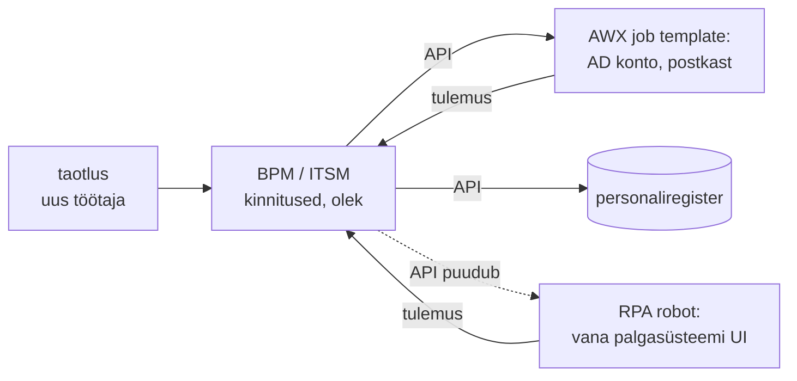

# RPA, äriprotsessid ja IT-automatiseerimine

Finantsosakond ostis RPA litsentsi ja robot sisestab arveid ERP-süsteemi. Nüüd küsitakse, kas sama robot võiks luua ka uued kasutajad AD-s ja käivitada VM-id hüperviisori veebiliidesest. Demo töötab ja projekt tundub odav. RPA automatiseerib inimese klikke graafilises liideses ja sobib sinna, kus API-t pole. Taristul on API, SSH või NETCONF ning seal annab IT-automatiseerimine soovitud seisu, dry-run'i, idempotentsuse ja oma identiteediga auditijälje, mida robot ei anna.

## RPA, BPA ja BPM: kes mida automatiseerib

Need mõisted kattuvad osaliselt ja segaduse põhjus on tavaliselt see, et neid müüakse samadele ostjatele.

**RPA** (robotic process automation) on tarkvararobot, mis kasutab rakendust nagu inimene: avab akna, leiab välja selektori (UI-elemendi, XPath'i, ekraanipildi) järgi, sisestab väärtuse ja vajutab nuppu. Robot töötab kasutajakontoga kas inimese kõrval (*attended*) või iseseisvalt eraldi masinas (*unattended*). Integratsiooni sihtsüsteemiga ei ole vaja, sellepärast on RPA kiire alustada.

**Äriprotsesside automatiseerimine** (business process automation, BPA) automatiseerib protsessi samme integratsioonide kaudu: API, sõnumijärjekord, andmebaas. Näiteks ostutellimus liigub ERP-st laosüsteemi ilma inimeseta.

**Äriprotsesside haldus** (business process management, BPM) on distsipliin, kus protsess modelleeritakse (sageli BPMN 2.0 standardis), seda mõõdetakse ja parandatakse. Workflow-mootor täidab mudelit: automaatsed sammud kutsuvad teenuseid, inimese sammud lähevad tööjärjekorda, taimerid ja eskalatsioonid on mudelis kirjas.

IT-automatiseerimise sihtmärk on masin või teenus, äritehing jääb BPA ja BPM-i pärusmaaks.

Robot taristu juures:

- robot ei tea soovitud seisu, vaid kordab klikkide järjekorda, ja teine käivitus teeb sama klikkide rea uuesti;
- dry-run'i ja diff'i pole, nii et kontrolli enne muudatust ei saa teha;
- liides muutub uuendusega ja selektor ei leia nuppu, aga robot võib leida vale nupu ja jätkata;
- robot logib sisse inimese või jagatud kontoga, nii et sihtsüsteemi audit näitab kasutajat, mitte automaatikat;
- skaleerimine käib graafiliste sessioonide kaupa ja üks robot teeb ühe asja korraga.

RPA koht on vana rakendus, millel pole API-t ega andmebaasi ligipääsu, ja sealgi ajutise lahendusena, millel on omanik ja kuupäev, mil see asendatakse integratsiooniga.

## Robot, protsessimootor ja piir ticket'i juures

**RPA robot** koosneb kolmest osast. Arenduskeskkonnas salvestatakse või kirjutatakse samm-sammult töövoog. Orkestraator jaotab töid robotitele, hoiab mandaate ja ajakava. Robot ise töötab masinas, kus on sihtrakendus ja graafiline sessioon. Avatud lähtekoodiga variandis on [Robot Framework](https://robotframework.org/) võtmesõnade mootor ja [RPA Framework](https://robocorp.com/docs-robot-framework/automation-libraries/rpa-framework-overview) annab sellele teegid veebi, Exceli, PDF-ide ja Windowsi töölaua jaoks. Selektor on robotile sama mis regex logiparserile: töötab, kuni sisend ei muutu.

**BPM-mootor** salvestab protsessi eksemplari oleku andmebaasi. Iga samm on tehing: kui teenuse kutse ebaõnnestub, jääb eksemplar ootele ja proovib uuesti või läheb inimese järjekorda. Erinevalt RPA-st on protsessi olek nähtav (mitu tellimust on mis sammus) ja mudel on versioonitud. Uus mudeli versioon ei katkesta pooleli olevaid eksemplare.

**Piir IT-automatiseerimisega** on tavaliselt ticket'i juures. BPM- või ITSM-protsess otsustab, kas uus kasutaja või server tuleb teha, ja kogub kinnitused. Seejärel kutsub see API kaudu IT-automaatika (AWX-i job template, pipeline), mis teeb tehnilise töö ja tagastab tulemuse. Protsessi omanik on äri, tegevuse omanik on infra.

<figure markdown="span">

  <figcaption>Joonis 1. Protsess juhib, IT-automaatika teeb tehnilise töö. RPA katab ainult selle sammu, millel API-t pole.</figcaption>
</figure>

## RPA- ja protsessimootorid

| Tööriist | Mida teeb | Litsents/hind | Millal valida |
|---|---|---|---|
| [Robot Framework](https://robotframework.org/) + [RPA Framework](https://robocorp.com/docs-robot-framework/automation-libraries/rpa-framework-overview) | võtmesõnapõhine robot, veebi, Exceli ja töölaua teegid | Apache 2.0 | API-ta rakendus, testiautomaatika ja RPA sama tööriistaga |
| [Flowable](https://github.com/flowable/flowable-engine) | BPMN-, CMMN- ja DMN-mootor Java teegina või serverina | Apache 2.0 | protsessimootor oma rakenduse sees |
| Camunda 7 | BPMN-mootor | Community Edition'i viimane väljalase 7.24 oli 14.10.2025, edasi Enterprise'i tugi kuni 2030. aasta aprillini ([Camunda foorum](https://forum.camunda.io/t/important-update-camunda-7-community-edition-end-of-life-announced/50921)) | olemasolevate paigalduste hooldus, mitte uus projekt |
| [n8n](https://n8n.io/) | integratsioonide töövood, webhook'id, sajad konnektorid | Sustainable Use License: kood on avatud, aga [OSI mõttes pole see avatud lähtekood](https://docs.n8n.io/n8n-community-license/community-license.md); ettevõtte sisekasutus on lubatud | kiire integratsioon SaaS-teenuste vahel |
| [Node-RED](https://nodered.org/) | voopõhine integratsioon, MQTT, HTTP | Apache 2.0 | sündmuste ja seadmete integratsioon, väike töövoog |
| UiPath, Microsoft Power Automate | kommerts-RPA ja töövood koos orkestraatoriga | tasuline, roboti või kasutaja kaupa | võrdluseks: organisatsioonis juba litsentsitud |

## Peretoetus ilma taotluseta ja Kaseya 2021

Alates 2019. aasta oktoobrist ei pea Eestis vanemad peretoetust taotlema. Kui lapse sünd on rahvastikuregistris registreeritud ja lapsele on nimi antud, saadab Sotsiaalkindlustusamet vanemale pakkumise ja vanem ainult kinnitab selle ([ERR](https://news.err.ee/991789/parents-no-longer-have-to-apply-for-family-benefits)). Ameti juhi sõnastuses on põhimõte see, et kui riigil on vajalik teave olemas, ei küsita seda inimeselt uuesti.

See on äriprotsessi automatiseerimine sündmuse peale (sünni registreerimine käivitab protsessi) ja integratsiooniga registrite vahel. Ükski robot ei kopeeri ühe ameti ekraanilt andmeid teise ameti vormi. Riigi infosüsteemid vahetavad andmeid [X-tee](https://x-tee.ee/) kaudu ja just see teeb niisuguse protsessi võimalikuks. Infra jaoks on muster sama mis sündmuspõhises automaatikas: sündmus käivitab ette kinnitatud protsessi, inimene kinnitab ainult otsuse ja iga samm jätab jälje.

**Hallatud IT-teenused** (managed services) toovad sama küsimuse lepingu tasemele. Teenusepakkuja (MSP) haldab sinu servereid oma automaatikaplatvormiga, mida nimetatakse RMM-iks (remote monitoring and management). Selleks on tal oma agent igas hostis ja administraatori õigused. 2. juulil 2021 kasutas REvili rühmitus ära Kaseya VSA kohapealse versiooni haavatavust. Alla 60 Kaseya kliendi VSA serveri kaudu jõudis lunavara kuni 1500 nende kliendi ettevõtteni, sealhulgas Rootsi supermarketiketti ([The Record](https://therecord.media/kaseya-more-than-1500-downstream-businesses-impacted-by-ransomware-attack)). Teenusepakkuja automaatikaplatvorm on sinu tarneahel. Lepingus peab olema kirjas, millised tegevused on lubatud, kelle identiteediga need käivad, kus on auditilogi, kes omab playbook'e ja kuidas lepingu lõpus ligipääs ja kood tagasi tulevad.

## Vaikne rike, robotikonto ja MSP mõjuala

- **RPA vaikne rike.** Uuendus muudab välja järjekorda ja robot sisestab summa vale lahtrisse. Veateadet ei tule, sest kõik klikid õnnestusid. Robotil peab olema järelkontroll andmete tasemel, mitte ainult "töövoog lõppes".
- **Mandaadid.** Robotikonto, millel on inimese õigused mitmes süsteemis ja parool orkestraatoris, on ründaja jaoks väärtuslik. Robotil on oma konto, kitsad õigused ja sama paroolipoliitika nagu teenusekontodel.
- **RPA kui tehniline võlg.** Iga robot lükkab edasi integratsiooni, mida sihtsüsteem vajab. Kui roboteid on 200, on hoolduskulu suurem kui API ehitamine oleks olnud.
- **Sõltuvus BPM-mootorist.** Protsessimudel on standardne (BPMN), aga skriptid, konnektorid ja kasutajaliides on mootori omad. Camunda 7 CE lõpp näitab, et litsentsimudel võib muutuda.
- **"Low-code" ilma muudatuste halduseta.** Töövoog, mida saab veebiliideses muuta, muutub ilma review'ta. Töövood ekspordi Giti ja muuda neid sama PR-protsessiga nagu playbook'e.
- **MSP mõjuala.** Üks RMM-platvorm on administraator sadades ettevõtetes. Nõua eraldi kontot iga kliendi jaoks, MFA-d, logide edastamist sinu SIEM-i ja võimalust ligipääs ise sulgeda.

## Kus see kursusel tuleb

[6. kohtumise loengu osa 7](../k06/loeng.md#7-jenkins-voi-github-actions) käsitleb RPA-d kui kolmandat valikut Jenkinsi ja GitHub Actionsi kõrval ja põhjendab, miks see on infra jaoks vale tööriist. [Osas 6](../k06/loeng.md#6-juhtimine-kes-kinnitab-ja-kus-on-logi) avab ja sulgeb pipeline ise ITSM-i change ticket'i; seal kohtuvad äriprotsess ja IT-automaatika. Nelja silma kontrolli ja muudatuse kirjet teed [6. kohtumise lisaülesandes 16](../k06/lisa.md#16-neli-silma-ja-muudatuse-kirje). CMDB kui inventory allikas ja platvormi RBAC, sama küsimus teenusepakkuja ligipääsu kohta, on [2. kohtumise loengu osas 7](../k02/loeng.md#7-kes-kaivitab-platvorm-rbac-cmdb-ja-sundmused).

## Kontrolli ennast

??? question "Hüperviisori veebiliidesel on REST API, aga meeskond tahab VM-ide loomiseks RPA robotit, sest see on kiirem teha. Mida vastad?"
    API olemasolul on RPA vale tööriist. Robot ei tea soovitud seisu, teine käivitus loob teise VM-i, dry-run'i pole ja liidese uuendus lõhub töö vaikselt. OpenTofu provider või Ansible'i moodul kasutab API-t ning annab plan'i, idempotentsuse, state'i ja oma identiteediga auditi.

??? question "Mis vahe on BPM-il ja IT-automatiseerimisel uue töötaja konto loomisel?"
    BPM juhib protsessi: kes taotleb, kes kinnitab, mis järjekorras sammud käivad ja kus on iga taotluse olek. IT-automatiseerimine teeb tehnilise sammu, näiteks AD konto, grupid ja postkasti, idempotentselt ning tagastab tulemuse. Protsess kutsub automaatikat API kaudu ja kumbki ei tee teise tööd.

??? question "Millal on RPA mõistlik valik ja mis peab sel juhul paigas olema?"
    Kui sihtrakendusel pole API-t, andmebaasi ligipääsu ega ekspordi ja integratsiooni ei saa lähiajal ehitada. Robotil peab olema omanik, oma kitsaste õigustega konto, andmete järelkontroll pärast sisestust ja kuupäev, mil see asendatakse integratsiooniga.

??? question "Teenusepakkuja haldab teie 80 serverit oma RMM-platvormiga. Mida Kaseya juhtum lepingu jaoks õpetab?"
    Teenusepakkuja platvorm on sinu tarneahel ja selle kompromiteerimine annab administraatori õigused sinu hostides. Lepingus peavad olema eraldi kontod, MFA, logide edastamine sinu SIEM-i, lubatud tegevuste nimekiri, võimalus ligipääs ise sulgeda ning playbook'ide ja ligipääsu üleandmine lepingu lõpus.
