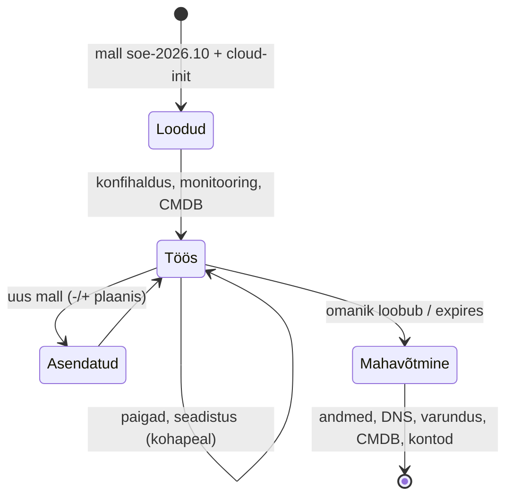

# Standard Operating Environment ja IT-süsteemi elutsükkel

Pool'is on 140 VM-i ja neist kuus eri Ubuntu ja Rocky versiooni, kolm eri hardening'u taset ja üksteist masinat, mille omanikku keegi ei tea. Iga skript kontrollib OS-i versiooni, iga paikamise tsükkel leiab mõne masina, millele paika ei ole, ja audit küsib, millal kõige vanem server maha võetakse. SOE määrab, millest iga süsteem algab, ja elutsükli haldus määrab, kuidas see muutub ja millal see lõpeb.

## SOE, selle artefaktid ja elutsükli kaks taset

**Standard Operating Environment** (SOE) on organisatsiooni kokkulepitud ja versioonitud baas, millest iga server algab: OS-i perekond ja versioon, partitsioonid, paketihoidlad, aja- ja nimeteenus, sshd ja sudo reeglid, logi- ja monitooringuagent, hardening'u profiil. Red Hat defineerib seda kui [operatsioonisüsteemi ja tarkvara komplekti, mille IT-osakond määrab standardseks build'iks](https://www.redhat.com/en/topics/management/what-is-an-soe). SOE-l on versioon, näiteks `soe-2026.10`, ja muudatuste ajalugu.

SOE on kirjeldus, millest tehakse mitu artefakti: VM-i golden image, konteineri baas-image, bare metal vastusefail ja konfihalduse baasroll. Kõik neli peavad andma sama tulemuse. Rakenduse roll lisab baasile oma seadistuse; SOE ütleb ainult, mis on kõigil ühine.

**IT-süsteemi elutsükli haldus** tähendab, et igal süsteemil on kirjeldatud tee loomisest muutmise kaudu mahavõtmiseni, igal etapil on omanik ja jälg. Elutsükkel on kahel tasemel: üksiku masina oma (loodud mallist, paigatud, asendatud, kustutatud) ja platvormi oma (OS-i versioon ilmub, on toetatud, toetus lõpeb). CMDB on arvestus, elutsükli haldus on töökord, mis seda arvestust kasutab ja uuendab.

## SOE kui kood: Packer, test ja koristus

SOE-d hoitakse Gitis ühe repo või kataloogina, millest ehitatakse kõik artefaktid:

- **Image'i ehitus**: [Packer](https://developer.hashicorp.com/packer/docs) kloonib distributsiooni cloud image'i, käivitab ajutise VM-i, käivitab sellel konfihalduse baasrolli, koristab masina identiteedi ja salvestab tulemuse mallina. Sama roll käib hiljem töötavatel masinatel, nii et mall ja konfihaldus ei lähe lahku.
- **Testimine**: igast uuest image'ist käivitatakse test-VM ja kontrollitakse, et sshd vastab, agent raporteerib ja OpenSCAP-i profiil annab oodatud tulemuse.
- **Versioon ja kuupäev**: image'i nimi sisaldab SOE versiooni ja ehituse kuupäeva. OpenTofu valib malli tag'i järgi data source'iga, mitte ID-ga.

Koristus enne malli salvestamist on kohustuslik. [systemd soovitab](https://systemd.io/BUILDING_IMAGES) eemaldada `/etc/machine-id` või kirjutada sinna `uninitialized`, et ID genereeritaks esimesel boodil, ja kustutada `/var/lib/systemd/random-seed`, sest muidu alustavad kõik kloonid sama juhuslike arvude seemnega. Lisaks eemaldatakse SSH host key'd (cloud-init teeb uued), cloud-init'i olek (`cloud-init clean`), logid ja ajalugu. Seda teeb `virt-sysprep` või Packeri viimane samm.

## Masina elutsükkel: loomine, muutmine, mahavõtmine

<figure markdown="span">

  <figcaption>Joonis 1. Masina elutsükkel. Muutmisel on kaks teed: paikamine kohapeal või asendus uuest mallist.</figcaption>
</figure>

**Loomine.** Masin tekib ainult koodist: OpenTofu plokk, mis viitab SOE mallile, ja tag'id `owner`, `service`, `expires`. Tag'id on andmed, mida ajastatud kontroll hiljem loeb.

**Muutmine.** Kaks teed, mida enamik meeskondi kasutab koos. Paikamine kohapeal (mutable) on kiire ja säilitab masina identiteedi, aga masinad lähevad aja jooksul lahku, sest igaüks on läbinud eri järjestuse muudatusi. Asendus uuest mallist (immutable) annab kõigile sama seisu ja lihtsa rollback'i (eelmine mall), aga eeldab, et andmed on masinast väljas ja asendus ei katkesta teenust.

**Mahavõtmine.** OpenTofu kustutab ainult selle, mis on tema state'is. Masina ümber on rohkem: DNS-kirjed, monitooringu kirje, varundustöö, FreeIPA või AD arvutikonto, sertifikaadid, tulemüürireeglid, CMDB rida ja andmed, millel on oma säilitusnõue. Mahavõtmine on seepärast töövoog, mille iga samm on koodis või kontrollnimekirjas, ja andmehostil on kustutamise kaitse (`prevent_destroy`, Proxmoxi `protection`).

## Platvormi elutsükkel: kolm kuupäeva igale baasile

SOE versioonid järgivad OS-i toetusaega. Ubuntu LTS saab [5 aastat tavalist turvatuge, ESM-iga 10 ja Legacy lisaga 15 aastat](https://ubuntu.com/about/release-cycle). Vahepealsed versioonid saavad 9 kuud uuendusi ja SOE-sse need ei sobi. SOE plaanis on iga toetatud baasi kohta kolm kuupäeva: millal see muutub vaikimisi valikuks, millal uusi masinaid sellest enam ei looda ja millal viimane masin peab olema maas. Kaks kõrvuti toetatud baasi on tavaline, kolm on juba kallis.

## Image'i ehitus, hardening ja CMDB: tööriistad

| Tööriist | Mida teeb | Litsents/hind | Millal valida |
|---|---|---|---|
| [Packer](https://developer.hashicorp.com/packer/docs) | golden image'i ehitus Proxmoxile, VMware'ile, pilve | BSL 1.1, tasuta oma taristu jaoks | mitu platvormi, sama SOE kõigile |
| [virt-sysprep](https://libguestfs.org/virt-sysprep.1.html) (libguestfs) | image'i koristus: machine-id, võtmed, logid | GPLv2+, tasuta | olemasoleva malli koristus ilma Packerita |
| [diskimage-builder](https://docs.openstack.org/diskimage-builder/latest/) | image'id elementidest (OpenStack) | Apache 2.0, tasuta | OpenStacki keskkond, avatud lähtekoodiga Packeri asendus |
| Ansible baasroll | sama SOE seadistus image'i ehitusel ja töötaval masinal | GPLv3, tasuta | alati: üks kood mallile ja hooldusele |
| [OpenSCAP](https://www.open-scap.org/) / [ComplianceAsCode](https://github.com/ComplianceAsCode/content) | SOE hardening'u profiil ja selle kontroll | LGPL / BSD, tasuta | CIS või STIG on nõue |
| Foreman + Katello | hostid, content view'd, mallid ja elutsükli keskkonnad ühes kohas | Foreman GPLv3+, Katello GPLv2, tasuta | suur RHEL-i perekonna park |
| NetBox | CMDB: omanik, staatus, roll, elutsükli kuupäevad | Apache 2.0, tasuta | elutsükli andmed peavad olema masinloetavad |
| Red Hat Satellite, VMware Aria | kommertsvõrdlus | tellimus | olemasolev tellimus ja tugi |

*Tabel 1. SOE ja elutsükli tööriistad.*

## CentOS 7 toetuse lõpp 30.06.2024

CentOS Linux 7 toetus lõppes [30. juunil 2024](https://docs.cloud.google.com/compute/docs/eol/centos-eol-guidance?hl=en). Pärast seda ei tule ühtki turvauuendust, pilvepakkujad märkisid image'id aegunuks ja peeglid kolisid arhiivi, nii et `yum` vanades masinates enam ei töötanud. Organisatsioonid, kelle SOE-s oli CentOS 7 kuupäev kirjas, olid kolinud Rocky, Alma, RHEL-i või Ubuntu peale juba varem. Need, kellel polnud, avastasid sel suvel servereid, mida keegi ei tundnud, ja rakendusi, mille paigaldusjuhend eeldas CentOS 7 pakette. Kolimine tähendas uut SOE-d: teine paketihaldur, teine SELinuxi poliitika versioon, teised teenuste nimed.

Eesti avalikus sektoris on sama küsimus [E-ITS](https://eits.ria.ee/)-i auditi osa: toetuseta OS on paikamata OS. Kui asutuses on serverite nimekiri koos OS-i versiooni ja toetuse lõpu kuupäevaga, on vastus auditile päring, mitte projekt. Kui sellist nimekirja ei ole, on see esimene elutsükli halduse töö.

## Variandid, vananev mall ja poolik mahavõtmine

**Liiga palju variante.** Iga lisa-OS kahekordistab testid, mallid ja konfihalduse tingimused. Väike arv toetatud baase ja kirjalik erandite kord on odavam kui paindlikkus.

**Liiga range SOE.** Kui baas keelab midagi, mida rakendus vajab, küsivad meeskonnad erandit või ehitavad oma masina SOE-st mööda. Erandid kirjutatakse koodi koos põhjenduse ja aegumiskuupäevaga.

**Vananev mall.** Pool aastat vana golden image vajab pärast kloonimist sadu pakette ja esimene boot on aeglane ning sõltub hoidlast. Mall ehitatakse ajakava järgi (kord kuus) ja kriitilise turvateate järel kohe.

**Koristamata mall.** Sama machine-id ja SSH host key kõigil kloonidel. systemd-networkd tuletab DHCP DUID-i machine-id'st ja kloonid võivad saada sama IP. Koristuse kontroll on image'i testi osa.

**Omanikuta masinad.** Masin ilma omaniku ja `expires` tag'ita jääb pool'i aastateks, paikamata ja dokumenteerimata. Ajastatud kontroll, mis loeb tag'id ja avab tiketi, on odavam kui audit.

**Mahavõtmine poolikult.** VM on kustutatud, aga DNS-kirje, varundustöö ja AD konto on alles. Hiljem saab keegi sama IP ja vana DNS-nimi viitab talle. Mahavõtmise töövoog peab katma kõik süsteemid, mitte ainult hüperviisori.

**Packeri litsents.** Packer on BSL 1.1 all nagu Terraform. Oma taristu jaoks see kasutust ei piira, aga konkureeriva toote ehitajale on see piirang. Avatud lähtekoodiga alternatiivid on diskimage-builder, mkosi ja virt-sysprep koos skriptiga.

## Kontrolli ennast

??? question "Mis vahe on SOE-l ja golden image'il?"
    SOE on kokkulepitud ja versioonitud baasi kirjeldus: OS, hoidlad, seaded, agendid, hardening. Golden image on üks artefakt, mis sellest kirjeldusest ehitatakse VM-ide jaoks. Samast SOE-st tehakse ka konteineri baas-image, bare metal vastusefail ja konfihalduse baasroll ning need peavad andma sama tulemuse.

??? question "Kümnest mallist kloonitud VM-ist said kaks DHCP-lt sama IP. Mis on tõenäoline põhjus?"
    Mallis oli `/etc/machine-id` alles. systemd-networkd tuletab DHCP kliendi identifikaatori (DUID) machine-id'st, nii et DHCP server peab kloone samaks kliendiks. Parandus on malli koristus: machine-id tühjaks või `uninitialized`, random-seed, SSH host key'd ja cloud-init'i olek maha, ning olemasolevatel kloonidel machine-id uuesti genereerida.

??? question "Mida peab mahavõtmise töövoog tegema peale VM-i kustutamise?"
    Eemaldama või arhiveerima DNS-kirjed, monitooringu kirje, varundustöö, arvutikonto kataloogis, sertifikaadid, tulemüürireeglid ja CMDB rea ning käsitlema andmeid nende säilitusnõude järgi. OpenTofu kustutab ainult oma state'is oleva, nii et ülejäänu peab olema samas koodis või kontrollnimekirjas. Muidu viitab vana DNS-nimi hiljem masinale, mis saab sama IP.

??? question "Millal paikad masinaid kohapeal ja millal asendad need uuest mallist?"
    Kohapeal paikad siis, kui masinal on identiteet või andmed, mida asendus katkestaks (fikseeritud IP ja nimi, kohalik andmebaas), ja muudatus on väike. Asendad siis, kui andmed on väljas, koormusjaotur saab liikluse ümber suunata ja tahad, et kõik masinad oleksid täpselt samast mallist. Enamik meeskondi teeb mõlemat: harv suur muudatus mallis, kuised paigad kohapeal.

??? question "SOE-s on Ubuntu 22.04 ja 24.04. Millised kuupäevad peavad SOE plaanis iga baasi kohta olema?"
    Millal see muutub vaikimisi valikuks, millal uusi masinaid sellest enam ei looda ja millal viimane masin peab olema maas. Viimane kuupäev tuleb OS-i toetuse lõpust (Ubuntu LTS-il 5 aastat tavalist tuge, ESM-iga kauem) miinus kolimiseks vajalik aeg.
