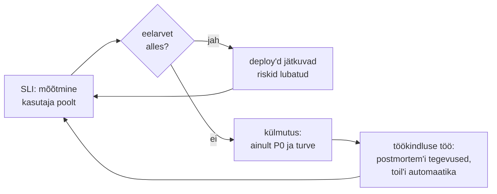

# Site Reliability Engineering

Teenuse omanik tahab "100% kättesaadavust", arendus tahab iga päev deploy'da ja valve ärkab kolm korda nädalas alerti peale, mis hommikuks iseenesest lahenes. Kõigil on õigus ja kokkulepet pole. SRE paneb selle kokkuleppe numbritesse: SLO ütleb, kui palju viga on lubatud, error budget'i poliitika ütleb, mis juhtub, kui see on kulutatud, ning valve ja toil'i piirid hoiavad koormuse inimeste jaoks talutavana.

## SLO on SLA-st rangem, SLI sõltub teenuse tüübist

SLO on SLA-st rangem, et rikkumine paistaks enne lepingu rikkumist. Kui SLA on 99,5%, võib SLO olla 99,9%. SLI valitakse kasutaja kogemuse järgi. Päringupõhisel teenusel on selleks kättesaadavus ja latentsus, andme-pipeline'il värskus (kui vanad on andmed, mida kasutaja näeb) ja korrektsus, salvestusel vastupidavus.

Google seab piiri, et operatsioonitöö ei võtaks SRE ajast üle 50% ([Eliminating Toil](https://sre.google/sre-book/eliminating-toil/)). Ülejäänu on inseneritöö, mis vähendab operatsioonitööd edaspidi.

## Error budget'i poliitika: kolm reeglit

SLO ilma poliitikata jääb graafikuks. SRE workbook'i [näidispoliitika](https://sre.google/workbook/error-budget-policy/) sätestab kolm reeglit. Kui teenus on nelja nädala libiseva akna jooksul eelarve ületanud, peatatakse kõik muudatused peale P0 paranduste ja turvaparanduste, kuni teenus on SLO piires. Kui üks intsident kulutab üle 20% nelja nädala eelarvest, on postmortem kohustuslik ja selles peab olema vähemalt üks P0 tegevus juurpõhjuse vastu. Vaidlused eelarve arvutuse üle lahendab tehnikadirektor (CTO). Poliitika allkirjastavad teenuse omanik, arendus ja SRE enne esimest rikkumist. Hiljem muutub see läbirääkimiseks.

<figure markdown="span">

  <figcaption>Joonis 1. Error budget'i poliitika otsustab, kuhu meeskonna aeg läheb.</figcaption>
</figure>

## Valve: 25%, kuus tundi intsidendi kohta, kaheksa inimest

[Being On-Call](https://sre.google/sre-book/being-on-call/) annab mõõdud, mis on ülekantavad ka väiksemale meeskonnale. Valvele kulub kuni 25% SRE ajast ja teisele operatsioonitööle veel kuni 25%. Ühe intsidendi käsitlus koos analüüsi ja postmortem'iga võtab keskmiselt 6 tundi, seega on 12-tunnises vahetuses jätkusuutlik kuni 2 intsidenti. Ööpäevaringseks valveks ühes asukohas on vaja vähemalt 8 inimest, kahes asukohas 6 inimest kummaski. Reageerimisaeg on kasutajale nähtava teenuse puhul 5 minutit, vähem kriitilise puhul 30 minutit. Kolmeliikmelise meeskonna puhul näitavad need numbrid, et ööpäevaringne valve ei ole jätkusuutlik ja öine valve tuleb siduda SLO-ga: inimene äratatakse ainult siis, kui burn rate seda nõuab.

## Toil'i mõõtmine ja tasuvus

Toil on käsitsi tehtav ja korduv töö. See on automatiseeritav ja taktikaline, ei jäta püsivat väärtust ja kasvab lineaarselt koos teenusega. Mõõdetakse kahte asja: kui suur osa valve- ja tööajast kulub korduvatele ülesannetele ja millised ülesanded korduvad. Andmed tulevad ticket'ite süsteemist (silt `toil`) ja valvelogist. Kui sertifikaadi käsitsi uuendamine võtab kuus kaks tundi ja automaatika kirjutamine kaks päeva, tasub see end ära poole aastaga. Tasuvusarvutus on sama mis automatiseerimisstrateegias: sagedus × aeg × vea hind, miinus hooldus.

## Postmortem ja tegevuste sulgemise määr

Struktuur on ajajoon, mõju (mitu protsenti eelarvest), tuvastamine (kuidas ja kui kiiresti märgati), soodustavad tegurid ja tegevused koos omaniku ja tähtajaga. Süüdistuseta (blameless) postmortem küsib, miks süsteem lubas selle sammu teha, sest inimese karistamine peidab järgmise vea. Vastutus tegevuste eest jääb alles. Postmortem'i väärtus tuleb tehtud tegevustest, seepärast jälgitakse tegevuste sulgemise määra samamoodi nagu SLO-d.

## SLO ja valve tööriistad

| Tööriist | Mida teeb | Litsents/hind | Millal valida |
|---|---|---|---|
| [Prometheus](https://prometheus.io/) + Alertmanager | SLI andmed, burn rate'i reeglid, teavitused | Apache 2.0 | SLI on juba Prometheuse meetrikates |
| [Sloth](https://github.com/slok/sloth) | genereerib SLO spetsifikatsioonist SLI recording rule'id ja mitme aknaga burn rate'i alerdid, toetab OpenSLO-d | Apache 2.0 | ei taha burn rate'i PromQL-i käsitsi kirjutada |
| [Pyrra](https://github.com/pyrra-dev/pyrra) | SLO-d Kubernetese CRD-na, eelarve vaade ja alerdid | Apache 2.0 | klastris, SLO on GitOps'i objekt |
| [OpenSLO](https://github.com/OpenSLO/OpenSLO) | tööriistast sõltumatu SLO kirjeldus YAML-is | Apache 2.0 | SLO peab olema tööriista vahetusel kaasas |
| [GoAlert](https://github.com/target/goalert) | valvegraafikud, eskalatsioon, SMS, kõne, Slack | Apache 2.0 | oma serveris valvesüsteem ilma kasutajapõhise hinnata |
| [Grafana](https://grafana.com/oss/) | SLO ja eelarve dashboard'id | AGPLv3 | eelarve peab olema nähtav ka juhtkonnale |

Grafana OnCall'i avatud versioon läks hooldusrežiimi 2025. aasta märtsis ja arhiveeriti 24. märtsil 2026 ([Grafana](https://grafana.com/blog/grafana-oncall-maintenance-mode/)), nii et uut paigaldust sellele ei tehta. Kommertsvõrdlus: PagerDuty ja incident.io pakuvad valvet, intsidendi koordineerimist ja postmortem'i malle teenusena.

## Cloudflare 18. novembril 2025: 200 tunnuse piir

18. novembril 2025 oli suur osa Cloudflare'i võrgust kella 11.20-st UTC umbes kolm tundi rikkis ja täielik taastumine võttis kuni 17.06-ni ([Cloudflare'i postmortem](https://blog.cloudflare.com/18-november-2025-outage/)). Kell 11.05 muudeti ClickHouse'i andmebaasi õigusi. Selle tõttu hakkas Bot Management'i tunnuste faili genereeriv päring tagastama topeltridu ja fail kasvas umbes 60 tunnuselt üle 200. Proxy moodulil oli 200 tunnuse fikseeritud piir ja piiri ületamisel lõppes protsess veaga (Rusti `unwrap()` `Err` väärtusel), mis andis kasutajatele 5xx vastuseid.

Diagnoosi aeglustas kaks asja. Õiguste muudatus levis klastris järk-järgult ja fail genereeriti iga viie minuti järel uuesti, nii et võrku jõudis vaheldumisi hea ja vigane fail. Rike paistis tulevat ja minevat nagu rünnak. Samal ajal läks kokkusattumusena maha ka Cloudflare'ist eraldi hostitud staatuseleht ja osa meeskonnast arvas, et ründaja tabab mõlemat.

Postmortem näitab SRE tava: avalik ajajoon minutite kaupa, tehniline juurpõhjus ilma süüdlaseta ja tegevused süsteemi tasemel. Tegevused olid konfifailide vastuvõtu valideerimine samamoodi nagu kasutaja sisendi puhul, globaalsed hädalülitid (*kill switch*), parem veakäsitlus moodulites ja üle moodulite ulatuv rikete ülevaatus. Admini jaoks on õppetund see, et konfiguratsioon on samuti deploy. Automaatselt genereeritud ja kiiresti leviv fail vajab samu kaitseid nagu kood: valideerimist, lainetena levitamist ja võimalust tagasi minna.

## Kus SLO-süsteem ei tööta

- **Vale SLI.** CPU, mälu ja pod'i restardid ei ole SLI-d. Kui SLI-d mõõdetakse serveri seest, jääb Ingress'i või DNS-i rike märkamata. Mõõta tuleb sealt, kust kasutaja teenust kasutab.
- **Liiga range SLO.** 99,99% tähendab umbes 4 minutit kuus. Selline eesmärk keelab praktiliselt iga riskantse muudatuse ja nõuab mitut asukohta. Iga lisaüheksa maksab rohkem kui eelmine ja SLO peab vastama sellele, mida kasutaja vajab.
- **Poliitika ilma võimuta.** Kui juhtkond nõuab tühja eelarvega release'i, kaotab SLO mõtte. Poliitika peab olema enne kinnitatud ja erand dokumenteeritud.
- **Väikese liiklusega teenus.** 100 päringut päevas tähendab, et üks viga on 1%. SLO jaoks on vaja pikemat akent või sünteetilist liiklust, muidu on burn rate'i alert pelgalt müra.
- **Postmortem süüdistusena.** Kui postmortem'i järel otsitakse süüdlast, hakkavad inimesed infot varjama ja järgmine ajajoon on puudulik.
- **Toil'i automatiseerimine ilma omanikuta.** Automaatika, mida keegi ei hoolda, muutub uueks toil'iks.

## Kontrolli ennast

??? question "Teenuse SLA kliendiga on 99,5% kuus. Millise SLO valid ja miks mitte sama numbri?"
    SLO on SLA-st rangem, näiteks 99,9%, et eelarve otsa saamine annaks hoiatuse enne lepingu rikkumist. Vahe on varu, mille jooksul jõuad muudatused külmutada ja parandada. Sama number tähendaks, et esimene märk probleemist on juba leppetrahv.

??? question "Kolmeliikmeline meeskond peab ööpäevaringset valvet. Mida ütlevad Google'i valvenumbrid ja mida muudad?"
    Ööpäevaringne valve ühes asukohas vajab vähemalt kaheksat inimest, et valve võtaks kuni 25% ajast. Kolmega tähendab see püsivat ülekoormust. Öised teavitused seotakse SLO burn rate'iga, et äratus tuleks ainult kasutajat mõjutava rikke korral. Ülejäänu läheb tööpäeva ticket'iks ja kordused automatiseeritakse.

??? question "Üks intsident kulutas 30% nelja nädala error budget'ist. Mida näidispoliitika nõuab?"
    Üle 20% kulutanud intsident vajab postmortem'i, milles on vähemalt üks P0 tegevus juurpõhjuse vastu. Kui kogu eelarve on nelja nädala aknas ületatud, peatatakse muudatused peale P0 ja turvaparanduste, kuni teenus on taas SLO piires.

??? question "Cloudflare'i rike tuli ja läks viieminutiliste vahedega. Miks see diagnoosi raskendas ja mis on õppetund sinu automaatika jaoks?"
    Vahelduv rike näeb välja nagu väline rünnak või ülekoormus, mitte nagu deploy, ja tähelepanu läheb valesse kohta. Põhjus oli automaatselt genereeritud konfifail, mida levitati kogu võrku ilma valideerimata. Õppetund: genereeritud konfiguratsioon on samuti deploy ja vajab vastuvõtul valideerimist, lainetena levitamist ja hädalülitit.
