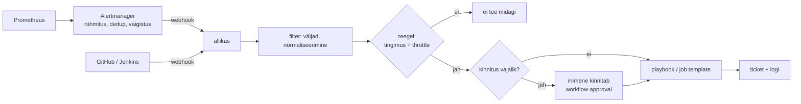

# Sündmuspõhine automaatika

Valvur ärkab kolm korda nädalas sama häire peale: `/var` on üle 90%, runbook ütleb "koristada journald ja vanad logipakid, kui ruumi ei vabane, eskaleerida". Iga samm on teada ja testitud, ainult käivitaja on inimene, kes peab enne sisse logima. Sündmuspõhises automaatikas asendub ainult käivitaja: tegevuse ja selle piirid kirjutab inimene ette ning reegel valib, millal see käivitub. Sündmus võib olla monitooringu alert, webhook Gitist või CI serverist, Kafka teade või logirida, tegevus on playbook, job template, workflow või API päring.

## Servapõhine sündmus ja tasemepõhine kontrolltsükkel

Käsitsi käivituse ja ajakava (cron, AWX-i schedule, Jenkinsi `cron` trigger) kõrval on lähim sugulane kontrolltsükkel, mida Kubernetes ja Argo CD kasutavad. Nende vahe on tööl oluline:

- sündmusele reageerimine on servapõhine (*edge-triggered*): tegevus käivitub muutuse hetkel. Kui sündmus kaob teel, ei käivitu midagi;
- kontrolltsükkel on tasemepõhine (*level-triggered*): kontroller võrdleb olekut ikka ja jälle ning parandab erinevuse, kuigi ta ei näinud muutust ennast.

Seepärast paneb töökindel lahendus mõlemad kokku: sündmus annab kiire reaktsiooni ja perioodiline kontroll (öine `--check`, Argo CD sync) püüab kinni kadunud sündmused.

AIOps korreleerib signaale ja otsib anomaaliaid, sündmuspõhine automaatika täidab deterministlikke reegleid. Neid saab kokku panna, aga piir peab jääma selgeks: AI soovitab, reegel valib kinnitatud tegevuse.

## Webhook'i tarne: 10 sekundit ja uuesti ei saadeta

Webhook'i tarnegarantii sõltub saatjast. GitHub märgib tarne ebaõnnestunuks, kui vastus ei tule 10 sekundi jooksul, ja [ei saada seda automaatselt uuesti](https://docs.github.com/webhooks/using-webhooks/handling-failed-webhook-deliveries). Webhook'i vastuvõtja peab seega vastama kiiresti, töö tegema asünkroonselt ja arvestama, et osa sündmusi ei jõua kunagi kohale.

## Allikas, filter, reegel ja tegevus

<figure markdown="span">

  <figcaption>Joonis 1. Alertmanager vähendab müra enne reeglit, reegel valib tegevuse ja riskantne tegevus ootab inimest.</figcaption>
</figure>

**Alertmanager** on esimene filter. See rühmitab sama alerti eri hostidelt (`group_by`), ootab enne esimest teavitust `group_wait` (vaikimisi 30 s), saadab sama grupi uuendused kõige sagedamini iga `group_interval` järel (5 min) ja kordab lahendamata alerti `repeat_interval` järel (4 h) ([seadistus](https://prometheus.io/docs/alerting/latest/configuration/)). Need vaikeväärtused tähendavad, et reegel ei saa iga mõõtmist eraldi sündmusena ja et sama alert võib tulla nelja tunni pärast uuesti. Korduse peab tegevus taluma.

## ansible-rulebook: allikad, tingimused ja tegevused

Rulebook on YAML: `sources` ütleb, kust sündmused tulevad, `rules` sisaldab tingimust (`condition`) ja tegevust (`action`). Erinevalt `ansible-playbook`-ist ei lõpeta rulebook tööd, vaid ootab järgmisi sündmusi. Mootor vajab [Java ≥ 17 ja Python ≥ 3.9](https://docs.ansible.com/projects/rulebook/en/latest/installation.html) ning playbook'id käivitab `ansible-runner`. Allikad on pluginad. Mootoriga tulevad kaasa näiteks `eda.builtin.webhook` ja `eda.builtin.pg_listener`, Alertmanageri ja Kafka allikad on kollektsioonis `ansible.eda` (`ansible.eda.alertmanager`, `ansible.eda.kafka`).

[Tegevused](https://docs.ansible.com/projects/rulebook/en/latest/actions.html) on `run_playbook`, `run_module`, `run_job_template`, `run_workflow_template`, `post_event`, `set_fact`, `retract_fact`, `print_event`, `debug`, `shutdown` ja `none`. Käivitavatel tegevustel on `retry`, `retries` ja `delay`. Tingimus näeb sündmust kui `event` ja seda saab siduda faktidega (`set_fact` jätab meelde, et host on hoolduses). `all:` ootab mitut sündmust, näiteks alerti ja kinnitust, ja `any:` võtab esimese. `throttle` koos `once_within` ja `group_by_attributes`-iga laseb hosti kohta läbi ühe tegevuse ajavahemikus.

## Kaks vaikeväärtust, mis peatavad järjekorra

Kaks [vaikeväärtust](https://docs.ansible.com/projects/rulebook/en/latest/rulebooks.html) on tööl olulised. `execution_strategy` on `sequential`: järgmine tegevus ootab, kuni eelmine lõpeb, nii et pikk playbook hoiab järjekorda kinni. `match_multiple_rules` on `false` ja sündmus läheb ainult esimesse sobivasse reeglisse. Kui rulebook'is on mitu allikat ja üks neist lõpetab töö, peatub kogu mootor ja teiste allikate sündmused võivad kaduma minna. Seepärast käivitatakse ansible-rulebook systemd teenusena `Restart=on-failure`-iga ja töö, mida ei tohi kaotada, läheb Kafkasse või muusse püsivasse järjekorda.

## Kinnitus AWX-iga ja ilma

AWX-iga koos töötades kutsub rulebook `run_job_template`-iga AWX-i template'it. Nii saad AWX-i RBAC-i, credential'id, logi ja *workflow approval* sammu, kus inimene kinnitab tegevuse. Ilma AWX-ita tuleb kinnitus teha teise sündmusena, nagu 2. kohtumise varasemas lisaülesandes. Rulebook'e haldav server on Red Hati tootes EDA controller. Selle avatud lähtekoodiga vaste on repo [`ansible/eda-server`](https://github.com/ansible/eda-server), mille paigaldus ja küpsus ei ole AWX-i tasemel.

## Reeglimootorid ja millal mida

| Tööriist | Mida teeb | Litsents/hind | Millal valida |
|---|---|---|---|
| [ansible-rulebook](https://github.com/ansible/ansible-rulebook) | Reeglid sündmustele, käivitab playbook'i või AWX-i template'i | Apache 2.0 | Tegevused on juba Ansible'i playbook'id |
| [Alertmanager](https://github.com/prometheus/alertmanager) | Rühmitus, dedup, vaigistus, webhook | Apache 2.0 | Prometheuse alertide eelfilter, alati enne reeglit |
| [Argo Events](https://github.com/argoproj/argo-events) | EventSource → Sensor → Kubernetese ressurss või Argo Workflow | Apache 2.0 | Tegevus on klastri sees ja kõik muu on juba Kubernetes |
| [Salt reactor](https://docs.saltproject.io/en/latest/topics/reactor/index.html) | Salti event bus'i sündmustele reageerimine | Apache 2.0 | Taristut hallatakse juba Saltiga |
| [StackStorm](https://github.com/StackStorm/st2) | Sensorid, reeglid, workflow'd, ChatOps | Apache 2.0 | Paljude süsteemide integratsioon; projekt on Linux Foundationi all ja väljalasked on harvad |
| [Zabbix](https://www.zabbix.com/) actions | Trigger'i peale skript või kaugkäsk | AGPLv3 (7.0-st) | Monitooring on Zabbix ja tegevus on lihtne |
| [Rundeck](https://github.com/rundeck/rundeck) (community) | Job'id webhook'i peale, ACL-id | Apache 2.0 | Runbook'id pole Ansible'is, vaja on käivitusliidest |

Kommertsvõrdluseks pakuvad PagerDuty ja ServiceNow sama ahelat intsidendihalduse sees, nii et tegevus ja ticket on ühes süsteemis.

## AWS us-east-1, detsember 2021: automaatne skaleerimine ummistas võrgu

7. detsembril 2021 kell 7.30 (PST) käivitus AWS-i us-east-1 regioonis automaatne tegevus, mis suurendas ühe teenuse võimsust. See tekitas suure hulga sisevõrgu klientide ootamatu käitumise. Ühenduskatsed ummistasid võrguseadmed, viivitused tõid kaasa veel rohkem kordusi ja klientide *back-off* ei töötanud varjatud vea tõttu. Ummik võttis ka reaalajas monitooringu, millega põhjust otsida. Võrguseadmed taastusid kell 14.22 ([AWS-i kokkuvõte](https://aws.amazon.com/message/12721)).

Sündmuspõhise automaatika jaoks on siin kolm õppetundi. Automaatne tegevus võib ise sündmuste tormi tekitada. Kordused ilma toimiva back-off'ita süvendavad ummikut. Kolmandaks peab vaatlus, mille järgi automaatika ja inimesed otsustavad, töötama rikkest sõltumatult.

## Rikkerežiimid: torm, tsükkel, kadunud sündmus

- **Torm.** Sada pod'i, sada alerti ja sada playbook'i. Kaitseks on Alertmanageri `group_by`, rulebook'i `throttle` ja AWX-i template, mille kaks käivitust ei tööta korraga.
- **Lõputu tsükkel.** Teenuse restart tekitab "teenus maas" alerti, mis käivitab restardi. Või kaks reeglit teevad vastupidist: üks skaleerib üles, teine alla. Igal tegevusel on sageduspiir hosti kohta ja ülemine piir, mille järel tuleb eskalatsioon inimesele.
- **Vananenud sündmus.** Alert jõudis kohale 10 minutit hiljem ja vahepeal on keegi juba koristanud. Tegevus kontrollib enne muutmist olekut uuesti (`df` playbook'i alguses) ja on idempotentne.
- **Sisend on võõras.** Webhook'i payload on ründaja sisend. Nõua tokenit või HMAC-allkirja (GitHubi `X-Hub-Signature-256`), kuula ainult sisevõrgus või `127.0.0.1`-l ja ära kasuta payload'i välja otse `hosts:` mustris ega shellis. `host: "all"` peab olema viga.
- **Kadunud sündmus.** Webhook'il pole järjekorda: kui vastuvõtja on maas, sündmus kaob ja tegevus jääb käivitamata.
- **Auditi jälg.** Öösel tehtud automaatne tegevus peab jätma kirje: mis sündmus, milline reegel, mis tegevus, mis tulemus. Ilma selleta näeb hommikune vahetus ainult tulemust.
- **Millal mitte.** Kui runbook nõuab hinnangut, mida reeglisse kirjutada ei saa, ei tohi reegel tegevust ise käivitada. Siis jääb reeglile teavitus koos vajalike andmetega ja otsustab inimene.

## Kontrolli ennast

??? question "Miks ei piisa ainult sündmustest ja miks on vaja ka perioodilist kontrolli?"
    Sündmus on servapõhine. Kui see kaob, näiteks vastuvõtja oli maas või GitHub ei saanud 10 sekundiga vastust, ei käivitu midagi ja keegi ei saa sellest teada. Perioodiline kontroll võrdleb olekut iga kord uuesti ja leiab ka selle, mille sündmus jättis vahele.

??? question "Rulebook'is on kaks reeglit: üks teavitab ketta täitumisest, teine käivitab koristuse, kui ketas on üle 95%. Ketas läheb 90-lt 97-le, aga koristus ei käivitu. Miks?"
    `match_multiple_rules` on vaikimisi `false` ja sündmus läks esimesse sobivasse reeglisse, see tähendab teavitusse. Lahendus on järjestada reeglid kitsamast laiemani või lülitada `match_multiple_rules` sisse ja arvestada sündmuste vahemälu mälukuluga.

??? question "Webhook'i payload'is on `host: app*` ja `pct: 95`. Mis läheb valesti, kui playbook kasutab seda otse `hosts:` väärtusena, ja kuidas seda vältida?"
    Ansible tõlgendab `app*` mustrina ja koristus läheb kõigile app-hostidele. Payload on võõras sisend. Kontrolli enne kasutamist, et väärtus on täpselt üks inventory hosti nimi (`assert` ja `groups['all']`), ning lisa host `add_host`-iga.

??? question "Alertmanager saadab sama lahendamata alerti nelja tunni pärast uuesti. Mida see tähendab tegevuse jaoks?"
    See on `repeat_interval` vaikeväärtus ja reegel saab sama sündmuse teist korda. Tegevus peab olema idempotentne ja kontrollima olekut enne muutmist. `throttle` peab katma vähemalt selle vahemiku või peab teine sündmus minema eskalatsiooni, mitte uude koristusse.
