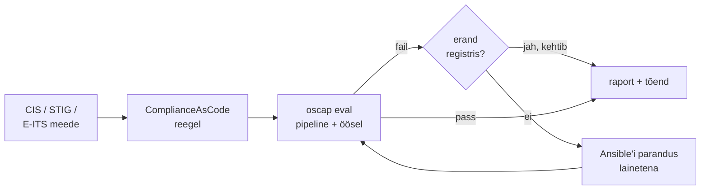

# Turvaautomaatika, compliance ja riskihaldus

Audiitor küsib, kas kõigil 300 serveril on E-ITS-i nõutud seadistus ja millega seda tõendad. Samal nädalal annab SIEM päevas 4000 hoiatust ja kahe inimesega meeskond jõuab neist läbi vaadata mõnisada. Mõlemat ei lahenda tööjõu lisamine, sest töö kasvab koos serverite arvuga. Turvaautomaatika koosneb kahest eri tööst: compliance hoiab süsteemi kokkulepitud seisus ja tõendab seda, SOAR reageerib sündmusele. Mõlemad vajavad testitud tegevuste kataloogi ja reeglit, millal automaatika peatub ja otsustab inimene.

## Compliance, SOAR ja erand kui aktsepteeritud risk

**Compliance management** tähendab, et süsteemi vastavust välisele nõudele kontrollitakse pidevalt, mitte kord aastas enne auditit. Nõue (CIS-i reegel, DISA STIG, E-ITS-i meede) seotakse tehnilise kontrolliga, kontroll käib ajakava järgi ja tulemus koos eranditega on tõend. Eeltingimus on tavaline konfihaldus, sest drift'i kontroll võrdleb hosti sinu koodiga. Compliance võrdleb seda välise standardiga.

**SOAR** (security orchestration, automation and response) on platvorm, mis võtab vastu SIEM-i või EDR-i hoiatuse ja käivitab selle peale töövoo. Töövoog rikastab hoiatust (IP maine, kasutaja grupid, hosti omanik CMDB-st), teeb lihtsad otsused ise ja avab juhtumi (*case*), kuhu analüütik kirjutab otsused. SIEM kogub ja korreleerib, SOAR tegutseb.

Riskihalduse vaates on iga hardening-reegli erand aktsepteeritud risk, millel on omanik, põhjus ja aegumiskuupäev.

## E-ITS ja selle kaardistus skänneri reeglitele

**E-ITS** on Eesti infoturbestandard, mis põhineb Saksa BSI IT-Grundschutzi etalonturbel ja ISO/IEC 27001-l. See on kohustuslik avalikke ülesandeid täitvatele asutustele ja asendas ISKE, mis kehtis 2022. aasta lõpuni ([RIA](https://ria.ee/en/cyber-security/management-state-information-security-measures)). E-ITS kasutab etalonturvet: asutus valib kataloogist oma objektidele sobivad moodulid koos valmismeetmetega. See sobib automaatikale hästi, sest moodulite meetmed on konkreetsed. Seos CIS-i või ComplianceAsCode'i reeglitega tuleb aga kaardistada: kui sinu skänneri profiilide hulgas E-ITS-i pole, on see sinu meeskonna töö ja kaardistus ise on auditi tõend.

## Compliance'i tsükkel: ComplianceAsCode ja OpenSCAP

Standard on masinloetav: [ComplianceAsCode](https://github.com/ComplianceAsCode/content) hoiab reegleid ühes allikas ja genereerib neist SCAP-andmevoo (XCCDF reeglid, OVAL kontrollid), Ansible'i playbook'i ja Bashi paranduse. [OpenSCAP](https://www.open-scap.org/) hindab hosti profiili järgi (`oscap xccdf eval --profile cis_server_l1 …`) ja annab ARF/XML-tulemuse ning HTML-raporti. Erandid on Gitis koos põhjenduse ja aegumisega. Pipeline käivitab skänni iga muudatuse järel ja öösel, raport läheb arhiivi, kus administraator seda muuta ei saa.

<figure markdown="span">

  <figcaption>Joonis 1. Compliance'i tsükkel. Skänn ja parandus tulevad samast reeglist, erand on kirjas ega teki vaikimisi.</figcaption>
</figure>

## Wazuh'i active response ja SOAR-i töövoog

Wazuh'i reegel tuvastab, et ühelt IP-lt on kahe minutiga 50 ebaõnnestunud SSH sisselogimist. [Active response](https://documentation.wazuh.com/current/user-manual/capabilities/active-response/index.html) on Wazuh'i sisseehitatud reaktsioon: `firewall-drop` lisab IP blokeeringusse ja `timeout` võtab selle teatud aja järel tagasi. Sellist tegevust nimetatakse olekupõhiseks (stateful). `repeated_offenders` pikendab blokeeringut korduva rikkuja puhul. Keerulisem juhtum läheb SOAR-i: [Shuffle](https://github.com/Shuffle/Shuffle) võtab hoiatuse webhook'iga vastu, küsib Cortexi analüsaatoritelt IP ja faili räsi kohta infot, avab TheHive'is juhtumi ja küsib analüütikult, kas host isoleerida.

## Mida automaatika tohib ise teha

Otsuse piir on mõlemas tsüklis sama: automaatne tegevus on lubatud siis, kui see on pöörduv ja mõjuala on väike, näiteks ajutine IP blokeering või ühe sshd seadistuse parandus. Pöördumatu või laia mõjuga tegevus ootab inimest. Sellised tegevused on näiteks serveri isoleerimine, kasutaja keelamine domeenis ja terve CIS-profiili korraga sisselülitamine.

## Avatud lähtekoodiga turvatööriistad

| Tööriist | Mida teeb | Litsents/hind | Millal valida |
|---|---|---|---|
| [OpenSCAP](https://www.open-scap.org/) | SCAP skänner, XCCDF-profiilid, HTML-raport | LGPL-2.1 | Linuxi vastavus CIS-ile või STIG-ile, tõend auditiks |
| [ComplianceAsCode](https://github.com/ComplianceAsCode/content) | reeglid ühest allikast: SCAP, Ansible, Bash | avatud lähtekood, tasuta | hardening ja skänn peavad vastama samale reeglile |
| [Lynis](https://cisofy.com/lynis/) | kiire hardening'u audit ilma profiilita | GPLv3 | esimene ülevaade, segapark |
| [Wazuh](https://wazuh.com/) | SIEM/XDR, agentide logid, SCA-poliitikad, active response | GPLv2 | avatud lähtekoodiga SIEM koos lihtsa automaatse reaktsiooniga |
| [Shuffle](https://github.com/Shuffle/Shuffle) | SOAR-i töövood ja integratsioonid | AGPLv3 (server), MIT (rakendused) | mitmesammuline reaktsioon mitme tööriista vahel |
| [TheHive](https://docs.strangebee.com/thehive/installation/licenses/about-licenses/) + Cortex | juhtumite haldus; Cortex teeb analüüsi | TheHive 5: tasuta Community litsents, tasulised tasemed; Cortex on avatud | SOC-i juhtumite haldus ja tõendite ahel |
| [Trivy](https://trivy.dev/), [gitleaks](https://github.com/gitleaks/gitleaks) | image'ite, sõltuvuste, IaC ja saladuste skänn pipeline'is | Apache 2.0, MIT | shift-left kontroll enne merge'i |

Kommertsvõrdlus: Splunk SOAR, Palo Alto Cortex XSOAR ja Microsoft Sentinel on sama mudeliga ja neil on rohkem valmis integratsioone. Hinnastus käib andmemahu või kasutajate järgi.

## Target 2013: hoiatused tulid, reaktsiooni ei tulnud

2013. aasta lõpus varastati jaemüüja Targeti kassasüsteemidest kuni 110 miljoni kliendi andmed. USA Senati kaubanduskomitee raport (*A "Kill Chain" Analysis of the 2013 Target Data Breach*) leidis, et turvavahendid tuvastasid nii pahavara paigaldamise kui ka andmete väljaviimise kavatsuse, aga hoiatustele ei reageeritud ([Senati pressiteade](https://www.commerce.senate.gov/2014/3/rockefeller-staff-report-details-target-s-missed-opportunities-to-stop-massive-data-breach), [NBC](https://www.nbcnews.com/business/consumer/target-missed-many-warning-signs-leading-breach-senate-report-n62021)). Ründaja pääses võrku lepingupartneri ligipääsu kaudu.

Tuvastus töötas, katki oli samm tuvastusest tegevuseni. Selles vahes on SOAR-i põhiväärtus: hoiatus avab juhtumi, rikastab seda ja nõuab otsust kindla aja jooksul. Kui keegi ei otsusta, eskaleeritakse juhtum edasi. Kõrge usaldusega leiu korral võib esimese pöörduva sammu teha automaatika.

## Kuidas turvaautomaatika ise kahju teeb

- **Ründaja käivitab sinu automaatika.** Kui blokeering käib allika IP järgi, võib võltsitud allikaga UDP-liiklus panna blokeeringusse sinu DNS-resolveri või partneri NAT-aadressi. Automaatselt blokeeritavatest jäetakse välja oma võrgud ja kriitilised partnerid ning blokeeringul on alati `timeout`.
- **Hardening katkestab teenuse.** Terve profiil korraga (`/tmp` `noexec`, auditd reeglid, STIG-i FIPS-režiim) peatab installerid ja agendid. Reeglid lülitatakse sisse lainetena, kõigepealt testringis ja `--check`-iga.
- **Roheline raport, vale seis.** Raport on roheline, sest reegel kontrollib faili, mitte töötavat seadistust. `sshd_config` põhifail võib olla korras, aga `sshd_config.d/` drop-in muudab efektiivset väärtust ja `sshd -T` näitab muud. Kontroll peab vaatama efektiivset seadistust.
- **Aegumiseta erandid.** Ilma aegumiseta erand jääb igaveseks. Erandiregister vaadatakse üle ajakava järgi ja aegunud erand muudab raporti punaseks.
- **Skänneri õigused.** Autenditud skänn ja SOAR-i integratsioonid vajavad laia ligipääsu kõikjale. Nende kontod on ründaja jaoks väärtuslikud: eraldi identiteet, kitsas sudo-reegel ja logi väljaspool hosti.
- **Automaatika kiirus ja tõendid.** Automaatne isoleerimine või kustutamine võib hävitada tõendid, mida forensics vajab. Enne muutvat sammu kogub töövoog andmed (mälu, protsessid, ühendused).

## Kontrolli ennast

??? question "Öine `ansible-playbook --check` annab kõigil hostidel `changed=0`, aga E-ITS-i audiitor leiab, et paroolipoliitika ei vasta nõudele. Kuidas see on võimalik ja mida muudad?"
    `--check` võrdleb hosti sinu koodiga ja koodis pole paroolipoliitika reeglit. Vastavust välise nõudega mõõdab eraldi skänn, näiteks OpenSCAP profiiliga, kuhu E-ITS-i meetmega seotud reeglid on kaardistatud. Puuduv reegel lisatakse koodi ja skänni või kirjutatakse erandina koos põhjuse ja omanikuga.

??? question "Wazuh'i active response blokeerib SSH brute force'i allika IP. Mis on selle kõige ohtlikum külg ja kuidas seda piirad?"
    Allikas võib olla jagatud või võltsitud aadress: kontori NAT, partneri VPN või sinu enda jump host. Selle blokeerimine katkestab teenuse paljudele. Piiramiseks on oma võrkude välistamine, kohustuslik `timeout`, mis teeb tegevuse pöörduvaks, ja teavitus igast blokeeringust.

??? question "Miks ei peaks SOAR-i töövoog serverit automaatselt isoleerima iga kõrge raskusega hoiatuse peale?"
    Isoleerimine on laia mõjuga: tootmisteenus katkeb ja kui hoiatus oli vale, maksab katkestus rohkem kui ründe oht. Automaatseks sobivad pöörduvad ja kitsad sammud. Isoleerimine vajab inimese kinnitust, kui hoiatuse usaldusväärsus pole tõestatud. Enne isoleerimist peavad olema kogutud tõendid.

??? question "Hardening'u erand `/tmp` `noexec`-i kohta tehti kaks aastat tagasi ühe installeri pärast. Mis on riskihalduse vaatest valesti?"
    Erandil pole omanikku ega aegumist, nii et keegi ei kontrolli, kas põhjus on alles. Aktsepteeritud risk peab olema kirjas koos põhjuse, omaniku ja ülevaatuse kuupäevaga. Aegunud erand teeb raporti punaseks, kuni keegi selle uuendab või reegli sisse lülitab.
