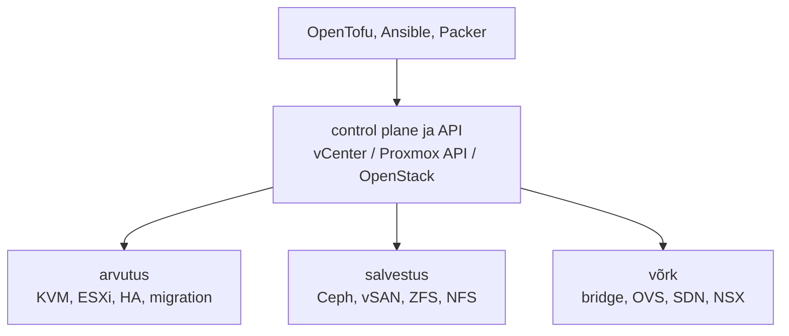

# Virtuaalse taristu haldus ja SDDC

VMware'i lepingu uuendamisel selgub, et uus hind on mitu korda vanast suurem ja juhtkond küsib, kas Proxmox sobiks asemele. Hüperviisori vahetus on lihtsam osa. Raskem küsimus on, kus on kirjas kõik see, mida vCenter, DRS, vSAN ja NSX seni tegid: millised võrgud kus on, kuidas kettad replitseeritakse, mis juhtub hosti rikke korral ja kellel on milline õigus. **Virtuaalset taristut hallatakse sama hästi, kui hästi on kirjeldatud ja automatiseeritud selle kolm osa (arvutus, salvestus ja võrk); hüperviisori bränd määrab ainult, millise API kaudu seda tehakse.**

## SDDC, HCI ja privaatpilv

Tarkvaraga määratletud andmekeskus (software-defined data center, SDDC) tähendab, et kõik kolm osa on virtualiseeritud ja neid juhitakse ühe control plane'i API kaudu. VMware'is on need vSphere, vSAN ja NSX koos vCenteriga, Proxmox VE-s klaster, Ceph ja SDN ning OpenStackis Nova, Cinder ja Neutron. Hüperkonvergentne taristu (HCI) on SDDC erijuht, kus salvestus töötab samadel hostidel kui VM-id (vSAN, Ceph Proxmoxi node'idel).

[NIST SP 800-145](https://csrc.nist.gov/pubs/sp/800/145/final) nõuab pilvelt iseteenindust, laia võrguligipääsu, ressursside jagamist mitme kasutaja vahel, kiiret elastsust ja mõõdetud teenust. Klaster, kus VM-i teeb ikka admin tiketi peale, on SDDC, aga mitte privaatpilv. Üks ESXi host kohaliku kettaga on virtualiseerimine, aga mitte SDDC, sest salvestus ja võrk on endiselt riistvaras.

## Kvoorum, fencing, salvestus ja SDN Proxmoxis

Proxmox VE klastri olek on [pmxcfs-is](https://pve.proxmox.com/pve-docs/pmxcfs.8.html): FUSE-failisüsteem `/etc/pve` all, mille taga on SQLite-andmebaas ja mida corosync replitseerib reaalajas kõigile node'idele. Seal on VM-ide konfiguratsioonid, salvestuse definitsioonid, tulemüür, HA ressursid ja SDN-i seadistus. Kui node kaotab kvoorumi, muutub `/etc/pve` sellel kirjutuskaitstuks. Siis ei saa VM-i käivitada ega konfiguratsiooni muuta, kuigi töötavad VM-id jäävad tööle. [Proxmoxi dokumentatsioon](https://pve.proxmox.com/wiki/Cluster_Manager) nõuab corosync'ile alla 5 ms latentsust ja soovitab eraldi füüsilist võrgukaarti, sest corosync on tundlik viivituse kõikumise suhtes, mitte ribalaiuse suhtes. Kahe node'iga klastrile soovitatakse QDevice'i, mis annab kolmanda hääle välisest masinast.

HA tugineb fencing'ule ilma eraldi fencing-seadmeta. Igal node'il on watchdog (riistvaraline või kerneli `softdog`). Kui node kaotab kvoorumi, lõpetab ta watchdog'i uuendamise ja taaskäivitub ise umbes 60 sekundi jooksul. Ülejäänud klaster ootab selle aja ära ja alles siis käivitab HA-ressursid teistel node'idel. Ootamine takistab split-brain'i, kus sama VM töötaks kahes kohas sama kettaga. Seepärast kulub rikke tuvastamisest VM-i taaskäivituseni minuteid, mitte sekundeid.

Salvestuses on põhiotsus, kas ketas on jagatud või kohalik. Jagatud salvestuse (Ceph RBD, NFS, iSCSI) korral liigub live migration'il ainult mälu ja HA saab VM-i kohe teisel node'il käivitada. Kohaliku salvestuse (LVM-thin, ZFS) korral kopeeritakse migration'il kogu ketas ja HA-ks on vaja ZFS-i replikatsiooni, mis on asünkroonne: rikke korral kaob see, mis kirjutati pärast viimast replikatsiooni. Ceph replitseerib vaikimisi kolm koopiat (`size 3`) ja peatab kirjutamise, kui alles on vähem kui `min_size` (vaikimisi 2). Seepärast on Cephil vaja vähemalt kolme node'i ja kiiret eraldi võrku.

Võrgus on aluseks Linuxi bridge või Open vSwitch igal node'il. [Proxmoxi SDN](https://pve.proxmox.com/pve-docs/chapter-pvesdn.html), mis on alates versioonist 8.1 vaikimisi paigaldatud, lisab nende kohale klastriülesed objektid: zone (Simple, VLAN, QinQ, VXLAN, EVPN), VNet ja subnet. Muudatus kirjutatakse kõigepealt `/etc/pve/sdn` alla ootele. Apply ajal genereerib iga node sellest ifupdown2 ja vajadusel FRR-i seadistuse.

<figure markdown="span">

  <figcaption>Joonis 1. SDDC kolm osa ühe API taga. Automaatika räägib ainult control plane'iga.</figcaption>
</figure>

Kui kõik kolm osa on API taga, saab neid hallata koodiga: OpenTofu [bpg/proxmox](https://search.opentofu.org/provider/bpg/proxmox/latest) provider loob VM-e, SDN-i objekte ja tulemüürireegleid, Ansible seadistab hoste ja Packer ehitab malle. Kõik see kasutab sama API tokenit, nii et tokeni õigus määrab, kui palju vigane kood või lekkinud võti kahju teeb.

## Proxmox, Ceph, OpenStack ja teised

| Tööriist | Mida teeb | Litsents / hind | Millal valida |
|---|---|---|---|
| [Proxmox VE](https://pve.proxmox.com/pve-docs/) | KVM ja LXC, klaster, HA, Ceph, SDN, REST API | AGPLv3; tellimus annab enterprise-repo ja toe | väike ja keskmine on-prem, VMware'i asendus |
| [XCP-ng](https://docs.xcp-ng.org/) + Xen Orchestra | Xen-põhine hüperviisor ja haldus | GPLv2 / AGPLv3, tugi tasuline | Citrix Hypervisori asendus |
| [OpenStack](https://docs.openstack.org/) | privaatpilv: iseteenindus, projektid, kvoodid | Apache 2.0 | suur organisatsioon, mitu meeskonda vajab pilvemudelit |
| [Ceph](https://docs.ceph.com/) | hajutatud ploki-, faili- ja objektisalvestus | LGPL | jagatud salvestus vähemalt kolmel node'il |
| [Open vSwitch](https://docs.openvswitch.org/) | virtuaalne kommutaator, VLAN, tunnelid | Apache 2.0 | keerukam võrk kui Linuxi bridge |
| [NetBox](https://netboxlabs.com/docs/netbox/) | IP-de, VLAN-ide ja seadmete tõe allikas | Apache 2.0 | IP-tabel Excelis ei skaleeru |
| [Proxmox Backup Server](https://pbs.proxmox.com/docs/) | deduplitseeritud varundus | AGPLv3 | Proxmoxi VM-ide varundus |
| VMware vSphere / VCF, Nutanix | kommertsplatvormid | tellimus | võrdluseks |

*Tabel 1. Virtuaalse taristu tööriistad.*

## Broadcom ja VMware 2023: mis kolimisel välja tuleb

Broadcom lõpetas VMware'i ostu 2023. aasta novembris ja teatas sama aasta detsembris, et VMware'i püsilitsentse enam ei müüda ([The Register](https://www.theregister.com/2023/12/12/vmware_broadcom_licensing_changes/)). Tooteportfell koondati tellimuspakettidesse, millest peamised on VMware Cloud Foundation ja vSphere Foundation. Paljud kliendid hakkasid alternatiive hindama. Proxmox lisas aprillis 2024 versioonis 8.2 impordiviisardi, mis toob VM-id otse ESXi-st või vCenterist ([Proxmoxi teade](https://proxmox.com/en/about/press-releases/proxmox-virtual-environment-8-2)).

Kolimisel ilmneb, mis oli VMware'is kirjeldamata. DRS-i reeglid, mis hoidsid kaht andmebaasi VM-i eri hostidel, tuleb Proxmoxis teha HA seadistuses uuesti; millised reeglid selleks olemas on, sõltub Proxmox VE versioonist. Distributed switch'i port group'id saavad SDN-i VLAN-zone'iks ja VNet'ideks. vSAN-i salvestuspoliitika asemel tuleb otsustada Cephi pool'i `size` ja `min_size`. Kus need otsused olid koodis (Tofu `vsphere` provider, Ansible'i `community.vmware`), saab need ümber kirjutada. Kus need olid ainult vCenteri UI-s, tuleb need kõigepealt üles leida. Eesti riigiasutustel on võimalik sihtkoht ka [Riigipilv](https://www.riigipilv.ee), mida haldab RIT. Kas ja millise osa asutus sinna viib, on eraldi otsus.

## Kvoorum, Ceph, SDN-i ootel muudatused ja token

Kvoorum on klastri kõige tavalisem rikkeallikas. Kahe node'iga klaster ilma QDevice'ita peatab kirjutamise, kui üks node kaob, ja corosync jagatud võrgukaardil koos varunduse või Cephi liiklusega võib tekitada watchdog'i taaskäivitusi, mis näevad välja nagu juhuslikud riistvararikked.

Ceph lisab töökindlust ja keerukust. See vajab kiiret eraldi võrku (tootmises tavaliselt vähemalt 10 Gbit/s), ühtlaseid kettaid ja adminit, kes oskab lugeda `ceph health detail` väljundit. Kolme node'iga klastris tähendab ühe node'i hooldus, et kaks koopiat on alles ja teine rike peatab kirjutamise.

SDN-i ootel muudatused jõustuvad klastri tasemel korraga. Kui kaks admini on samal ajal muudatusi teinud, jõustab üks neist Apply'ga ka teise oma. Koodiga hallatud SDN annab plaani, aga ei kaitse UI-st tehtud ootel muudatuste eest.

Pikalt alles hoitud snapshot aeglustab kirjutamist ja täidab thin-pool'i.

Tokeni ja kasutaja õigused määravad SDDC-s mõjuala. Token õigusega `/` peal annab ligipääsu igale VM-ile, salvestusele ja võrgule. Õigused antakse pool'i, salvestuse ja SDN-zone'i kaupa ning automaatikal on oma token.

Platvormi vahetus on alati ka litsentsirisk. Ka avatud lähtekoodiga platvormil maksab tugi ja väljaõpe. Lock-in'i vähendab see, et VM-id, võrgud ja õigused on kirjeldatud koodis, mida saab teisele providerile ümber kirjutada.

## Kus see kursusel tuleb

SDDC-d, tokeni õigusi ja SDN-i ootel muudatusi käsitleb [4. kohtumise loengu ptk 1](../k04/loeng.md#1-provisioning-ja-soovitud-seis-taristu-tasemel). Proxmoxi, snapshot'i ja backup'iga töötad laboris [Keskkond](../k01/lab-1-keskkond.md), tokeni ja malliga laboris [Üks VM koodist](../k04/lab-1-uks-vm.md), `protection` lipuga laboris [Elutsükkel ja kaitsed](../k04/lab-5-elutsukkel.md) ning malli ehitad laboris [Golden image Packeriga](../k04/lab-7-kuldne-mall.md); lisaülesanded on [Lisaprojekt: tulemüür koodis](../k04/lisa.md#lisaprojekt-tulemuur-koodis) ja [14. mc01 ja rmq01 LXC-na](../k04/lisa.md#14-mc01-ja-rmq01-lxc-na).

## Kontrolli ennast

??? question "Kolmest Proxmoxi node'ist kaks kaotavad võrgu. Mis juhtub üksi jäänud node'il töötavate VM-idega ja miks?"
    Üksi jäänud node'il pole kvoorumit, nii et `/etc/pve` muutub seal kirjutuskaitstuks. Kui node'il töötab HA-ressursse, lõpetab ta watchdog'i uuendamise ja taaskäivitub umbes minuti jooksul, koos kõigi oma VM-idega. Kui HA-ressursse pole, jäävad VM-id tööle, aga neid ei saa hallata. Nii takistatakse olukorda, kus sama VM käivitatakse ka teisel pool võrgu katkestust.

??? question "Miks võtab Proxmoxi HA-l VM-i taaskäivitus teisel node'il minuteid, kuigi rike tuvastatakse kiiresti?"
    Klaster peab olema kindel, et rikkis node on end fence'inud, enne kui sama ketta peal VM teisel node'il käivitatakse. Seepärast oodatakse ära watchdog'i aeg, umbes 60 sekundit, ja alles siis taastatakse ressursid. Lühem ooteaeg riskiks split-brain'iga ja ketta rikkumisega.

??? question "Kas klaster, kus VM-e loob admin tiketi peale vCenteri UI-s, on privaatpilv?"
    Ei. See võib olla SDDC, kui arvutus, salvestus ja võrk on API taga, aga NIST-i definitsiooni järgi puudub iseteenindus ja mõõdetud teenus. Privaatpilveks muudab selle näiteks OpenStack või iseteeninduskataloog koos kvootidega.

??? question "SDN-is on ootel sinu VLAN-i muudatus. Kolleeg vajutab samal ajal oma muudatuse jaoks Apply. Mis juhtub?"
    Jõustuvad kõik ootel muudatused korraga, ka sinu oma, sest ootel olek on klastri tasemel `/etc/pve/sdn` all, mitte kasutaja kaupa. Seepärast tehakse SDN-i muudatused ühe kanali kaudu, näiteks ainult koodist, ja kontrollitakse enne Apply vajutamist, mis ootel on.
