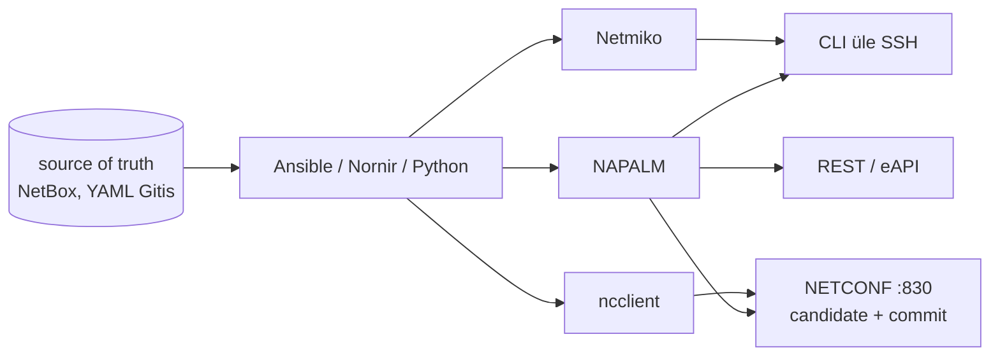

# Võrguautomaatika ja NetOps

Hooldusaknas tuleb 140 kommutaatoril vahetada NTP serverid ja SNMPv3 kasutaja. Käsitsi tähendab see 140 SSH sessiooni ja kopeerimist, Expect-skriptiga habrast prompti ootamist. Kolmandiku seadmete järel märkad, et kaks mudelit vastavad teise süntaksiga. **Võrguautomaatikas määrab seadme liides (CLI, NETCONF või REST) selle, kui usaldusväärne on diff, kas muudatus läheb seadmesse tervikuna ja kas seade oskab ise tagasi minna.**

## NetOps, source of truth ja piir SDN-iga

**NetOps**-is on soovitud seis versioonihalduses, muudatus läbib review ja automaatsed kontrollid ning seadmete nimekiri ja omadused tulevad *source of truth*'ist, näiteks NetBoxist. Seadmeid seadistatakse source of truth'i järgi; Oxidizedi tüüpi varukoopia näitab ainult seda, mis seadmetes juba on.

- SDN tõstab control plane'i seadmetest välja tsentraalsesse kontrollerisse (OpenFlow, tootjate fabric'u kontrollerid). Võrguautomaatika jätab marsruutimise ja kommutatsiooni seadmetesse ja muudab ainult seda, kuidas konfiguratsioon sinna jõuab.
- Monitooringuga on liidesed samad: SNMP polling ja gNMI streaming telemetry annavad olekut, automaatika kasutab seda muudatuse eel- ja järelkontrolliks.
- "Intent-based networking" on tootjate termin sama idee kohta: soovitud seis kirjeldatakse ja süsteem viib seadmed sinna. Mõiste sisu sõltub tootjast.

## CLI, NETCONF ja API: kolm liidest seadmega

Igal automaatikatööriistal on seadmega kolm võimalikku liidest.

**CLI üle SSH.** Programm teeb sama, mida inimene: logib sisse, saadab käsu ja loeb teksti, kuni prompt on tagasi. [Paramiko](https://www.paramiko.org/) on Pythoni SSH teek. [Netmiko](https://github.com/ktbyers/netmiko) tunneb selle peal platvormide eripärasid: prompti kuju, paging'u väljalülitust (`terminal length 0`), enable- ja konfirežiimi. Väljund on tekst ja struktuuri saamiseks parsitakse see TextFSM-i mallidega (ntc-templates) või Genie parseritega. CLI-l on kaks nõrka kohta. Seade täidab konfiread ükshaaval ja keskel ebaõnnestunud muudatus jääb pooleks. Teiseks muudab tarkvarauuendus vahel väljundi kuju ja parser hakkab tagastama tühja tulemust ilma veata.

**NETCONF ja YANG.** [NETCONF](https://www.rfc-editor.org/rfc/rfc6241) on XML RPC protokoll, mis töötab SSH alamsüsteemina pordil 830 ([RFC 6242](https://www.rfc-editor.org/rfc/rfc6242)). Seadmel on andmehoidlad `running`, `startup` ja, kui seade toetab, `candidate`. Töövoog on `<lock>` → `<edit-config>` candidate'i → `<validate>` → `<commit>` → `<unlock>`. Muudatus jõustub tervikuna või üldse mitte. `:confirmed-commit` võimalusega seade võtab muudatuse ise tagasi, kui kinnitav `<commit>` ei tule ajapiiri jooksul (vaikimisi 600 sekundit). Andmete kuju kirjeldab [YANG](https://www.rfc-editor.org/rfc/rfc7950) mudel: IETF-i ja OpenConfigi mudelid on tootjate ülesed, tootja oma (*native*) mudelid katavad rohkem. [RESTCONF](https://www.rfc-editor.org/rfc/rfc8040) annab samad YANG-andmed HTTP kaudu JSON-is või XML-is.

**Tootja REST või JSON-RPC API.** Arista eAPI, Cisco NX-API, FortiOS-i ja pilvest hallatavate seadmete API-d tagastavad struktureeritud andmeid, aga iga API on omamoodi.

Nende peal töötavad teegid, mis ühtlustavad platvorme. [NAPALM](https://napalm.readthedocs.io/en/latest/support/) annab mitmele platvormile ühe Pythoni API. Lugemiseks on getter'id (`get_facts`, `get_interfaces`, `get_bgp_neighbors`), mis tagastavad igal platvormil sama kujuga sõnastiku. Muutmiseks on [kaks töövoogu](https://napalm.readthedocs.io/en/latest/tutorials/changing_the_config.html): `load_replace_candidate` asendab kogu konfi, `load_merge_candidate` lisab read juurde. `compare_config` näitab diff'i, `commit_config(revert_in=300)` teeb muudatuse ja võtab selle tagasi, kui `confirm_commit` 300 sekundi jooksul ei tule. Põhidraiverid on EOS (pyeapi), Junos (junos-eznc), IOS-XR (pyIOSXR või NETCONF-draiveris ncclient), NX-OS (pynxos, NX-API kaudu) ja IOS (Netmiko). `revert_in`-i toetavad neist EOS, Junos ja IOS. Diff'i kvaliteet sõltub sellest, mida seade ise toetab: Junosel on candidate olemas, IOS-il teeb draiver selle ise failina ja võrdlus on täpne ainult siis, kui seade toetab konfi asendamist.

[Nornir](https://nornir.readthedocs.io/en/latest/configuration/index.html) on Pythoni raamistik seadmeteekide kohal. See annab inventory (vaikimisi `SimpleInventory`: hostid, grupid ja vaikeväärtused YAML-is), paralleelsuse (`Threaded` runner, [vaikimisi 20 lõime](https://nornir.readthedocs.io/en/latest/api/nornir/plugins/runners/__init__.html)) ja tulemuste kogumi, kus on näha ebaõnnestunud hostid. Ülesanne on tavaline Pythoni funktsioon, mis kutsub Netmikot, NAPALM-it või scrapli't pluginate kaudu. Nornir sobib siis, kui loogika on keeruline ja YAML jääb kitsaks.

Ansible'is töötab võrgumoodul [control node'il](https://docs.ansible.com/projects/ansible/latest/network/getting_started/network_differences.html), sest seadmel pole Pythonit. Ühenduse tüüp ütleb liidese: `ansible.netcommon.network_cli` on CLI üle SSH, `ansible.netcommon.netconf` on XML üle SSH ja `ansible.netcommon.httpapi` on seadme HTTP API. Kõik kolm on püsivad: üks sessioon teenindab kogu play't. Platvormi määrab `ansible_network_os` (nt `cisco.ios.ios`), enable-režiim on `become_method: enable` ja `*_config backup: true` kirjutab varukoopia control node'i, mitte seadmesse. Ressursimoodulid (`cisco.ios.ios_interfaces`, `junipernetworks.junos.junos_ospfv2`) loevad oleku struktureeritult ja `state` väärtused `merged`, `replaced`, `overridden` ja `deleted` ütlevad, kui palju olemasolevast konfist jääb alles. `overridden` eemaldab kõik, mida sinu andmetes pole.

<figure markdown="span">

  <figcaption>Joonis 1. Tööriistad töötavad üksteise peal. Diff'i ja rollback'i võimaluse määrab kõige alumine osa, see tähendab seadme liides.</figcaption>
</figure>

## Netmiko, NAPALM, Nornir ja Ansible'i võrgumoodulid

| Tööriist | Mida teeb | Litsents/hind | Millal valida |
|---|---|---|---|
| [Netmiko](https://github.com/ktbyers/netmiko) | SSH CLI paljudele platvormidele, Paramiko peal | MIT | `show`-käskude kogumine, väike skript, platvorm ilma API-ta |
| [NAPALM](https://github.com/napalm-automation/napalm) | Ühtne getter'ite ja konfi asendamise API | Apache 2.0 | Mitme tootja võrk, vaja on diff'i ja `revert_in`-i |
| [Nornir](https://github.com/nornir-automation/nornir) | Inventory, paralleelsus ja tulemused Pythonis | Apache 2.0 | Loogika on liiga keeruline YAML-i jaoks |
| [ncclient](https://github.com/ncclient/ncclient) | NETCONF-i klient | Apache 2.0 | Otse YANG-andmetega töötamine |
| [Ansible](https://docs.ansible.com/) + tootjate kollektsioonid | `network_cli`/`netconf`/`httpapi`, ressursimoodulid | GPLv3 (ansible-core) | Sama muudatus kümnetele seadmetele, meeskond kasutab Ansible'it juba serverites |
| [NetBox](https://github.com/netbox-community/netbox) | IPAM/DCIM ja source of truth, Ansible'i dünaamiline inventory | Apache 2.0 | Seadmeid on rohkem, kui üks YAML-fail mahutab |
| [Batfish](https://github.com/batfish/batfish) | Analüüsib konfifaile ilma seadmeteta: kättesaadavus, ACL-id, BGP | Apache 2.0 | PR-i kontroll enne, kui muudatus seadmesse jõuab |
| [Oxidized](https://github.com/ytti/oxidized) | Öine konfi varundus Giti | Apache 2.0 | Esimene samm: backup ja diff |
| [containerlab](https://containerlab.dev/) | Virtuaalsete ruuterite labor konteinerites | BSD-3 | Testkeskkond CI jaoks |

Kommertsplatvormid (Cisco NSO, Itential) lisavad tehingupõhise mitme seadme muudatuse ja teenusemudelid. Nende hind ja lock-in on suurusjärgu võrra suuremad.

## Facebook 2021: käsk, mis võttis maha kogu magistraali

4. oktoobril 2021 käivitati Facebooki magistraalvõrgu tavahoolduses käsk, mis pidi hindama globaalse magistraali läbilaskevõimet. Käsk võttis maha kõik magistraali ühendused. Audititööriist, mis pidi sellise käsu peatama, ei peatanud seda vea tõttu. DNS-serverid tõmbavad oma BGP kuulutused tagasi, kui nad andmekeskustega ühendust ei saa, ja nii muutusid töötavad DNS-serverid kättesaamatuks. Kaugligipääs käis sama võrgu kaudu ja seadmeteni tuli füüsiliselt minna ([Facebooki selgitus](https://engineering.fb.com/2021/10/05/networking-traffic/outage-details/)).

Võrguautomaatikale tuleb siit kolm järeldust. Eelkontroll on samuti kood ja selles võib olla viga, seega ei asenda see väikest esimest lainet. Muudatus, mis puudutab kõiki seadmeid korraga, ei jäta osa võrku alles, et sealt parandada. Kolmandaks on vaja eraldi haldusvõrku (*out-of-band*), mis ei sõltu sellest, mida parasjagu muudetakse.

## Mõjuala, välja lukustamine ja vale source of truth

- **Mõjuala.** Playbook, mis töötab 200 seadmel paralleelselt, levitab vea sama kiiresti kui paranduse. Ansible'is piirab seda `serial` koos `max_fail_percentage`-iga, Nornir'is filter ja lained. Esimene laine on laboriseade või üks vähem tähtis sait.
- **Iseenda välja lukustamine.** ACL-i või marsruudi muudatus halduspordil katkestab ühenduse keset tööd. NETCONF-i `confirmed-commit`, Junose `commit confirmed` ja NAPALM-i `revert_in` võtavad muudatuse ise tagasi. IOS-il teeb sama `configure terminal revert timer` koos `configure confirm`-iga, mis eeldab seadistatud `archive`-it. Kui seade seda ei toeta, kasutatakse ajutist `reload in`-i.
- **Idempotentsus.** `*_config` võrdleb tekstiridu. Kui seade kirjutab rea teisiti, kui sina selle saatsid (lühend, vaikeväärtus, järjekord), on iga jooks `changed`. Ressursimoodulid võrdlevad struktuuri ja on täpsemad, aga katavad ainult osa konfist.
- **Mandaadid.** Automaatika teenusekonto, millel on igal seadmel *privilege 15*, on ründaja jaoks kogu võrk. Piiramiseks kasutatakse TACACS+-i käsupõhist autoriseerimist, eraldi kontot lugemiseks ja kirjutamiseks ning AAA accounting'ut, mis näitab, milline konto millise käsu saatis.
- **Source of truth'i kvaliteet.** Kui NetBoxis on vale VLAN, viib automaatika vea kõigisse seadmetesse. Andmetel peavad olema samad kontrollid mis koodil: kohustuslikud väljad, lubatud vahemikud ja review.
- **Python või Ansible.** Python annab täieliku kontrolli veakäsitluse ja parsimise üle ning sinu vastutusel on ka hooldus. Ansible annab inventory, `--check`-i ja recap'i, aga tootja kollektsioonide versioonid ja CLI parserid tuleb hoida kontrolli all. Paljudes meeskondades käivitab töö Ansible ja keerulisem osa on Pythoni filter või moodul.

??? info "Loe juurde"

    - [Red Hat: Network automation guide](https://www.redhat.com/en/resources/network-automation-guide-ebook) (e-raamat): võrguautomaatika kasutusjuhud alates inventuurist ja varundusest kuni sündmuspõhise automaatikani. Tootjapoolne materjal, mis tutvustab Ansible Automation Platformi.

## Kontrolli ennast

??? question "Playbook muudab `cisco.ios.ios_config`-iga ACL-i ja iga jooks näitab `changed`, kuigi seadmes ei muutu midagi. Mis on tõenäoline põhjus ja mis on kaks lahendust?"
    Seade salvestab rea teisel kujul, kui moodul saatis, näiteks lühendatud märksõna või lisatud vaikeväärtusega, ja tekstivõrdlus ei leia vastet. Üks lahendus on kirjutada read täpselt seadme `show running-config` kujul. Teine on kasutada ressursimoodulit (`ios_acls`), mis võrdleb struktuuri, mitte teksti.

??? question "Miks on NETCONF-iga muudatus ohutum kui sama muudatus CLI kaudu, kui seade toetab `candidate` andmehoidlat?"
    Seade täidab CLI read ükshaaval ja keskel ebaõnnestunud muudatus jääb pooleks. NETCONF kogub muudatuse candidate'i, valideerib selle ja `commit` jõustab kõik korraga või mitte midagi. `confirmed-commit` lisab automaatse tagasimineku, kui ühendus pärast muudatust katkeb.

??? question "Millal valiksid Nornir'i Ansible'i asemel?"
    Siis, kui töö loogika on programmeerimine: tingimused seadme vastuse põhjal, mitme API andmete ühendamine, oma veakäsitlus ja testid Pythonis. Ansible on parem, kui sama muudatus läheb paljudele seadmetele ja meeskond tunneb Ansible'it juba serverite poolt. Nornir annab paralleelsuse ja inventory, aga ei anna `--check`-i ega moodulite idempotentsust.

??? question "NetBox on inventory allikas ja keegi märgib seal 30 kommutaatorit kogemata teise saidi alla. Mis juhtub järgmisel öisel jooksul ja kuidas seda ette ära hoida?"
    Kommutaatorid saavad teise saidi muutujad, näiteks NTP serverid, VLAN-id ja syslogi sihtkoha, ning automaatika seadistab need seadmetesse. Kaitseks on play alguses `assert`, mis peatab jooksu, kui grupi suurus muutub oodatust rohkem, NetBoxi muudatuste review ja esimene laine ühe seadmega.
