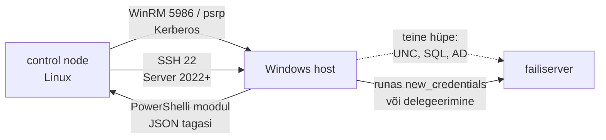

# Windowsi automatiseerimine

Linuxi pool on Ansible'is, aga 40 Windows Serverit hallatakse endiselt RDP, GPO ja käsitsi PowerShelli skriptidega, mis on kellegi kodukaustas. Patch'imine käib WSUS-i kaudu ja keegi ei tea täpselt, millal mõni server reboot'ib. **Windowsi saab hallata sama playbook'ide, inventory ja RBAC-iga nagu Linuxit. Erinevus on transpordis ja autentimises: kuidas moodul hosti jõuab ja milliste õigustega ta seal edasi pääseb.**

## Mis Windowsil teisiti on

Erinevusi on kolm. Sihtmasinas pole Pythonit ja moodulid on PowerShellis. Ühendus käib kas WinRM-i või SSH kaudu. Domeenis on autentimine Kerberos ja sellega kaasneb delegeerimise probleem. [Ansible'i dokumentatsiooni](https://docs.ansible.com/ansible/devel/os_guide/intro_windows.html) järgi peab host olema Windows Server 2016 või Windows 10 või uuem, PowerShell 5.1 on seal vaikimisi olemas. Control node ise Windows olla ei saa, ainult WSL-is või konteineris ja ka siis ilma tootmistoeta.

Seotud tööriistad, mis ei ole Ansible'i asendused:

- **Group Policy** jõustab seadistuse domeeniliikmetel. Taustal värskendatakse seda vaikimisi iga 90 minuti järel kuni 30-minutilise juhusliku nihkega ([Microsoft](https://learn.microsoft.com/en-us/previous-versions/windows/it-pro/windows-server-2008-R2-and-2008/cc731840(v=ws.10))). GPO sobib kasutajatele ja turvapoliitikale, aga paigalduste järjekorda, health check'e ega lainetena muutmist see ei tee.
- **WSUS** jagab uuendusi. Microsoft teatas 2024. aasta septembris, et WSUS on aegunud (deprecated): uusi funktsioone ei tule, aga teenus jääb Windows Server 2025-sse alles ([Patch My PC kokkuvõte](https://patchmypc.com/kb/wsus-deprecation-what-it-means/)).
- **PowerShell DSC** on Microsofti soovitud seisu mudel (vt allpool).

## WinRM, moodulid ja double hop

**Transport.** WinRM kuulab porti 5985 (HTTP) ja 5986 (HTTPS). Ansible'il on Windowsi jaoks kolm ühenduspluginat: `winrm`, `psrp` (PowerShell Remoting üle WinRM-i, kiirem ja parema timeout'ide käsitlusega) ja `ssh`. Autentimisviisid on Basic, NTLM, Kerberos, CredSSP ja sertifikaat. Domeenis kasutatakse Kerberost. Kerberos ja NTLM krüptivad WinRM-i sõnumid ka HTTP peal, aga NTLM on nõrk protokoll ja domeenis seda ei eelistata. Basic sobib ainult HTTPS-iga ja kohalike kontodega. SSH on [ametlikult toetatud](https://docs.ansible.com/projects/ansible/latest/os_guide/windows_ssh.html) alates ansible-core 2.18-st Windows Server 2022 ja uuemal ning nõuab OpenSSH versiooni 7.9.0.0 või uuemat. Server 2019 vaikimisi OpenSSH 7.7.2.1 seda nõuet ei täida. Vaikeshell on `cmd.exe`, aga soovitatav on `powershell.exe`, sest seda on rohkem testitud.

**Moodulid.** Kollektsioonid on `ansible.windows` (`win_package`, `win_service`, `win_updates`, `win_regedit`, `win_dsc` jt), `community.windows`, `microsoft.ad` (kasutajad, grupid, domeeniga liitumine) ja `chocolatey.chocolatey`. Moodul on PowerShelli skript koos C#-abiteegiga. Ansible pakib selle, saadab hosti ja käivitab seal, tulemus tuleb tagasi JSON-ina. Linuxi mooduleid (`copy`, `template`, `command`, `shell`) Windowsi hostil ei kasutata, nende vasted on `win_copy`, `win_template`, `win_command` ja `win_shell`.

**Double hop.** Tüüpiline Windowsi automaatika rike. Ansible autendib end hostis, aga see sessioon ei saa sama identiteediga minna edasi kolmandasse masinasse, näiteks kopeerida faili UNC-teelt `\\fs01\install`. Moodul saab vea „Access denied“, kuigi sama käsk töötab RDP-s. Põhjus on selles, et RDP-s on interaktiivne logon koos mandaadiga, võrgulogon'il seda pole. Lahendusi on kolm ([Red Hati selgitus](https://www.redhat.com/en/blog/making-double-hop-windows-ansible)). `become_method: runas` koos `logon_type=new_credentials` ja `logon_flags=netcredentials_only`-ga annab ülesandele võrgumandaadi. Teine võimalus on delegeerimist toetav autentimine: CredSSP või Kerberos koos delegeerimisega. Kolmas on mooduli enda mandaat, näiteks `microsoft.ad.user` `domain_username`-iga. `runas` ja CredSSP on piiramata delegeerimine: kompromiteeritud host saab mandaadiga edasi minna kuhu tahes. Kerberos lubab ka piiratud (constrained) delegeerimist kindlatele teenustele.

**Uuendused ja reboot.** `ansible.windows.win_updates` paigaldab uuendused kategooriate kaupa (`SecurityUpdates`, `CriticalUpdates`), kasutab hosti seadistatud allikat (Windows Update või WSUS) ja `reboot: true` korral teeb reboot'i ning jätkab. Lainete loogika on sama mis Linuxis: `serial`, health check enne järgmist lainet, `max_fail_percentage`.

**PowerShell DSC.** Klassikaline PSDSC (Windows PowerShell 5.1) kompileerib konfiguratsiooni MOF-failiks. Local Configuration Manager (LCM) on hosti teenus, mis loeb MOF-i push- või pull-mudeliga, viib hosti selle seisu ja režiimis `ApplyAndAutoCorrect` parandab drift'i ise. 12. märtsil 2025 tuli välja [DSC v3](https://devblogs.microsoft.com/powershell/?p=20702) ja see on teistsugune tööriist. LCM-i pole, DSC on käsurea tööriist, mida kutsutakse otse. Konfiguratsioon on JSON või YAML, PowerShelli ei ole vaja ja tööriist töötab ka Linuxis ja macOS-is. Vanad PSDSC ressursid töötavad adapteri kaudu. Ansible'is kutsub `ansible.windows.win_dsc` DSC ressursi `Test` ja `Set` meetodeid, nii et olemasolevaid DSC ressursse saab kasutada ilma LCM-ita ja tulemus tuleb Ansible'i recap'i.

<figure markdown="span">

  <figcaption>Joonis 1. Esimene hop on Ansible'i ühendus. Teine hop ebaõnnestub, kui sessioonil pole edasiantavat mandaati.</figcaption>
</figure>

## Ansible, DSC, GPO ja WSUS: kumb mida teeb

| Tööriist | Mida teeb | Litsents/hind | Millal valida |
|---|---|---|---|
| [Ansible](https://docs.ansible.com/ansible/devel/os_guide/intro_windows.html) + `ansible.windows`, `microsoft.ad` | moodulid PowerShellis, WinRM/psrp/SSH, sama inventory ja RBAC mis Linuxil | GPLv3 (ansible-core) | segapark, Linuxi pool on juba Ansible'is |
| PowerShell DSC v3 | soovitud seis JSON/YAML-is, ressursid mis tahes keeles | tasuta | Windowsi-kesksed meeskonnad, olemasolevad DSC ressursid |
| [Chocolatey](https://chocolatey.org/) / winget | pakihaldus, idempotentne tarkvara paigaldus | Chocolatey CLI Apache 2.0, winget MIT | tarkvara paigaldus ilma MSI-de käsitsi kogumiseta |
| Group Policy | domeeni poliitika, kasutajate ja turvaseaded | Windows Serveri osa | jõustamine, mis peab kehtima ka ilma automaatikaserverita |
| WSUS | uuenduste jagamine sisevõrgus | Windows Serveri osa, aegunud | olemasolev taristu, mille kõrval käib `win_updates` |
| Microsoft Configuration Manager, Intune | paigaldus, inventuur, uuendused, tööjaamad | tasuline | suur tööjaamade park, Microsofti litsentsid on juba olemas |

## CrowdStrike 2024: kui OS ei käivitu

19. juulil 2024 saatis CrowdStrike Falcon-agentidele sisu-uuenduse, mis pani Microsofti hinnangul umbes 8,5 miljonit Windowsi seadet sinisele ekraanile. Masin tuli käivitada WinPE-st või turvarežiimist, vigane fail käsitsi kustutada ja BitLockeriga kettal oli selleks vaja taastevõtit ([SecurityWeek](https://www.securityweek.com/microsoft-says-8-5-million-windows-devices-impacted-by-crowdstrike-incident-publishes-recovery-tool/)).

Ükski WinRM-i ega SSH-põhine automaatika siin ei aidanud, sest OS ei käivitunud. Kahe asja olemasolu otsustas, kas taastamine võttis tunde või päevi. Esimene on out-of-band ligipääs, näiteks iLO/iDRAC/IPMI konsool füüsilistel serveritel ja hüperviisori konsool või snapshot'i taaste VM-idel. Teine on BitLockeri taastevõtmed kohas, mis ise ei sõltu samadest Windowsi masinatest. Kui võtmed on ainult AD-s ja domeenikontrollerid on samuti maas, on vaja võtmete varukoopiat mujal. Mõlemad on automaatika eeldused, mida playbook ise ei taga, ja kuuluvad automaatikaplaani nagu inventory.

## WinRM-i turve, teenusekonto ja kaks soovitud seisu

- **WinRM-i avamine.** `ConfigureRemotingForAnsible.ps1` tüüpi skriptid lubasid ajalooliselt Basic-autentimist ja ise allkirjastatud sertifikaati. Tootmises on WinRM ainult HTTPS-iga, domeeni sertifikaadiga, tulemüüris lubatud ainult control node'ilt ja autentimine käib Kerberosega.
- **Teenusekonto.** Domeeni administraatorina käivitatud automaatika annab kompromiteeritud control node'iga kogu domeeni. Kasuta eraldi kontot, mis on kohaliku administraatori grupis ainult hallatavatel hostidel, ja vajadusel JEA-d (Just Enough Administration), mis piirab lubatud käsud.
- **Kaks soovitud seisu.** Kui GPO ja Ansible hallavad sama registrivõtit, kirjutab GPO 90 minuti pärast Ansible'i muudatuse üle või vastupidi. Iga seade peab olema ühe allika hallata.
- **Reboot'i ootamatus.** `win_updates` koos `reboot: true`-ga reboot'ib ilma kinnituseta. Rakendus, mis ei kannata reboot'i (vana teenus, mis käivitub käsitsi), vajab enne laineid oma health check'i ja vajadusel eraldi akent.
- **Double hop'i lahendus nõrgendab turvet.** CredSSP ja `runas` koos võrgumandaadiga annavad hostile mandaadi, mida saab edasi kasutada. Parem on andmed tuua hosti control node'ilt (`win_copy`, HTTP-allikas) kui lasta hostil endal võrgust lugeda.
- **DSC v3 on uus.** Ressursside valik ja tööriistade tugi kasvavad alles. Olemasolev PSDSC kood töötab adapteri kaudu, aga LCM-i automaatset drift'i parandust enam pole: see tuleb ajakavast või pipeline'ist.

## Kus see kursusel tuleb

WinRM-i ja SSH transporti ning `ansible.windows.win_*` mooduleid käsitleb [2. kohtumise loengu osa 6](../k02/loeng.md#6-vorguseadmed-ja-windows). Laboris Windowsi hosti pole, aga samad mustrid on Linuxi peal olemas: [Deploy ja rolling](../k02/lab-6-deploy.md#paigad-ja-reboot-lainetena) paikab ja reboot'ib lainetena, mis on `win_updates`-i ja `serial`-i loogika, ning [lisaülesanne 18](../k02/lisa.md#18-ansible-teenusena-semaphore) annab sama RBAC-i, mis Windowsi hostidele kehtiks. CrowdStrike'i juhtumit vaatab tarne ja rollback'i poolelt [5. kohtumise loengu osa 5](../k05/loeng.md#5-deployment-automation-risk-ja-rollback).

## Kontrolli ennast

??? question "Playbook paigaldab `win_package`-iga MSI faili failiserveri UNC-teelt ja saab vea „Access denied“. RDP-s töötab sama käsk. Miks?"
    See on double hop. Ansible'i võrgulogon autendib hosti, aga sessioonil pole mandaati, mida failiserverile edasi anda. RDP-s on interaktiivne logon koos mandaadiga. Lahendused on `become: runas` koos `logon_type=new_credentials`-iga, Kerberose delegeerimine või, mis on turvalisem, faili kopeerimine control node'ilt hosti enne paigaldust.

??? question "Kas Server 2019 hosti saab hallata Ansible'iga üle SSH?"
    Mitteametlikult jah, aga ametlik tugi on alates Server 2022-st. Server 2019 vaikimisi OpenSSH 7.7.2.1 on vanem kui nõutud 7.9.0.0. Server 2019 jaoks on toetatud tee WinRM või psrp HTTPS-i ja Kerberosega.

??? question "Ansible seab registrivõtme, kuid paari tunni pärast on väärtus tagasi vana. Kust otsid?"
    Kõige tõenäolisemalt haldab sama võtit GPO, mis värskendub iga 90 minuti järel juhusliku nihkega. Põhjuse kinnitab `gpresult /h`. Teine võimalus on PSDSC LCM režiimis `ApplyAndAutoCorrect`. Otsusta, kumb allikas seadet haldab, ja eemalda see teisest.

??? question "Mille poolest erineb DSC v3 klassikalisest PowerShell DSC-st automaatika vaates?"
    DSC v3-l pole LCM-i, mis töötaks hostis teenusena ja parandaks drift'i ise. See on käsurea tööriist, mida kutsub välja pipeline, ajakava või Ansible. Konfiguratsioon on JSON või YAML ja PowerShelli ei ole vaja. Drift'i parandus tuleb seega sellest, mis DSC-d käivitab, nagu Ansible'i puhul.
